# 基期比重计算与结构图形匹配

考点：[[20-考点/资料分析/比重/基期比重计算与结构图形匹配|比重 / 基期比重计算与结构图形匹配]]
材料：[[15-材料/资料分析/198620 2016年某自治区农林牧渔业发展综述|198620 2016年某自治区农林牧渔业发展综述]]

**问法模型**：题干问'2015年各产业产值占农林牧渔总产值的比例'（时间前移至基期＋占比＋图形匹配）→ 用基期比重公式[现期产值/(1+g产业)]÷[总产值/(1+g总)]还原2015年各业占比，再以'最大扇区＋最小扇区'两个结构特征排除选项图形。

## 推理链
1. 第1步：题干'2015年……占……比例'而材料数据为2016年现期值，判定为基期比重问题；从第1段提取数据：2016年农林牧渔业总产值2969.70亿元，其中农业2163.11亿元、林业50.28亿元、畜牧业653.15亿元、渔业22.18亿元、农林牧渔服务业80.98亿元，各业及总产值的同比增速以原卷为准（本档案原文增速数值空缺）。
2. 第2步：所用公式为基期比重：某产业2015年占比=[现期产值/(1+g产业)]÷[2969.70/(1+g总)]=现期占比×(1+g总)/(1+g产业)。
3. 第3步：抓最大扇区定大方向——农业现期占比2163.11/2969.70≈72.8%，各业增速为个位数且与总产值增速相近，调整系数(1+g总)/(1+g产业)≈1，故2015年农业占比仍在七成以上，与B、D图中农业占比量级不符，排除B、D。
4. 第4步：抓最小扇区排除C——渔业2015年产值为22.18/(1+g渔)（约20亿元量级），农林牧渔服务业2015年产值为80.98/(1+g服)（约70~80亿元量级），渔业基期产值远小于服务业，渔业必为最小扇区，C图不符合该相对大小关系，排除C。
5. 第5步：仅A图同时满足'农业约占七成、畜牧业约两成（653.15/2969.70≈22%）、渔业为最小扇区'的2015年结构特征，故选A。

**最快解法**：⚡ 估算排除法（图形匹配题不必精算）：各业增速均为个位数且方向相近，基期占比≈现期占比，截位直除2163.11/2969.70≈216/297≈72.8%，锁定'农业约七成'排除B、D；再用渔业22.18亿元<服务业80.98亿元（基期同向缩放、量级不变）判定最小扇区为渔业，排除C，秒选A。

## 易错点
- ⚠ 基期与现期混淆：材料全是2016年数据而题干问2015年占比，直接拿现期占比匹配图形在本题可侥幸命中，但严格做法是基期比重公式还原，且选项图形按2015年占比绘制。
- ⚠ 增速数据空缺不可编造：本档案原文所有'增长/下降'后的数值均无法辨认，代入基期公式时不得虚构增速，凡涉精确数值须以原卷完整数据为准。
- ⚠ 小扇区排序看混：林业50.28亿元、渔业22.18亿元、服务业80.98亿元三块占比均不足3%，易混淆大小关系；图形匹配只需抓两个决定性特征——农业约七成、渔业(22.18亿元)为最小扇区。

## 母题抽象
> 🧩 当题干出现'早于材料现期的某年份＋各部分占总体比例＋图形匹配'特征时，用基期比重公式还原各部分占比，增速相近时可直接以现期比重近似，先抓最大部分占比、再抓最小部分相对大小，双重排除锁定图形。

**同类特征**：基期2015年、各产业产值占总产值的比例、结构图形匹配（饼图选项）、农林牧渔五业结构、基期比重、排除法选图

## 相关题
- [[10-真题/资料分析/比重/16069815 基期比重倒推与排序（现期比重−提升百分点）|16069815]]（贵州 2026，相关度1）
- [[10-真题/资料分析/比重/5494775 基期比重（月度基期量÷年度总量，跨源拼接）|5494775]]（湖北 2023，相关度1）
- [[10-真题/资料分析/比重/10718177 现期比重（饼图结构判断，分组加总后排除法选图）|10718177]]（深圳市考 2024，相关度1）
- [[10-真题/资料分析/比重/16437531 基期比重（'恢复至同期比例'反推基期值+全年值求占比）|16437531]]（山东 2024，相关度1）
- [[10-真题/资料分析/比重/16593075 现期比重计算与饼图占比关系判断（排除法）|16593075]]（海南 2024，相关度1）

---

### 题干
最符合2015年该自治区农林牧渔业各产业产值占农林牧渔总产值的比例情况的是：

### 选项
- A. 
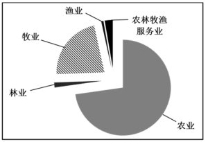
　✅
- B. 

- C. 

- D. 

### 官方解析

根据题干“2015年······占······比例”，结合材料时间为2016年，判定本题为基期比重问题。定位文字材料第一段可得，2016年该自治区农林牧渔业总产值为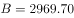亿元，增长率为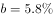；农业产值为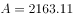亿元，增长率为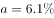；渔业产值22.18亿元，增长率为；农林牧渔服务业产值为80.98亿元，增长率为。

代入公式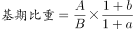可得，2015年农业产值占总产值的比重为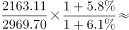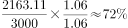，所占比重接近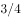，排除B、D两项；根据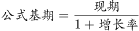可得，2015年渔业产值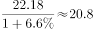亿元远小于农林牧渔服务业产值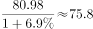亿元，排除C项。

故正确答案为A。

### 给定材料

        2016年，某自治区全年实现农林牧渔业总产值2969.70亿元，比上年增长，其中，农业产值2163.11亿元，增长；林业产值50.28亿元，增长；畜牧业产值653.15亿元，增长；渔业产值22.18亿元，增长；农林牧渔服务业产值80.98亿元，增长。

        全年农作物播种面积9348.42万亩，同比增长。其中，粮食（含薯类）3601.70万亩，增长；棉花3232.36万亩，下降；油料382.82万亩，增长；甜菜115.69万亩，增长；蔬菜489.84万亩，增长。特色林果2475.48万亩，增长，其中，园林水果1490.64万亩，增长。

        全年粮食产量（含薯类）1512.28万吨，下降。棉花420万吨，增长。油料75.89万吨，增长。甜菜554.99万吨，增长。蔬菜1966.45万吨，增长。特色林果产量1790.88万吨，增长，其中，园林水果1011.02万吨，增长。

        年末猪牛羊存栏4621.35万头（只），比上年下降。全年猪牛羊出栏4341.90万头（只），增长。猪牛羊肉总产量134.70万吨，增长，其中，牛肉产量42.48万吨，增长；羊肉产量58.32万吨，增长；猪肉产量33.90万吨，增长。禽肉产量15.92万吨，增长。禽蛋产量36.13万吨，增长。牛奶产量156.08万吨，增长。水产品产量16.16万吨，增长。

        年末农业机械总动力2581.96万千瓦，同比增长。拥有大中型拖拉机48.68万台，增长；小型拖拉机26.74万台，下降。农作物机耕率，农作物机播率。化肥施用量（折纯）250.21万吨，增长。农村用电量108.16亿千瓦时，增长。

        拥有农业产业化经营组织12682家，比上年增加820家。自治区级以上农业产业化重点龙头企业507家。农产品加工（流通）企业14165家（其中规模以上企业达到1030家），增加407家；实现农产品加工（流通）业总产值1895.02亿元，增长；自治区级以上休闲观光农业示范点达到183家，其中，国家级示范点达到19家。

> [!warning] 疑点（官方解析可能有误，待人工复核）
> 本档案原文与官方解析中所有增速数值均空缺（解析'产值为□亿元，增长率为□'处为空），基期占比的精确数值无法复算，官方判据'所占比重接近□'只能按现期占比2163.11/2969.70≈72.8%近似理解；正确答案A以官方为准，笔记中'20亿元量级/70~80亿元量级'仅为个位数增速下的区间推断，非原卷数据。
