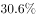
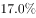

# 两期比重比较——比重比上年提高的百分点数（两期比重差公式）

考点：[[20-考点/资料分析/比重/两期比重比较——比重比上年提高的百分点数（两期比重差公式）|比重 / 两期比重比较——比重比上年提高的百分点数（两期比重差公式）]]
材料：[[15-材料/资料分析/198623 2017年上半年Y市文化创意产业运行|198623 2017年上半年Y市文化创意产业运行]]

**问法模型**：题干出现'占地区生产总值比重比上年提高了约多少个百分点'→采用两期比重差模型：Δ=现期比重×(a−b)/(1+a)，其中a为文创增加值同比增速、b为地区生产总值同比增速，结果直接以'个百分点'计。

## 推理链
1. 第1步：提取条件——题干给出整体（Y市地区生产总值）2017年上半年同比增长b；材料第一段给出部分（文创产业增加值A=1734.7亿元）同比增长a、占地区生产总值的现期比重（所给文本中a、b及占比三处数值空白，须以原卷完整数值代入，不得臆造）。
2. 第2步：由'比重比上年提高了'判定比重上升，即部分增速a＞整体增速b、差值为正；锁定两期比重差公式：Δ=现期比重×(a−b)/(1+a)。
3. 第3步：代入计算——现期比重（小于1的百分数）×(a−b)/(1+a)：因占比<1且(1+a)>1，Δ必远小于增速差a−b本身，按原卷数值算得约0.8个百分点，属1以内的小值量级。
4. 第4步：与选项对照——A.0.2、B.0.8、C.2.5、D.6.2，计算结果与B项0.8最接近，故正确答案为B。

**最快解法**：⚡ 公式法+量级排除：直接套两期比重差公式Δ=现期占比×(a−b)/(1+a)。先由'提高了'锁定a>b、结果为正；再利用'比重变化量恒小于|a−b|且被占比与(1+a)双重稀释'排除量级偏大的2.5和6.2；最后用百化分/截位直除代入原卷a、b与现期占比一步得约0.8，选B。

## 易错点
- ⚠ 分子分母口径陷阱：'占GDP比重'只与增加值配对（分子=文创增加值1734.7亿元），切勿误用收入6902.7亿、利润349.8亿或投资141.6亿充当分子，材料中四套总量口径不能互为分母。
- ⚠ '个百分点'与'%'混淆：两期比重差公式算出的数值本身就是百分点数，不要再乘100，也不能把它当作增长率百分比。
- ⚠ 增速差≠比重变化量：不能拿a−b直接去选项里找数（易误选与增速差同量级的6.2）；比重变化量必小于|a−b|，且升降方向由a与b相对大小决定（a>b才'提高'）。

## 母题抽象
> 🧩 当题干出现'部分占整体的比重比上年（同期）提高/下降约多少个百分点'时，用两期比重差公式Δ=现期比重×(a−b)/(1+a)（a=部分增速、b=整体增速）：先由升降方向确定a与b的大小关系，再按'Δ远小于|a−b|'做量级排除，最后代入数值锁定最接近的小值选项；若只问升降方向，比较a与b即可定性作答。

**同类特征**：'占地区生产总值比重比上年提高了……个百分点'、题干另行补充整体（地区生产总值）同比增速b、部分为文创增加值1734.7亿元及其增速a、两期比重比较/两期比重差模型、现期值与增长率齐备、求比重变化量、选项为量级递增的百分点数值（0.2/0.8/2.5/6.2）

## 相关题
（暂无）

---

### 题干
2017年上半年，Y市地区生产总值同比增长。该市文化创意产业增加值占地区生产总值比重比上年提高了约多少个百分点？

### 选项
- A. 0.2
- B. 0.8　✅
- C. 2.5
- D. 6.2

### 官方解析
由题干“2017年上半年，Y市地区生产总值同比增长（b）。······占······比重比上年提高了约多少个百分点”，可判定本题为两期比重比较问题。定位文字材料第一段可得，“2017年上半年，Y市文化创意产业实现增加值（A）1734.7亿元，同比增长（a），占地区生产总值的”。由两期比重比较公式可得，所求，与B项最接近。
故正确答案为B。

### 给定材料

        2017年上半年，Y市文化创意产业实现增加值1734.7亿元，同比增长，占地区生产总值的；规模以上文创产业法人单位实现收入6902.7亿元，同比增长，比上年4季度和今年1季度分别提高1.3个和0.2个百分点；实现利润总额349.8亿元，同比增长。

        分领域看，上半年，文化艺术服务领域规模以上法人单位实现收入182.7亿元，同比增长；软件和信息技术服务领域实现收入2836.7亿元，增长；设计服务领域实现收入167.1亿元，增长；新闻出版及发行服务领域实现收入340.6亿元，增长。

        分功能区看，上半年文创功能区规模以上法人单位实现收入5087.5亿元，同比增长。其中，文化科技融合示范区实现收入2616.1亿元，同比增长；时尚创意功能区、文化体育（会展）融合功能区、文化艺术品交易功能区分别实现收入187.9亿元、167.5亿元、52.2亿元，同比分别增长、和，均呈快速增长态势。

        上半年文化创意产业完成固定资产投资141.6亿元，同比增长。其中，旅游休闲娱乐领域完成投资81.3亿元，占文创产业投资总额的。

> [!warning] 疑点（官方解析可能有误，待人工复核）
> 所给材料文本与题干中，文创增加值增速a、GDP增速b及现期占比三处数值均为空白（材料导读已声明不得臆造、须以原卷完整材料为准），故无法仅凭所给文本独立复算出0.8；官方解析同样以符号a、b表述，其'与B项最接近'依赖原卷数值，未见公式或口径错误。
