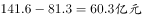
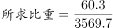
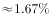

# 现期比重计算（部分量=材料总量−已知部分，分母为题干补充的整体量）

考点：[[20-考点/资料分析/比重/现期比重计算（部分量=材料总量−已知部分，分母为题干补充的整体量）|比重 / 现期比重计算（部分量=材料总量−已知部分，分母为题干补充的整体量）]]
材料：[[15-材料/资料分析/198623 2017年上半年Y市文化创意产业运行|198623 2017年上半年Y市文化创意产业运行]]

**问法模型**：题干出现'某领域之外……占全市投资总额的比重'且整体量由题干补充 → 先做减法求部分量（141.6−81.3），再除以全市投资总额3569.7的现期比重模型

## 推理链
1. 第1步：从材料第4段提取——2017年上半年文创产业完成固定资产投资141.6亿元，其中旅游休闲娱乐领域完成投资81.3亿元；题干补充：同期全市固定资产投资总额3569.7亿元
2. 第2步：所求部分量=文创投资总额−旅游休闲娱乐领域投资=141.6−81.3=60.3亿元
3. 第3步：比重=部分量÷整体量=60.3÷3569.7，分子分母同截位≈60÷3570≈1.7%（精确约1.69%）
4. 第4步：与选项对照，60.3÷3569.7≈1.7%与A项最接近，故正确答案为A

**最快解法**：⚡ 截位直除：先口算部分量141.6−81.3=60.3，再算60.3÷3569.7，把分母截为3570、分子视为60，首位商1、次位约6~7，得约1.7%，直接锁定A

## 易错点
- ⚠ 分母口径陷阱：整体量3569.7亿元是题干补充的'全市固定资产投资总额'，材料中并无此数；误用材料内文创投资141.6亿元或收入6902.7亿元做分母均错
- ⚠ '之外'需先减后除：部分量=141.6−81.3=60.3亿元，误把81.3（旅游休闲娱乐本身）或141.6（文创全部）直接除以3569.7会错选
- ⚠ 四套总量互不可混用：固定资产投资（141.6/3569.7）与增加值1734.7亿、收入6902.7亿、利润349.8亿是不同口径，本题只允许在投资口径内运算（单位均为亿元，无需换算）

## 母题抽象
> 🧩 当题干出现'A领域中除B外的部分占全市/全行业比重'且整体量由题干补充时，用'材料内A总量−B'求部分量，再除以题干补充的整体量做现期比重，分子做减法、分母只认题干给的整体量

**同类特征**：固定资产投资总额、旅游休闲娱乐领域之外、占全市投资总额的比重、题干补充整体量（材料外生数据）、现期比重、先减后除求部分量

## 相关题
- [[10-真题/资料分析/比重/4792819 现期比重计算（多部分比重依次求解）|4792819]]（新疆 2014，相关度1）
- [[10-真题/资料分析/比重/827355 现期比重比较（部分占比过半速判）|827355]]（政法干警 2014，相关度1）
- [[10-真题/资料分析/比重/2272297 现期比重比较|2272297]]（选调 2015，相关度1）
- [[10-真题/资料分析/比重/2032972 现期比重计算（多地区占比求和）|2032972]]（吉林 2015，相关度1）
- [[10-真题/资料分析/比重/2187857 现期比重计算（部分量需先由'总量−其中量'减法间接求得）|2187857]]（山东 2018，相关度1）

---

### 题干
Y市2017年上半年固定资产投资总额为3569.7亿元。则同期旅游休闲娱乐领域之外的文化创意产业完成固定资产投资占全市投资总额的比重为：

### 选项
- A. 

　✅
- B. 

- C. 

- D. 

### 官方解析

由题干“······占······的比重为”，可判定本题为现期比重计算问题。定位文字材料第四段可得，“（2017年）上半年文化创意产业完成固定资产投资141.6亿元，其中，旅游休闲娱乐领域完成投资81.3亿元，占文创产业投资总额的” 。则同期旅游休闲娱乐领域之外的文化创意产业完成固定资产投资为，故，与A项最接近。

故正确答案为A。

### 给定材料

        2017年上半年，Y市文化创意产业实现增加值1734.7亿元，同比增长，占地区生产总值的；规模以上文创产业法人单位实现收入6902.7亿元，同比增长，比上年4季度和今年1季度分别提高1.3个和0.2个百分点；实现利润总额349.8亿元，同比增长。

        分领域看，上半年，文化艺术服务领域规模以上法人单位实现收入182.7亿元，同比增长；软件和信息技术服务领域实现收入2836.7亿元，增长；设计服务领域实现收入167.1亿元，增长；新闻出版及发行服务领域实现收入340.6亿元，增长。

        分功能区看，上半年文创功能区规模以上法人单位实现收入5087.5亿元，同比增长。其中，文化科技融合示范区实现收入2616.1亿元，同比增长；时尚创意功能区、文化体育（会展）融合功能区、文化艺术品交易功能区分别实现收入187.9亿元、167.5亿元、52.2亿元，同比分别增长、和，均呈快速增长态势。

        上半年文化创意产业完成固定资产投资141.6亿元，同比增长。其中，旅游休闲娱乐领域完成投资81.3亿元，占文创产业投资总额的。

