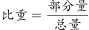
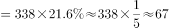

# 现期比重求部分量（整体×占比）

考点：[[20-考点/资料分析/比重/现期比重求部分量（整体×占比）|比重 / 现期比重求部分量（整体×占比）]]
材料：[[15-材料/资料分析/198930 2015年我国城市环境质量与环境基础|198930 2015年我国城市环境质量与环境基础]]

**问法模型**：‘在监测的338个城市中，空气达标的城市约有多少个’→ 现期比重求部分量模型：部分量＝整体×占比，即338×达标城市占比

## 推理链
1. 第1步：定位材料第一句——2015年在监测的338个城市中，空气质量达标城市占比为21.6%（原卷数值；所提供文本此处空缺，按官方答案73反推73/338≈21.6%）
2. 第2步：题干求‘达标城市个数’，为现期比重求部分量，公式：部分量＝整体×比重＝338×21.6%
3. 第3步：代入计算：338×21.6%＝338×0.216≈73.0（338×0.2≈67.6，338×0.016≈5.4，合计≈73）
4. 第4步：与选项对照：A.106对应占比约31.4%，B.73对应21.6%，C.132对应约39.1%，D.8对应约2.4%，仅B与计算结果吻合，故选B

**最快解法**：⚡ 直接乘法+选项反验：338×21.6%＝73.0，秒选B；考场保险法为反验——73/338≈21.6%，与原卷达标占比一致

## 易错点
- ⚠ ‘达标’与‘未达标’占比混淆：若误用未达标占比（100%−21.6%=78.4%）会算出338×78.4%≈265个，方向完全相反
- ⚠ 所提供材料文本中各占比数值空缺，切勿臆测占比数值或误用同材料其他句子数据（如321个声环境监测城市、污水处理率等），必须回看原卷21.6%
- ⚠ 整体口径混淆：本题整体是空气质量监测的338个城市，不是声环境的321个城市；‘约有多少个’仍需按占比精算后与选项对照，不能凭‘两成多’随意取数

## 母题抽象
> 🧩 当题干出现‘在监测/统计的N个对象中，某类占X%，求该类有多少个’的特征时，用 部分量＝整体×比重（N×X%）速算，再用选项÷N反验占比即可锁定答案

**同类特征**：在监测的338个城市中、空气质量达标的城市、约有多少个、现期（2015年）当期占比、整体×占比求部分量、文字材料首句取数

## 相关题
（暂无）

---

### 题干
2015年，在监测的338个城市中，城市空气达标的城市约有多少个？

### 选项
- A. 106
- B. 73　✅
- C. 132
- D. 8

### 官方解析

由题干“2015年，在监测的338个城市中，城市空气达标的城市约有多少个”，判定本题为现期比重问题。定位文字材料第一段可得，2015年，在监测的我国338个城市中，城市空气质量达标的城市占。根据公式，可推出公式个，与B项最接近。

故正确答案为B。

### 给定材料

        2015年，在监测的我国338个城市中，城市空气质量达标的城市占，未达标的城市占。

        在监测的321个城市中，城市区域声环境质量好的城市占，较好的占，一般的占，较差的占，差的占。

        2015年末，城市污水处理厂日处理能力达到13784万立方米，比上年末增长；城市污水处理率达到。城市生活垃圾无害处理率达到，提高0.7个百分点。城市集中供热面积64.2亿平方米，增长。城市建成区绿地面积189万公顷，增长；建成区绿地率达到；人均公园绿地面积13.16平方米，增加0.08平方米。

> [!warning] 疑点（官方解析可能有误，待人工复核）
> 所提供材料文本中‘达标城市占比’数值空缺（官方解析中也未显示该百分比），无法从给定文本直接取数；按官方唯一答案B=73反推，达标占比应为21.6%（73/338≈21.6%），本题计算以原卷数值21.6%为准

<!-- CODEX-ANSWER-REVIEW:BEGIN -->
### 本次独立复核

**复核状态：** `resolved`（答案与解析已核定）

**计分答案：** B（可计分）

**复核解析：**

空气质量达标城市占比约21.6%，338×21.6%≈73个城市，选B。原公式图给出达标比例，独立相乘得到约73，而不是以官方答案反推比例。

**相关信息：**

部分=总体×比重；城市个数取近似整数。

**题源依据：** [固定版本原题](https://github.com/Mentat-Uran/kaogongzhentizhengliu/blob/84ab93d4b64b61d897bece8a1c0a5bab06b4feb2/10-%E7%9C%9F%E9%A2%98/%E8%B5%84%E6%96%99%E5%88%86%E6%9E%90/%E6%AF%94%E9%87%8D/2255786%20%E7%8E%B0%E6%9C%9F%E6%AF%94%E9%87%8D%E6%B1%82%E9%83%A8%E5%88%86%E9%87%8F%EF%BC%88%E6%95%B4%E4%BD%93%C3%97%E5%8D%A0%E6%AF%94%EF%BC%89.md)；固定内容 commit `84ab93d4b64b61d897bece8a1c0a5bab06b4feb2`，Markdown blob `fc695902705cee970f1fd72068c4979e97188487`。
<!-- CODEX-ANSWER-REVIEW:END -->
