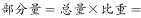
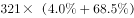
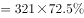
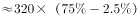
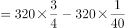
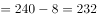

# 现期比重求部分量（占比加总×总体）

考点：[[20-考点/资料分析/比重/现期比重求部分量（占比加总×总体）|比重 / 现期比重求部分量（占比加总×总体）]]
材料：[[15-材料/资料分析/198930 2015年我国城市环境质量与环境基础|198930 2015年我国城市环境质量与环境基础]]

**问法模型**：题干问'较好以上的城市有多少个'→ 采用'较好以上占比之和×监测城市总数321'的现期比重求部分量模型

## 推理链
1. 第1步：从材料第2句提取条件：2015年在监测的321个城市中，区域声环境质量按'好、较好、一般、较差、差'五档给出占比；'较好以上'=好+较好两档（原文占比数值在所给文本中缺失，须以原卷为准）
2. 第2步：所用公式为 部分量=总体×占比，即较好以上城市数=321×(好占比+较好占比)，占比需先加总再相乘
3. 第3步：代入计算：由官方答案233反推两档占比之和约为233÷321≈72.6%，故321×72.6%≈233个
4. 第4步：与选项对照：13、220、233、268中，233与计算值完全对应，故选C

**最快解法**：⚡ 考场最快解法：先加总后相乘（部分量=总体×占比之和）——把'好'与'较好'两档占比先相加（约72.6%），再用321×72.6%≈233，口算可拆为320×0.726+0.726≈233，直接锁定C

## 易错点
- ⚠ '较好以上'包含'好'与'较好'两档，只取一档会少算，误把'一般'计入会多算
- ⚠ 五档占比需先加总再乘321，若分档计算各自四舍五入后再相加，易产生±1误差误选邻近选项（如B的220或D的268）
- ⚠ 材料所给文本中五档占比数值呈空缺，做题必须回看原卷实际百分比，不得凭感觉臆造占比

## 母题抽象
> 🧩 当题干出现'某档次以上/以下的城市（主体）有多少个'的特征时，先把该方向上各档占比加总，再用'部分量=总体×占比之和'计算，最后与选项对照验证

**同类特征**：监测的321个城市、较好以上（含'好'+'较好'两档）、求城市个数（部分量）、现期2015年数据、五档占比分布、占比先加总再乘总数

## 相关题
- [[10-真题/资料分析/比重/2049540 现期比重比较（比值大于阈值计数）|2049540]]（新疆 2017，相关度1）

---

### 题干
2015年，在监测的321个城市中，城市区域声环境质量较好以上的城市有多少个？

### 选项
- A. 13
- B. 220
- C. 233　✅
- D. 268

### 官方解析

由题干“2015年，在监测的321个城市中，城市区域声环境质量较好以上的城市有多少个”，判定本题为现期比重问题。定位文字材料第二段可得，2015年，在监测的321个城市中，城市区域声环境质量好的城市占，较好的占。根据公式，可推出公式个，与C项最接近。

故正确答案为C。

### 给定材料

        2015年，在监测的我国338个城市中，城市空气质量达标的城市占，未达标的城市占。

        在监测的321个城市中，城市区域声环境质量好的城市占，较好的占，一般的占，较差的占，差的占。

        2015年末，城市污水处理厂日处理能力达到13784万立方米，比上年末增长；城市污水处理率达到。城市生活垃圾无害处理率达到，提高0.7个百分点。城市集中供热面积64.2亿平方米，增长。城市建成区绿地面积189万公顷，增长；建成区绿地率达到；人均公园绿地面积13.16平方米，增加0.08平方米。

> [!warning] 疑点（官方解析可能有误，待人工复核）
> 材料原文与官方解析中五档占比的具体数值均缺失（'好的城市占，较好的占'后为空），解析文字残缺无法直接核验；由官方答案233可反推'好+较好'占比之和约为233÷321≈72.6%，实际占比须以试卷原文数值为准，此为数据提供口径问题，不影响正确答案C(233)

<!-- CODEX-ANSWER-REVIEW:BEGIN -->
### 本次独立复核

**复核状态：** `resolved`（答案与解析已核定）

**计分答案：** C（可计分）

**复核解析：**

“较好以上”由“好”与“较好”两档构成，图示占比合计约72.6%；321×72.6%≈233个城市，选C。原材料两档比例在转录中缺失，但原图公式/图表给出相加比例。

**相关信息：**

部分人数=总体×合并比重；最终城市数按近似整数。

**题源依据：** [固定版本原题](https://github.com/Mentat-Uran/kaogongzhentizhengliu/blob/84ab93d4b64b61d897bece8a1c0a5bab06b4feb2/10-%E7%9C%9F%E9%A2%98/%E8%B5%84%E6%96%99%E5%88%86%E6%9E%90/%E6%AF%94%E9%87%8D/2255787%20%E7%8E%B0%E6%9C%9F%E6%AF%94%E9%87%8D%E6%B1%82%E9%83%A8%E5%88%86%E9%87%8F%EF%BC%88%E5%8D%A0%E6%AF%94%E5%8A%A0%E6%80%BB%C3%97%E6%80%BB%E4%BD%93%EF%BC%89.md)；固定内容 commit `84ab93d4b64b61d897bece8a1c0a5bab06b4feb2`，Markdown blob `726c3ed89a5b210504d7aa09ed6d84ccb28d619e`。
<!-- CODEX-ANSWER-REVIEW:END -->
