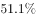
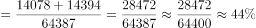

# 现期比重计算（部分求和÷整体）

考点：[[20-考点/资料分析/比重/现期比重计算（部分求和÷整体）|比重 / 现期比重计算（部分求和÷整体）]]
材料：[[15-材料/资料分析/198935 2016年1-8月我国东、中、西部地|198935 2016年1-8月我国东、中、西部地]]

**问法模型**：题干为'2016年1-8月份，A（中西部之和）占B（全国）的比重'→ 现期比重模型：比重=部分÷整体，直接用同期累计值相除

## 推理链
1. 第1步：定位表1'投资额（亿元）'总计列，提取2016年1-8月现期值：中部地区14078亿元、西部地区14394亿元、全国总计64387亿元
2. 第2步：题干'中西部地区'=中部+西部两个地区之和，'全国'即全国总计行，用现期比重公式：比重=(中部+西部)÷全国
3. 第3步：代入计算：分子=14078+14394=28472亿元，分母=64387亿元，比重=28472÷64387
4. 第4步：截位直除：28472/64387≈28.47/64.39，首位商4、次位商4，得≈0.442，即约44.2%
5. 第5步：与选项对照，计算值≈44.2%与A选项一致，故正确答案为A

**最快解法**：⚡ 截位直除法：先加和分子14078+14394=28472，再对28472/64387做截位直除（分母取64400、分子取28500），首位商4、第二位商4，得约44.2%，直接锁定A；亦可用量级校验：中西部之和28472略小于东部35915的约0.8倍且全国是东部的约1.8倍，粗判比重略低于40%~45%区间，排除明显偏离项

## 易错点
- ⚠ 口径串用陷阱：题干问'房地产开发投资额'，必须用表1'总计'列（14078、14394、64387）；若误用'住宅'列（9812+9076=18888、43076），会得到约43.9%的接近但错误的结果
- ⚠ '中西部地区'指中部+西部两行之和，不能只取其中一行，也不能误把东部一并加入（东中西部全加则为100%）
- ⚠ 行/列定位陷阱：表1为双列结构（总计/住宅），且两表同序（全国→东部→中部→西部），跨表题易串行；本题只用表1，与表2销售数据无关，勿混用销售面积/销售额

## 母题抽象
> 🧩 当题干出现'现期某区域（多地区之和）占整体比重'特征时，直接在同期表格定位部分与整体的绝对数列（注意选对总计/分项列），加和部分后除以整体，用截位直除两位有效数字即可锁定选项

**同类特征**：2016年1-8月份（现期）、中西部地区、占全国…的比重、房地产开发投资额、两地区加和作分子、表1总计列

## 相关题
- [[10-真题/资料分析/比重/2377296 现期比重计算（部分求和÷整体）|2377296]]（选调 2019，相关度2）
- [[10-真题/资料分析/比重/5911367 现期比重计算（部分求和÷整体）|5911367]]（浙江 2024，相关度2）
- [[10-真题/资料分析/比重/18643945 现期比重计算（部分求和÷整体）|18643945]]（浙江 2026，相关度2）
- [[10-真题/资料分析/综合/2049736 综合分析（混合增长率+两期比重变化判定）|2049736]]（山东 2017，相关度1）

---

### 题干
2016年1-8月份，中西部地区房地产开发投资额占全国房地产开发投资额的比重是：

### 选项
- A. 

　✅
- B. 

- C. 

- D. 

### 官方解析

根据题干“2016年1-8月份······占······的比重”，可判定本题为现期比重问题。定位表1，2016年1-8月份，中部地区房地产开发投资额14078亿元，西部地区房地产开发投资额14394亿元，全国房地产开发投资额64387亿元。则所求比重。

故正确答案为A。

### 给定材料

