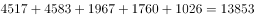
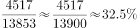

# 现期比重计算（大类需加总作分母）

考点：[[20-考点/资料分析/比重/现期比重计算（大类需加总作分母）|比重 / 现期比重计算（大类需加总作分母）]]
材料：[[15-材料/资料分析/198982 全国一般公共预算收支执行情况：按'9|198982 全国一般公共预算收支执行情况：按'9]]

**问法模型**：'1-9月累计，A占B约为'且选项为百分数 → 现期比重=部分/整体；B是'土地和房地产相关税收'大类，须先把5个明细税种加总作分母

## 推理链
1. 第1步：题干限定1-9月累计口径，问契税占土地和房地产相关税收的比重，数据全部取自表1，无需用正文总盘
2. 第2步：表1中'土地和房地产相关税收'是一个包含5个税种的大类：契税4517、土地增值税4583、房产税1967、城镇土地使用税1760、耕地占用税1026（亿元），分母不能只取单项
3. 第3步：分母=4517+4583+1967+1760+1026=13853亿元；分子=契税4517亿元
4. 第4步：比重=4517÷13853≈32.6%（参照：13853/3≈4618＞4517，故略小于33.3%）
5. 第5步：与选项对照，C项32.6%最接近，故选C

**最快解法**：⚡ 加总+特殊分数放缩：先加总五个税种得分母13853；由于4517＜13853÷3≈4618，比重应略小于1/3（33.3%），估约32.6%，直接锁定C

## 易错点
- ⚠ 把'土地和房地产相关税收'当成单一税种，直接拿契税4517除以土地增值税4583等单项，未先加总五项得13853
- ⚠ 分子分母取错数：土地增值税4583略大于契税4517，两数相邻勿互取，且勿漏加最小的耕地占用税1026
- ⚠ 口径错位：误用1-9月累计税收收入127486亿元或正文总盘作分母，而题干分母仅指'土地和房地产相关税收'这一大类

## 母题抽象
> 🧩 当题干出现'A占B约为'且B在表中是含明细行的大类（如'土地和房地产相关税收：'）时，先把大类下各明细项加总作分母，再用部分÷整体截位直除或特殊分数放缩对照选项

**同类特征**：1-9月累计、契税占、土地和房地产相关税收、大类下含多个明细税种、约为+百分数选项、现期比重

## 相关题
- [[10-真题/资料分析/比重/4792819 现期比重计算（多部分比重依次求解）|4792819]]（新疆 2014，相关度1）
- [[10-真题/资料分析/比重/827355 现期比重比较（部分占比过半速判）|827355]]（政法干警 2014，相关度1）
- [[10-真题/资料分析/比重/2272297 现期比重比较|2272297]]（选调 2015，相关度1）
- [[10-真题/资料分析/比重/2032972 现期比重计算（多地区占比求和）|2032972]]（吉林 2015，相关度1）
- [[10-真题/资料分析/比重/2187857 现期比重计算（部分量需先由'总量−其中量'减法间接求得）|2187857]]（山东 2018，相关度1）

---

### 题干
1-9月累计，契税占土地和房地产相关税收约为（    ）。

### 选项
- A. 

- B. 

- C. 

　✅
- D. 

### 官方解析

由题干“1-9月累计，······占······约为”，结合选项为百分数，可判定本题为现期比重问题。定位材料表格一可得：契税收入金额为4517亿元，土地和房地产相关税收金额为亿元，故比重为，C项最接近。

故正确答案为C。

### 给定材料

一、根据以下资料，回答106-110题。

        9月份，全国一般公共预算收入12963亿元，同比增长。其中，中央一般公共预算收入5919亿元，同比增长；地方一般公共预算本级收入7044亿元，同比增长。全国一般公共预算收入中的税收收入10269亿元，同比增长；非税收入2694亿元，同比下降。

        1-9月累计，全国一般公共预算收入145831亿元，同比增长。其中，中央一般公共预算收入69582亿元，同比增长；地方一般公共预算本级收入76249亿元，同比增长。全国一般公共预算收入中的税收收入127486亿元，同比增长；非税收入18345亿元，同比下降。

        9月份，全国一般公共预算支出22616亿元，同比增长，其中，中央一般公共预算本级支出2533亿元，同比增长；地方一般公共预算支出20083亿元，同比增长。

        1-9月累计，全国一般公共预算支出163289亿元，同比增长，为年初预算的，比序时进度快2.8个百分点。其中，中央一般公共预算本级支出22959亿元，同比增长；地方一般公共预算支出140330亿元，同比增长。

