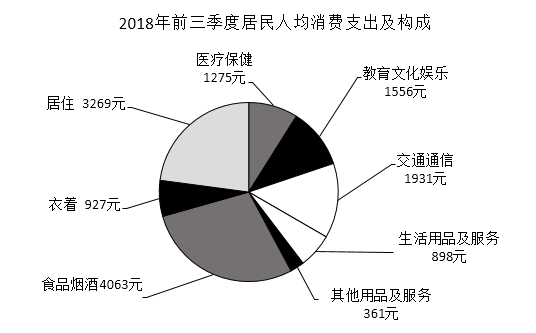

# 现期比重计算

考点：[[20-考点/资料分析/比重/现期比重计算|比重 / 现期比重计算]]
材料：[[15-材料/资料分析/198983 2018年前三季度全国居民（含城镇、|198983 2018年前三季度全国居民（含城镇、]]

**问法模型**：题干出现现期时间（2018年前三季度）+'某类消费所占的比例约为'→直接用现期比重=部分值÷整体值，一步除法对照选项，无需基期或增速换算

## 推理链
1. 第1步：题干限定现期时间'2018年前三季度'，所求为居住消费占全国居民人均消费支出的比例，属于现期比重
2. 第2步：从饼图提取部分值——居住消费支出3269元；从文字材料提取整体值——全国居民人均消费支出14281元
3. 第3步：代入现期比重公式：比重=3269÷14281
4. 第4步：截位直除：3269÷14281≈32.69÷142.81≈0.229，即约22.9%
5. 第5步：与选项对照，结果与B项最接近，故选B

**最快解法**：⚡ 截位直除（首位法）：分子3269取33，分母14281取143，33÷143≈0.23，即比重约23%（精确值22.9%），对照四个选项中最接近者即为B；亦可用百化分速判：居住3269元约为总量14281元的1/4弱（14281÷4≈3570>3269），故略小于25%，锁定唯一该量级选项B

## 易错点
- ⚠ 分母口径误取：同名指标有三套数值，全国14281/城镇19014/农村8538元，本题分母必须取全国14281元，误取城镇或把第1题的农村口径带入都会错
- ⚠ 分母取饼图8项合计14280元与文字全国数14281元存在1元舍入差，3269÷14280与3269÷14281结果几乎相同（均约22.9%），但规范做法是以文字中的整体数14281元为分母
- ⚠ 分子取错饼图项：居住3269元，勿与相邻标注的交通通信1931元、医疗保健1275元混淆；本题与名义/实际增速无关，不需扣除价格因素，也不要误做基期回推

## 母题抽象
> 🧩 当题干出现'现期时间+某部分占整体的比例（比重）约为'，且文字/图表直接给出部分值与整体值时，用现期比重=部分÷整体，截位直除后对照选项即可，全程不涉及增速与基期换算

**同类特征**：现期时间（2018年前三季度）、'所占的比例约为'、整体为全国居民人均消费支出、部分为饼图中某一消费类别、'约'字提示估算即可、选项为百分数量级比对

## 相关题
- [[10-真题/资料分析/比重/2604234 现期比重计算|2604234]]（广东 2020，相关度2）
- [[10-真题/资料分析/比重/1751688 现期比重计算|1751688]]（江苏 2015，相关度2）
- [[10-真题/资料分析/比重/2456370 现期比重计算|2456370]]（浙江 2020，相关度2）
- [[10-真题/资料分析/比重/2050970 现期比重计算|2050970]]（江西 2017，相关度2）
- [[10-真题/资料分析/比重/2188157 现期比重计算|2188157]]（陕西 2018，相关度2）

---

### 题干
2018年前三季度，全国居民人均消费支出中居住消费所占的比例约为（    ）。

### 选项
- A. 

- B. 

　✅
- C. 

- D. 

### 官方解析
根据题干“2018年前三季度······全国居民人均消费支出中······所占的比例”，结合材料中给出2018年前三季度数据，可判定本题为现期比重问题。定位文字材料可得：2018年前三季度，全国居民人均消费支出14281元。定位饼状图可得，居住消费支出为3269元。根据，故与B项最接近。
故正确答案为B。

### 给定材料

        2018年前三季度，全国居民人均消费支出14281元，比上年同期名义增长，扣除价格因素，实际增长。其中，城镇居民人均消费支出19014元，增长，扣除价格因素，实际增长；农村居民人均消费支出8538元，增长，扣除价格因素，实际增长。

