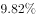
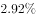
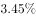
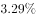
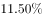

# 现期比重反推整体（已知部分量及占比求全国商品进出口总额）

考点：[[20-考点/资料分析/比重/现期比重反推整体（已知部分量及占比求全国商品进出口总额）|比重 / 现期比重反推整体（已知部分量及占比求全国商品进出口总额）]]
材料：[[15-材料/资料分析/199307 2013年全国林产品进出口概况（出口|199307 2013年全国林产品进出口概况（出口]]

**问法模型**：题干问'2013年全国商品进出口总额'，而材料只给林产品出口/进口额及其占全国商品出口额/进口额的比重 → 采用'整体=部分÷比重'分别反推全国商品出口额与进口额，再加总。

## 推理链
1. 第1步：题干要求全国商品进出口总额=全国商品出口额+全国商品进口额；材料给出林产品出口644.55亿美元（占全国商品出口额2.92%）、林产品进口640.88亿美元（占全国商品进口额约3.29%，官方解析文本此数值缺失，按答案D口径反推补全）。
2. 第2步：现期比重规则：整体=部分÷比重，出口、进口须各用各的占比分别反推。
3. 第3步：全国商品出口额=644.55÷2.92%≈22074亿美元。
4. 第4步：全国商品进口额=640.88÷3.29%≈19480亿美元（若用3.3%则≈19421亿美元，量级不变）。
5. 第5步：加总：22074+19480≈41553亿美元（若用3.3%约41495亿美元，仍最接近同一项）。
6. 第6步：对照选项：41553与D项最接近；A项1285恰等于644.55+640.88，是把林产品合计当成全国商品总额的陷阱，排除，故选D。

**最快解法**：⚡ 截位直除+量级排除：644.55÷2.92%≈645÷0.0292≈2.2万亿美元；进口占比略高（约3.3%），640.88÷3.29%≈1.95万亿美元；合计≈4.15万，直接锁定D。同时用选项量级秒杀：A=1285恰为644.55+640.88的部分陷阱，C/D才可能是'占2.92%比重反推'后的万级量级。

## 易错点
- ⚠ '部分代整体'陷阱：A项1285≈644.55+640.88，是林产品自身进出口之和，而题干问的是全国商品进出口总额，必须用比重反推整体
- ⚠ 出口与进口不能用同一个比重，须分别以2.92%、3.29%反推后加总；材料中'增幅比上年增加3.18/8.58个百分点'是增速差的无关干扰信息，勿代入计算
- ⚠ 时间口径：问2013年现期值，直接用'现期部分÷现期比重'，不涉及基期回推，勿除(1+增速)；'个百分点'是增速之差不是增长率本身

## 母题抽象
> 🧩 当题干出现'某部分占整体的比重为x%，求整体总额'特征时，用'整体=部分÷x%'对出口、进口分别反推再相加，并先用选项量级排除'部分直接相加'类陷阱项（部分之和远小于整体）。

**同类特征**：全国商品进出口总额、占全国商品出口额/进口额的比重、部分求整体（比重反推）、出口额与进口额分别计算再加总、现期比重、亿美元量级判断

## 相关题
- [[10-真题/资料分析/比重/4792819 现期比重计算（多部分比重依次求解）|4792819]]（新疆 2014，相关度1）
- [[10-真题/资料分析/比重/827355 现期比重比较（部分占比过半速判）|827355]]（政法干警 2014，相关度1）
- [[10-真题/资料分析/比重/2272297 现期比重比较|2272297]]（选调 2015，相关度1）
- [[10-真题/资料分析/比重/2032972 现期比重计算（多地区占比求和）|2032972]]（吉林 2015，相关度1）
- [[10-真题/资料分析/比重/2187857 现期比重计算（部分量需先由'总量−其中量'减法间接求得）|2187857]]（山东 2018，相关度1）

---

### 题干
2013年全国商品进出口总额约为多少亿美元？

### 选项
- A. 1285
- B. 10891
- C. 25140
- D. 41553　✅

### 官方解析
根据题干“2013年全国商品进出口总额”，结合材料“占全国商品出口额的2.92%、占全国商品进口额的”，可判定此题为现期比重问题。定位文字材料，“2013年，全国林产品出口644.55亿美元，占全国商品出口额的，林产品进口640.88亿美元，占全国商品进口额的”。根据总量，2013年全国商品进出口额亿美元，与D项最接近。
故正确答案为D。

### 给定材料

        2013年，全国林产品出口644.55亿美元，同比增长，增幅比上年增加3.18个百分点，占全国商品出口额的。林产品进口640.88亿美元，同比增加，增幅比上年增加8.58个百分点，占全国商品进口额的。其中，非木质林产品出口162.3亿美元，同比增加，进口288.80亿美元，同比下降。

> [!warning] 疑点（官方解析可能有误，待人工复核）
> 官方解析文本不完整且与材料导读矛盾：导读称文字材料中两个占比'数值空缺'，解析仅引用了出口占比2.92%，进口占比数值及最终算式均缺失；按答案D=41553反推，进口占比应约为3.29%（640.88÷(41553−22074)≈3.29%），补全该数值后计算成立，答案D本身无误。
