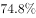

# 现期比重计算（部分=整体−另一部分的反推拆分）

考点：[[20-考点/资料分析/比重/现期比重计算（部分=整体−另一部分的反推拆分）|比重 / 现期比重计算（部分=整体−另一部分的反推拆分）]]
材料：[[15-材料/资料分析/199307 2013年全国林产品进出口概况（出口|199307 2013年全国林产品进出口概况（出口]]

**问法模型**：题干出现'2013年A占B的比重约为'→现期比重模型：部分=整体−另一部分，再除以整体

## 推理链
1. 第1步：定位文字材料，2013年林产品出口总额644.55亿美元，其中非木质林产品出口162.3亿美元
2. 第2步：木质林出口额材料未直接给出，需用拆分公式：木质出口=林产品出口总额−非木质出口=644.55−162.3=482.25亿美元
3. 第3步：现期比重=部分÷整体=482.25÷644.55，因题干时间与材料时间均为2013年，直接用现期值，无需基期回推
4. 第4步：速算，644.55×75%≈483.4略大于482.25，故比重略低于75%，即约74.8%
5. 第5步：与选项对照，约74.8%与D项最接近，故选D

**最快解法**：⚡ 截位直除：先做减法644.55−162.3=482.25；再算482.25/644.55，按645估：645×0.75=483.75>482.25，故比重略小于75%，约74.8%，直接锁定D

## 易错点
- ⚠ 误将非木质162.3直接当部分，算成162.3÷644.55≈25.2%，与正确值约74.8%恰好互补，选项中常设此陷阱
- ⚠ 误用表格中7类木质产品数据加总求木质出口额——表格量纲混杂（万立方米/万吨/亿美元），数量与金额不能相加，且表格产品并非木质出口的全部口径，只有'总出口−非木质'才是正确拆分
- ⚠ 时间口径：题干问的是2013年现期比重，勿看到'增长'字样就去回推2012年基期

## 母题抽象
> 🧩 当题干要求'某部分占整体的比重'而材料只给'整体值'和'另一部分值'时，用'部分=整体−另一部分'反推出部分，再除以整体，选项差距大时用截位直除即可锁定

**同类特征**：2013年……占……的比重约为、木质林出口额、现期比重、整体为644.55亿美元、部分需由整体减非木质162.3反推、约为（估算型）

## 相关题
- [[10-真题/资料分析/比重/4792819 现期比重计算（多部分比重依次求解）|4792819]]（新疆 2014，相关度1）
- [[10-真题/资料分析/比重/827355 现期比重比较（部分占比过半速判）|827355]]（政法干警 2014，相关度1）
- [[10-真题/资料分析/比重/2272297 现期比重比较|2272297]]（选调 2015，相关度1）
- [[10-真题/资料分析/比重/2032972 现期比重计算（多地区占比求和）|2032972]]（吉林 2015，相关度1）
- [[10-真题/资料分析/比重/2187857 现期比重计算（部分量需先由'总量−其中量'减法间接求得）|2187857]]（山东 2018，相关度1）

---

### 题干
2013年木质林出口额占林产品出口总额的比重约为：

### 选项
- A. 

- B. 

- C. 

- D. 

　✅

### 官方解析
根据题干“2013年······占······的比重”，结合材料时间为2013年，可判定此题为现期比重问题。定位文字材料可得，“2013年全国林产品出口644.55亿美元，其中非木质林产品出口162.3亿美元”。可得木质林出口额亿美元，故2013年木质林出口额占林产品出口总额的比重为 ，与D项最接近。
故正确答案为D。

### 给定材料

        2013年，全国林产品出口644.55亿美元，同比增长，增幅比上年增加3.18个百分点，占全国商品出口额的。林产品进口640.88亿美元，同比增加，增幅比上年增加8.58个百分点，占全国商品进口额的。其中，非木质林产品出口162.3亿美元，同比增加，进口288.80亿美元，同比下降。

