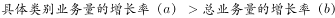

# 两期比重比较（比重升降判定）

考点：[[20-考点/资料分析/比重/两期比重比较（比重升降判定）|比重 / 两期比重比较（比重升降判定）]]
材料：[[15-材料/资料分析/199338 2017年A省邮电业务（电信-邮政-|199338 2017年A省邮电业务（电信-邮政-]]

**问法模型**：题干问'某分项占总业务量比重高于上年水平的分类'→ 转化为两期比重升降判定：只需比较分项增速a与整体增速b，a>b即2017年比重高于上年，无须计算比重具体值

## 推理链
1. 第1步：定位材料第三段，2017年全省全年快递业务量100.51亿件（整体），其同比增速为整体增速b；同城、异地、国际和港澳台地区三类快递业务量各附增速a
2. 第2步：两期比重判定规则：基期比重=现期比重×(1+b)/(1+a)，故现期比重−基期比重的符号与(a−b)一致，当分项增速a>整体增速b时，2017年占比高于上年
3. 第3步：将同城、异地、国际和港澳台三类业务量增速分别与100.51亿件对应的整体增速b逐一比大小（所给文本中增速数值缺失，以原卷为准：异地、国际和港澳台的a大于b，同城的a小于b）
4. 第4步：满足a>b的分类为'异地快递'和'国际和港澳台地区快递'两项
5. 第5步：与选项对照，B项'异地快递、国际和港澳台地区快递'与判定结论完全一致，故选B

**最快解法**：⚡ 两期比重'找a比b'秒杀法：不必算任何比重，直接把三个分项增速与快递总量100.51亿件的同比增速比较，'分项增速>整体增速'者即比重高于上年；结合选项两两分组结构（同城+异地 vs 同城单独 vs 同城+异地 vs 仅国际），可先锁定b介于同城与异地增速之间，直接选B

## 易错点
- ⚠ 判定方向记反：'比重高于上年'要求分项增速>整体增速，误记成'分项增速<整体增速'会错选C或D的反向组合
- ⚠ 死算具体比重：先算三类业务量占比再与上年占比相减，计算量大且易因增速缺失无从下手，两期比重比较只需比增速符号
- ⚠ 三类只比一两类：同城增速低于整体易被排除，但若漏比国际和港澳台一类会漏选组合项B；须三类增速全部与b比对齐

## 母题抽象
> 🧩 当题干出现'某部分占总体比重高于/低于上年（同期）水平'特征时，用两期比重升降判定法：比较部分增速a与总体增速b，a>b则比重上升、a<b则比重下降，只比增速不算比重

**同类特征**：比重高于上年水平、占总业务量比重、分类（同城/异地/国际和港澳台）、同比增速比较、文字材料定位某段、两期比较

## 相关题
- [[10-真题/资料分析/比重/2136902 两期比重比较（比重升降判定）|2136902]]（北京 2018，相关度3）
- [[10-真题/资料分析/增长/10204589 增长率比较（逐年同比增速比较）|10204589]]（河北 2024，相关度1）
- [[10-真题/资料分析/增长/2050944 增长率计算与比较（逐年同比增速找最小）|2050944]]（江西 2017，相关度1）
- [[10-真题/资料分析/增长/5102379 增长率比较（由'部分增速高出整体N个百分点'派生整体增速作基准）|5102379]]（湖北 2022，相关度1）
- [[10-真题/资料分析/增长/13504437 同比增速比较（部分增速与全国整体增速对比）|13504437]]（河北 2025，相关度1）

---

### 题干
2017年A省快递业务中，业务量占总业务量比重高于上年水平的分类是：

### 选项
- A. 仅国际和港澳台地区快递
- B. 异地快递、国际和港澳台地区快递　✅
- C. 仅同城快递
- D. 同城快递、异地快递

### 官方解析

根据“2017年A省快递业务中，······占······比重高于上年水平的分类是···”，可判断此题为两期比重问题。定位文字材料第三段，“2017年，全省全年完成快递业务量100.51亿件，同比增长。其中，同城快递业务量增长，异地快递业务量增长，国际和港澳台地区快递业务量增长”，可知总业务量增长率（b）为。若业务量占总业务量比重高于上年水平，需满足，即大于。所以满足题意的有异地快递业务量，国际和港澳台地区快递业务量，对应选项B。

故正确答案为B。

### 给定材料

        2017年，A省完成邮电业务总量6065.71亿元。其中，电信业务总量3575.86亿元，同比增长；邮政业务总量2489.85亿元，增长。

        2017年，A省移动电话期末用户1.48亿户，比上年末增长。其中，4G期末用户达1.18亿户，比上年末增长。互联网宽带接入期末用户3128万户，比上年末增长。移动互联网期末用户1.31亿户，比上年末增长，移动互联网接入流量同比增长。

        2017年，全省全年完成快递业务量100.51亿件，同比增长。其中，同城快递业务量增长，异地快递业务量增长，国际和港澳台地区快递业务量增长。

        2017年，A省完成客运总量148339万人次，同比增长，增幅比前三季度提高0.2个百分点，比上年提高0.5个百分点；完成旅客周转总量4143.84亿人公里，增长，增幅比前三季度提高0.7个百分点，比上年提高1.8个百分点。

        2017年，A省完成高铁客运量17872万人次，旅客周转量474.64亿人公里，同比分别增长和。高铁客运量和旅客周转量分别占铁路旅客运输总量的和，比重比上年分别提高4.3个和3.9个百分点。

> [!warning] 疑点（官方解析可能有误，待人工复核）
> 所给材料文本及官方解析中各增速百分比数值均缺失（疑为原卷公式/图片丢失，解析'b为'后为空白），无法呈现'同城<整体<异地、国际港澳台'的具体数值链；本标注仅依据官方结论确认异地与国际港澳台增速大于整体增速，须回原卷补齐具体增速后复核
