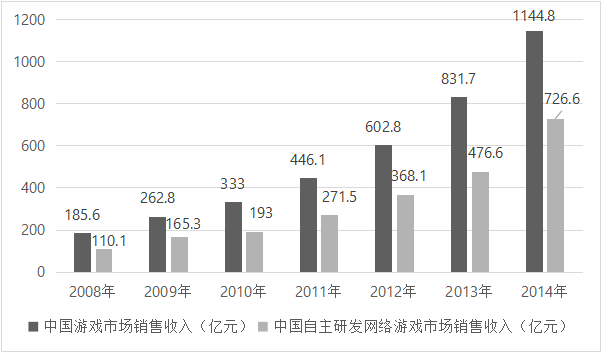
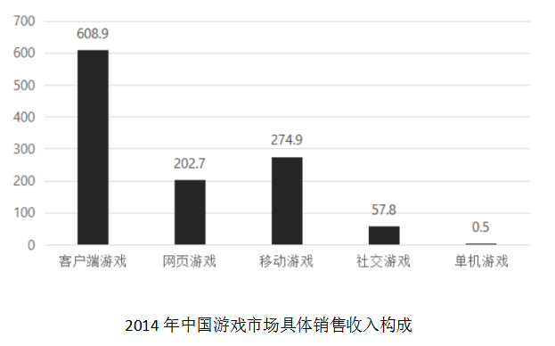

# 现期比重比较

考点：[[20-考点/资料分析/比重/现期比重比较|比重 / 现期比重比较]]

**问法模型**：问'部分占整体的比重最高的年份'→逐年计算 部分量÷整体量 的现期比重并比较大小，取最大者

## 推理链
1. 第1步：题干要求比较'中国自主研发网络游戏市场销售收入占中国游戏市场销售收入的比重'，判为现期比重比较，只需比较选项给出的2011～2014四个年份；材料文字中'用户5.17亿人、增长率减少16个百分点'属用户口径，与本题销售收入无关。
2. 第2步：定位第一个统计图，读取2011、2012、2013、2014年'自主研发网络游戏市场销售收入'（分子）与'中国游戏市场销售收入'（分母）两组数据。
3. 第3步：按公式 比重=自主研发网络游戏市场销售收入÷中国游戏市场销售收入，分别计算四个年份的比值并比较。
4. 第4步：比较可知2014年的比重在四个年份中最大，对应选项D，故正确答案为D。

**最快解法**：⚡ 估比法（截位直除比首商）：对四个年份分别用'自主研发销售收入÷游戏市场销售收入'截位相除，只比首商、无需精算；读图比较四个比值，2014年最大，直接锁定D。

## 易错点
- ⚠ 误用材料文字中的用户数量（5.17亿人）或同比增长率数据，与'销售收入'口径不符。
- ⚠ 只比较分子（自主研发销售收入）谁更大，忽略比重=分子÷分母需做比值比较。
- ⚠ 图表定位错误，或未对四个选项年份逐一求比值、凭分子逐年增大就猜答案。

## 母题抽象
> 🧩 当题干出现'占……的比重最高（最大）的年份'特征时，定位图表取各年部分量与整体量，逐年截位直除比首商，验证比值最大者即为答案。

**同类特征**：占……的比重最高、多年份比较、自主研发网络游戏市场销售收入、中国游戏市场销售收入、统计图数据定位、现期比重

## 相关题
- [[10-真题/资料分析/比重/2052082 现期比重比较|2052082]]（吉林 2017，相关度2）
- [[10-真题/资料分析/比重/2049524 现期比重比较|2049524]]（新疆 2017，相关度2）
- [[10-真题/资料分析/比重/2031610 现期比重比较|2031610]]（广东 2016，相关度2）
- [[10-真题/资料分析/比重/2166225 现期比重比较|2166225]]（深圳市考 2018，相关度2）
- [[10-真题/资料分析/比重/2172876 现期比重比较|2172876]]（广州市考 2018，相关度2）

---

### 题干
2008～2014年，中国自主研发网络游戏市场销售收入占中国游戏市场销售收入的比重最高的年份是：

### 选项
- A. 2011年
- B. 2012年
- C. 2013年
- D. 2014年　✅

### 官方解析
由题干“占······的比重最高”，结合材料给定数据，可判定此题为现期比重问题，。定位第一个统计图：2011年比重；2012年比重；2013年比重；2014年比重。可知2014年的比重最高。
故正确答案为D。

### 给定材料

        2014年，中国游戏市场用户数量约为5.17亿人，比2013年增长了，同比增长率比2013年减少了16个百分点。

