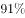

# 现期比重计算（部分和占整体比重）

考点：[[20-考点/资料分析/比重/现期比重计算（部分和占整体比重）|比重 / 现期比重计算（部分和占整体比重）]]
材料：[[15-材料/资料分析/200302 2014年某区限额以上第三产业单位（|200302 2014年某区限额以上第三产业单位（]]

**问法模型**：题干出现'按单位数从多到少排列，排在前三位的三个门类单位数之和约占…总数的'→ 先对'单位数'列排序取前三求和，再用现期比重=部分之和/整体总数计算

## 推理链
1. 第1步：从表格'单位数（家）'列读取13个门类：批发和零售291、交通运输38、住宿餐饮50、信息传输7、金融22、房地产35、租赁和商务服务63、科学研究26、水利23、居民服务7、教育69、卫生和社会工作26、文化体育娱乐17，合计674家
2. 第2步：按单位数从多到少排序，前三为批发和零售业291家、教育69家、租赁和商务服务业63家（第四名住宿餐饮50家，被淘汰）
3. 第3步：前三门类单位数求和：291+69+63=423家
4. 第4步：现期比重公式：比重=部分量之和/整体总量=423/674
5. 第5步：截位直除估算：423/674≈62.8%，即约63%
6. 第6步：与选项对照，约63%对应C项，故正确答案为C

**最快解法**：⚡ 排序+截位直除：按'单位数'列从大到小锁定前三291+69+63=423，再423/674，首商6得60%+，精细一步674×0.63≈424.6≈423，即约63%，直接锁定C

## 易错点
- ⚠ 排序列混淆：表中收入列最大的是批发零售893.4、卫生38.6、房地产31.6，若误按'2014年收入'列排序会取错门类，必须按'单位数（家）'列排序
- ⚠ 排序漏项/错位：教育69家、租赁和商务服务63家须进入前三，住宿餐饮50家排第四易被误认进前三；卫生与社会工作26家、科学研究26家并列不参与前三，只影响中间名次不影响结果
- ⚠ 总数口径：分母用合计行674家（13个门类之和恰等于674，可加总验证），而非文字中其他总量（如从业人员58631人或收入1059.1亿元）

## 母题抽象
> 🧩 当题干出现'排在前N位的…之和约占…总数的'特征时，先按题干指定列（防与其他数值列混排）排序取前N项求和，再除以合计行总数，用截位直除估算比重并匹配选项

**同类特征**：排在前三位、单位数从多到少排列、单位数之和、约占、总数的、现期比重

## 相关题
- [[10-真题/资料分析/比重/2725306 现期比重计算（两分项求和占整体比重）|2725306]]（四川 2020，相关度2）
- [[10-真题/资料分析/比重/2741671 增长量计算+增量比重（现期比重，分子分母均为同比增量）|2741671]]（山东 2021，相关度2）
- [[10-真题/资料分析/比重/5893776 现期比重计算（多地区累计值求比重）|5893776]]（国考 2024，相关度2）
- [[10-真题/资料分析/比重/4792819 现期比重计算（多部分比重依次求解）|4792819]]（新疆 2014，相关度1）
- [[10-真题/资料分析/比重/827355 现期比重比较（部分占比过半速判）|827355]]（政法干警 2014，相关度1）

---

### 题干
表中所列各类限额以上第三产业单位中，按单位数从多到少排列，排在前三位的三个门类单位数之和约占到该区限额以上第三产业单位总数的

### 选项
- A. 

- B. 

- C. 

　✅
- D. 

### 官方解析
由题干“······排在前三位······单位数之和约占到······总数的”，判定本题为现期比重问题。定位表格材料可知，按单位数从多到少排列，排在前三位的为：批发和零售业291个，教育69个，租赁和商务服务业63个，限额以上第三产业单位总数674个。根据，题目所求为：。
故正确答案为C。

### 给定材料

<b>根据下列统计资料回答问题</b>

        2014年某区限额以上第三产业单位共674家，实际收入1059.1亿元，同比增长；实现利润总额13.5亿元，同比增长；从业人员达到58631人，同比下降。

