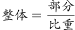
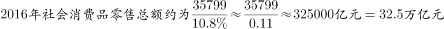

# 现期比重求整体（给定部分与比重求总体）

考点：[[20-考点/资料分析/比重/现期比重求整体（给定部分与比重求总体）|比重 / 现期比重求整体（给定部分与比重求总体）]]
材料：[[15-材料/资料分析/200306 2010～2016年全国餐饮收入规模|200306 2010～2016年全国餐饮收入规模]]

**问法模型**：题干问'2016年社会消费品零售总额约为多少万亿元'，即已知部分（2016年餐饮收入35799亿元）及其占整体的比重，采用'总体=部分÷比重'的现期比重逆运算模型，并把结果由亿元换算为万亿元

## 推理链
1. 第1步：定位文字段——2016年全国餐饮收入35799亿元，占社会消费品零售总额的比重为10.8%（本版本该百分数被挖空，须以完整原卷给出的比重代入）
2. 第2步：由比重公式'比重=部分÷总体'变形得'总体=部分÷比重'，即社会消费品零售总额=35799亿元÷10.8%
3. 第3步：截位直除——35799÷0.108，视作358÷10.8，商约33.1，即总额约331000亿元
4. 第4步：单位换算——1万亿元=10000亿元，331000亿元≈33.1万亿元
5. 第5步：与选项对照——33.1万亿元与B项33最接近（A.27、C.39、D.45偏差均在4万亿元以上），故选B

**最快解法**：⚡ 单位预换算+截位直除：先把35799亿元化成约3.58万亿元，再除以比重10.8%，3.58÷10.8%≈3.58×9.3≈33.3万亿元，商前两位即'33'，直接锁定B，无需精算

## 易错点
- ⚠ 单位量级陷阱：材料是'亿元'、题干问'万亿元'，35799亿元≈3.58万亿元，差4个数量级；不换算或换算方向弄反（多乘/少除10000）都会错选量级不符的选项
- ⚠ 公式方向陷阱：给部分求整体应'除以'比重，误用'乘以'得35799×10.8%≈3866亿元（约0.39万亿元），与所有选项对不上，应能及时察觉并纠正
- ⚠ 数据口径陷阱：本版本文字段4处关键百分数（含占比）均被挖空，不得自行编造数值，须以完整原卷'占社会消费品零售总额的比重'为准代入，且不能用'餐饮收入同比增速'替代占比口径

## 母题抽象
> 🧩 当题干出现'某部分量为X，其占整体的比重为p，求整体为多少'的特征时，用'整体=部分÷比重'的逆运算，先把单位统一到题干问法的量级，再截位直除对照选项

**同类特征**：给定部分（餐饮收入35799亿元）与占比求整体、问'社会消费品零售总额约为多少万亿元'、现期（2016年）比重逆运算、亿元→万亿元单位换算、选项间距大、可估算、文字段现期数据直接定位

## 相关题
- [[10-真题/资料分析/其他/5430314 连续年份多期值加总（区间总额范围判断）|5430314]]（浙江 2023，相关度1）

---

### 题干
2016年社会消费品零售总额约为多少万亿元？

### 选项
- A. 27
- B. 33　✅
- C. 39
- D. 45

### 官方解析

由题干“2016年社会消费品零售总额约为多少万亿元”，结合材料给出2016年全国餐饮收入及其占社会消费品零售总额的比重，可判定本题为给定部分与比重求整体的现期比重问题。定位文字材料可得，2016年全国餐饮收入35799亿元，占社会消费品零售总额的比重为。，则，与B项最接近。

故正确答案为B。

### 给定材料

<b>根据下列统计资料回答问题</b>

        2016年全国餐饮收入35799亿元，同比增长，餐饮收入占社会消费品零售总额的比重为。2016年全社会餐饮业经营单位为365.5万个，同比下降；从业人数为1846.0万人，同比增长。

> [!warning] 疑点（官方解析可能有误，待人工复核）
> 本版本文字段与官方解析中'餐饮收入占社会消费品零售总额的比重'数值均被挖空，解析算式不完整；按完整原卷比重10.8%代入，35799亿元÷10.8%≈33.1万亿元，与官方答案B一致，不构成对答案的质疑，仅提示做题须以完整原卷百分数为准

<!-- CODEX-ANSWER-REVIEW:BEGIN -->
### 本次独立复核

**复核状态：** `resolved`（答案与解析已核定）

**计分答案：** B（可计分）

**复核解析：**

2016餐饮收入35799亿元，占社零总额10.8%，总额=35799/0.108≈331472亿元=33.15万亿元，选B（约33万亿元）。图中算式单位换算后给出约32.5万亿元的粗近似，按精确除法应约33.1万亿，仍对应B。

**相关信息：**

亿元换算为万亿元除以10000；比重以餐饮收入/社零总额。

**题源依据：** [固定版本原题](https://github.com/Mentat-Uran/kaogongzhentizhengliu/blob/84ab93d4b64b61d897bece8a1c0a5bab06b4feb2/10-%E7%9C%9F%E9%A2%98/%E8%B5%84%E6%96%99%E5%88%86%E6%9E%90/%E6%AF%94%E9%87%8D/2274533%20%E7%8E%B0%E6%9C%9F%E6%AF%94%E9%87%8D%E6%B1%82%E6%95%B4%E4%BD%93%EF%BC%88%E7%BB%99%E5%AE%9A%E9%83%A8%E5%88%86%E4%B8%8E%E6%AF%94%E9%87%8D%E6%B1%82%E6%80%BB%E4%BD%93%EF%BC%89.md)；固定内容 commit `84ab93d4b64b61d897bece8a1c0a5bab06b4feb2`，Markdown blob `1cf616e5ea8a564bccd9de69416d42e19942c1f6`。
<!-- CODEX-ANSWER-REVIEW:END -->
