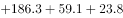
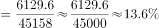

# 现期比重计算（部分为多主体加总、总体为题干外挂数据）

考点：[[20-考点/资料分析/比重/现期比重计算（部分为多主体加总、总体为题干外挂数据）|比重 / 现期比重计算（部分为多主体加总、总体为题干外挂数据）]]
材料：[[15-材料/资料分析/210315 2018年1～2月我国厦门、深圳、珠|210315 2018年1～2月我国厦门、深圳、珠]]

**问法模型**：题干问'5大经济特区进出口总额占全国进出口总额的比重'→ 现期比重=部分/整体=（5特区累计出口+累计进口之和）/题干外挂的全国总额45158亿元

## 推理链
1. 第1步：从题干提取总体数据'2018年1～2月全国进出口总额45158亿元'（表中无此数），并锁定现期为2018年1～2月，属于现期比重问题
2. 第2步：从表中取5大特区'1～2月'累计列（不可误用'2月'当月列）共10个数：出口534.3、2464.1、298.2、59.1、22.0，进口424.0、2064.7、186.3、23.8、53.1
3. 第3步：累计出口加总=534.3+2464.1+298.2+59.1+22.0=3377.7亿元；累计进口加总=424.0+2064.7+186.3+23.8+53.1=2751.9亿元
4. 第4步：5特区进出口总额=3377.7+2751.9=6129.6亿元
5. 第5步：代入比重公式=6129.6/45158≈61/452≈13.6%
6. 第6步：与选项对照，约13.6%与B选项最接近，故选B

**最快解法**：⚡ 截位直除+凑整加总：出口'534.3+2464.1'先凑成约3000，再加298.2+59.1+22.0≈3378；进口'2064.7+424.0'凑成约2489，再加186.3+23.8+53.1≈2752；合计约6130，则6130/45158≈61/452，首位商1、次位商3，约13.6%，直接锁定B

## 易错点
- ⚠ 当月列与累计列混排：必须取'1～2月'累计值；若误用'2月'当月值加总仅约2762亿元，比重会错成约6%，是主要干扰项来源
- ⚠ 分子漏项：'进出口总额'需出口+进口共10个数全加，只加出口（3377.7）会得约7.5%，只加进口（2751.9）会得约6.1%，均落入干扰选项
- ⚠ 总体数据外挂：全国45158亿元只在题干中、表中没有，漏读题干会无从下手；分子分母均为亿元口径，可直接相除无需换算

## 母题抽象
> 🧩 当题干出现'某几类主体合计占总体比重'且总体数据外挂在题干中时，先核对分子分母同为累计（或同为当月）口径，将分子各列加总后用截位直除求占比，再对照选项

**同类特征**：占全国进出口总额的比重、总体数值外挂在题干（45158亿元）、同期/1～2月（累计口径）、5大经济特区（多主体分子加总）、进出口总额（出口列+进口列均需）、约为（选项为百分比）

## 相关题
（暂无）

---

### 题干
已知2018年1～2月全国进出口总额为45158亿元。则同期5大经济特区进出口总额占全国进出口总额的比重约为：

### 选项
- A. 

- B. 

　✅
- C. 

- D. 

### 官方解析

由题干“2018年1～2月······比重约为”，可判定本题为现期比重问题。定位图表可得5大经济特区进口额和出口额，对其求和：。代入公式，可得：5大经济特区进出口总额占全国进出口总额的比重，最接近B选项。

故正确答案为B。

### 给定材料

