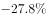

# 两期比重比较（比重升降-高于上年判断）

考点：[[20-考点/资料分析/比重/两期比重比较（比重升降-高于上年判断）|比重 / 两期比重比较（比重升降/高于上年判断）]]
材料：[[15-材料/资料分析/210318 2018年3月及2018年1～3月国|210318 2018年3月及2018年1～3月国]]

**问法模型**：题干出现'A占B比重高于上年水平'→两期比重比较模型，不需计算比重值，直接判据：部分增速a＞整体增速b则比重高于上年，否则低于

## 推理链
1. 第1步：从题干提取需比较的三个部分——2018年1～3月4G手机出货量8195.6万部、国产品牌出货量7586.4万部、智能手机出货量8187.0万部，整体为全国手机出货量8737.0万部，均为1～3月累计口径
2. 第2步：规则——两期比重比较结论：部分占整体比重高于上年⟺部分同比增速＞整体同比增速，与比重具体数值无关
3. 第3步：从材料第2～4段定位1～3月三个部分的同比增速，从第1段定位全国出货量整体同比增速
4. 第4步：比较——三个部分增速均低于全国手机市场出货量整体增速（官方解析明确给出该比较结论）
5. 第5步：三个部分增速a均＜整体增速b→三类手机占比均低于上年水平，满足'高于上年水平'的类别数为0
6. 第6步：与选项对照，0类对应A，故选A

**最快解法**：⚡ 两期比重速判法（增速比较）：'比重高于上年'只需比大小不比数值——逐一定位1～3月4G、国产品牌、智能手机三个增速，与全国整体增速一比，三者全小于整体，直接数出0个，5秒定型选A

## 易错点
- ⚠ 方向搞反：部分增速小于整体增速时比重是'下降'，误判为'上升'会错数成3类而选D
- ⚠ 硬算比重：误以为要分别算出2018年与2017年两组具体比重（还需回推基期），既耗时又受本材料增速数值缺失限制；两期比重比较只需增速比大小
- ⚠ 口径与抄数陷阱：占比分母是全国出货量8737.0万部而非4G手机或各部分自身；4G出货量8195.6万部与智能手机出货量8187.0万部仅差一位，极易看串；题干问1～3月累计增速，误用3月当月数据比较

## 母题抽象
> 🧩 当题干出现'A占B的比重高于（低于）上年同期'并要求数类别数时，不用算比重，直接比较各部分增速a与整体增速b：a＞b比重升、a＜b比重降，数出满足项个数即可

**同类特征**：占……比重高于上年水平、有几类（多部分计数）、两期比重比较、部分增速vs整体增速、1～3月累计口径、无需计算具体比重值

## 相关题
- [[10-真题/资料分析/比重/2448412 两期比重比较（比重上升-下降判定：部分增速vs总体增速）|2448412]]（国考 2020，相关度2）
- [[10-真题/资料分析/比重/5102477 两期比重变化判断（比重升降定性比较）|5102477]]（黑龙江 2022，相关度2）
- [[10-真题/资料分析/综合/10204448 综合分析-逐项判断（历史极值确认、两期比重比较、多期累计求和、基期比重）|10204448]]（广东 2024，相关度1）
- [[10-真题/资料分析/比重/17097813 两期比重比较（比重差计算）|17097813]]（山西 2024，相关度1）
- [[10-真题/资料分析/比重/1746802 两期比重变化比较（增速比较法，连续两年判断）|1746802]]（国考 2016，相关度1）

---

### 题干
在①国内4G手机出货量、②国产品牌手机出货量、③智能手机出货量中，2018年1～3月出货量占全国手机出货量比重高于上年水平的有几类？

### 选项
- A. 0　✅
- B. 1
- C. 2
- D. 3

### 官方解析

根据题干“2018年······占······比重高于上年水平······”，可以判定本题为两期比重问题。由两期比重比较结论可知，部分占整体比重高于上年即为部分增长率大于总体增长率。定位文字材料可得2018年1~3月，国内手机市场出货量、国内4G手机出货量、国产品牌手机出货量、智能手机出货量分别同比增长、、，，可得国内4G手机出货量、国产品牌手机出货量、智能手机出货量同比增长率均低于国内手机市场出货量同比增长率（），故国内4G手机出货量、国产品牌手机出货量、智能手机出货量所占比重均低于上年水平。

故正确答案为A。

### 给定材料

        2018年3月，国内手机市场出货量3018.5万部，同比下降，2018年1～3月，国内手机市场出货量8737.0万部，同比下降。3月，国内上市新机型80款，同比下降，2018年1～3月，上市新机型206款，同比下降。

        2018年3月，国内4G手机出货量2808.5万部，同比下降，其中4G全网通手机占比；4G上市新机型67款，同比下降，其中4G全网通手机占比。1～3月，4G手机出货量8195.6万部，同比下降，其中4G全网通手机占比；4G上市新机型156款，同比下降，其中4G全网通手机占比。

        2018年3月，国产品牌手机出货量2699.5万部，同比下降；上市新机型78款，同比下降。1～3月，国产品牌手机出货量7586.4万部，同比下降；上市新机型190款，同比下降。

        2018年3月，智能手机出货量为2808.3万部，同比下降。1～3月，智能手机出货量为8187.0万部，同比下降。3月，上市智能手机新机型68款，同比下降，其中支持安卓操作系统的手机67款。2018年1～3月，上市智能手机新机型158款，同比下降,其中支持安卓操作系统的手机152款。

> [!warning] 疑点（官方解析可能有误，待人工复核）
> 材料文本中所有'同比下降'后的增速数值及官方解析中引用的增速均缺失未显示，本题无法在给定残缺文本上独立复算增速比较，仅能依托官方解析'三个部分增速均低于整体增速'的结论落地；该结论与答案A（0类）逻辑自洽，不构成答案错误。

<!-- CODEX-ANSWER-REVIEW:BEGIN -->
### 本次独立复核

**复核状态：** `resolved`（答案与解析已核定）

**计分答案：** A（可计分）

**复核解析：**

2018年1–3月总手机出货量同比下降约27.1%；国内4G、国产品牌和智能手机出货量的同比降幅均大于总市场降幅，因此三类部分增速都低于整体增速，份额均未高于上年；符合条件0类，A。

**相关信息：**

两期比重变化常用公式：现期比重×(部分增长率−整体增长率)/(1+部分增长率)；部分增速高于整体时比重上升。

**题源依据：** [固定版本原题](https://github.com/Mentat-Uran/kaogongzhentizhengliu/blob/84ab93d4b64b61d897bece8a1c0a5bab06b4feb2/10-%E7%9C%9F%E9%A2%98/%E8%B5%84%E6%96%99%E5%88%86%E6%9E%90/%E6%AF%94%E9%87%8D/2281002%20%E4%B8%A4%E6%9C%9F%E6%AF%94%E9%87%8D%E6%AF%94%E8%BE%83%EF%BC%88%E6%AF%94%E9%87%8D%E5%8D%87%E9%99%8D-%E9%AB%98%E4%BA%8E%E4%B8%8A%E5%B9%B4%E5%88%A4%E6%96%AD%EF%BC%89.md)；固定内容 commit `84ab93d4b64b61d897bece8a1c0a5bab06b4feb2`，Markdown blob `e9c18a9fbdf6276e23308e6854279245ea688fc0`。
<!-- CODEX-ANSWER-REVIEW:END -->
