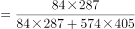
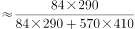
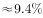

# 现期比重计算（部分占整体，部分与整体均需订单量×单价折算）

考点：[[20-考点/资料分析/比重/现期比重计算（部分占整体，部分与整体均需订单量×单价折算）|比重 / 现期比重计算（部分占整体，部分与整体均需订单量×单价折算）]]
材料：[[15-材料/资料分析/215726 AK制造公司2018年4月五家客户（|215726 AK制造公司2018年4月五家客户（]]

**问法模型**：题干出现'Boeing公司钻床订单价占该公司总订单价约为'→现期比重模型：比重=钻床订单额÷Boeing公司全部订单额，其中订单额=订单量×英镑单价

## 推理链
1. 第1步：定位表1中Boeing行：磨床574件、铣床0件、钻床84件；表末单价行：磨床405英镑、铣床20245英镑、钻床287英镑
2. 第2步：比重公式：比重=部分订单价÷整体订单价=钻床订单额÷(磨床订单额+铣床订单额+钻床订单额)
3. 第3步：代入计算：钻床订单额=84×287=24108英镑；磨床订单额=574×405=232470英镑；铣床订单额=0×20245=0英镑
4. 第4步：整体订单额=232470+24108=256578英镑
5. 第5步：比重=24108÷256578≈24108/256578≈9.4%，与选项B相符，故正确答案为B

**最快解法**：⚡ 估算+截位直除：部分=84×287≈2.4万，整体=574×405+2.4万≈23.2万+2.4万≈25.7万，比重≈24/257≈9.4%（明显小于10%但大于9%），锁定唯一落在9%~10%区间的选项B，无需精算

## 易错点
- ⚠ 表1末行'订单单价（英镑）'是价格行而非第6家公司的订单量，混排在'公司'列名下，极易误读代入
- ⚠ 铣床单价20245英镑与磨床405、钻床287相差约两个数量级，量级陷阱易导致乘法位数出错；Boeing铣床订单量为0，其订单额为0，不能漏加也不能误算
- ⚠ 分母必须是'该公司（Boeing行）总订单价'，不能误用五行公司加总作整体；也不能用订单数量直接相比（84/658≈12.8%），必须先各自乘单价折算成金额再求比重

## 母题抽象
> 🧩 当题干出现'A占B(该公司总)约为'特征时，先在同一行内定位部分量与整体量（若给单价需按'数量×单价'折算成金额），用比重=部分/整体+截位估算首两位，验证选项量级与首位数字

**同类特征**：占...总...约为、现期比重、公司行内部分/整体、订单价=订单量×单价、无需汇率折算、单行定位排除其他公司

## 相关题
- [[10-真题/资料分析/比重/4792819 现期比重计算（多部分比重依次求解）|4792819]]（新疆 2014，相关度1）
- [[10-真题/资料分析/比重/827355 现期比重比较（部分占比过半速判）|827355]]（政法干警 2014，相关度1）
- [[10-真题/资料分析/比重/2272297 现期比重比较|2272297]]（选调 2015，相关度1）
- [[10-真题/资料分析/比重/2032972 现期比重计算（多地区占比求和）|2032972]]（吉林 2015，相关度1）
- [[10-真题/资料分析/比重/2187857 现期比重计算（部分量需先由'总量−其中量'减法间接求得）|2187857]]（山东 2018，相关度1）

---

### 题干
Boeing公司钻床订单价占该公司总订单价约为：

### 选项
- A. 

- B. 

　✅
- C. 

- D. 

### 官方解析

根据题干“······占该公司总订单······”，可判断本题为现期比重问题。定位表格，Boeing公司钻床订单数量为84个，单价为287英镑，磨床订单数量为574，单价为405英镑。则代入比重公式：。

故正确答案为B。

### 给定材料

