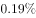

# 两期比重差（比重较上年升降方向+百分点量级）

考点：[[20-考点/资料分析/比重/两期比重差（比重较上年升降方向+百分点量级）|比重 / 两期比重差（比重较上年升降方向+百分点量级）]]
材料：[[15-材料/资料分析/215727 国家统计局公布的2014—2018年|215727 国家统计局公布的2014—2018年]]

**问法模型**：题干'2018年A占B的比重，较上一年约'+选项'增长/减少+百分点'→两期比重比较模型：方向由部分增速a与整体增速b之差判定，量级用现期比重×(a−b)/(1+a)估算

## 推理链
1. 第1步：提取数据：2018年谷物总产量A=6102亿公斤、粮食总产量B=6579亿公斤（文字/条形图/统计表三处一致）；谷物同比增速a=−0.8%（文字留空处数据），粮食同比增速b由条形图反推：(6579−6616)/6616≈−0.56%≈−0.6%
2. 第2步：定方向：a=−0.8%<b=−0.6%，谷物（部分）降幅大于粮食（整体），比重应下降，锁定'减少'类选项（B/D）
3. 第3步：用公式：两期比重差=A/B×(a−b)/(1+a)
4. 第4步：代入计算：6102/6579≈92.7%，比重差≈92.7%×(−0.2%)/0.992≈−0.19个百分点
5. 第5步：基期法验证：2017年谷物=6102/(1−0.8%)≈6151亿公斤，基期比重=6151/6616≈93.0%，与现期比重92.7%相减≈−0.2~−0.3个百分点，与公式结果一致
6. 第6步：对照选项：比重下降且幅度约0.2个百分点（远小于2个百分点量级），仅B项'减少+小幅数值'符合，选B

**最快解法**：⚡ 两期比重差公式法+截位直除：先比增速定方向（−0.8%<−0.6%→下降），再算量级：比重差≈现期比重92.7%×(a−b)=92.7%×(−0.2%)≈−0.19≈0.2个百分点，1+a≈1可直接忽略，秒选B

## 易错点
- ⚠ 方向误判：比重升降看a−b的符号而非'部分是否下降'——本题两指标同降，但谷物降得更快（0.8%>0.6%）才导致比重下降；只看单指标增减而不比相对快慢易出错
- ⚠ 留空数据陷阱：文字中同比百分数留空，2017年谷物量无法从图表直接读出，须用a=−0.8%还原基期（6102/0.992≈6151亿公斤）；2017年粮食6616亿公斤只藏在条形图中，漏看图形会卡壳
- ⚠ 量级与单位陷阱：结果单位是'个百分点'而非'%'，数值≈0.2，选项常配'2个百分点'做10倍干扰项，切勿误选；产量为'亿公斤'（1亿公斤=10万吨），若选项带质量单位须换算

## 母题抽象
> 🧩 当题干出现'A占B的比重，较上一年上升/下降'+选项为'增长/减少+百分点'时，先比较部分增速a与整体增速b定方向（a<b→下降），再用两期比重差=现期比重×(a−b)/(1+a)估量级，验证与小幅选项匹配即锁定答案

**同类特征**：占…的比重，较上一年约、两期比重比较/比重差、选项为增长或减少+百分点、部分与整体增速均需提取（文字留空+图形反推）、量级干扰：0.2与2个百分点成对出现、谷物与粮食为包含口径

## 相关题
（暂无）

---

### 题干
2018年全国谷物总产量占全国粮食总产量的比重，较上一年约：

### 选项
- A. 
增长

- B. 
减少
　✅
- C. 
增长

- D. 
减少

### 官方解析
由题干“2018年······占······的比重，较上一年约”，结合选项为增长/减少+百分数，可判定本题为两期比重比较问题。定位文字材料及柱状图可得，“2018年全国粮食总产量为6579亿公斤，2017年为6616亿公斤。2018年谷物总产量6102亿公斤，比2017年下降（）。2018年粮食总产量为6579亿公斤，比2017年下降（）”。根据两期比重比较公式可知，，比重下降，且两期比重差，只有B项符合。
故正确答案为B。

### 给定材料

        国家统计局公布的全国粮食生产数据显示，2018年全国粮食播种面积175555万亩，比2017年下降。全国粮食单位面积产量375公斤/亩，比2017年增长。谷物单位面积产量408公斤/亩，比2017年增长。粮食总产量6579亿公斤，比2017年下降；其中谷物（包括稻谷，小麦，玉米、大麦、高粱、荞麦、燕麦等）总产量6102亿公斤，比2017年下降。全年粮食产量虽有所下降，但减幅不大，仍处于高位水平，属于丰收年景。

