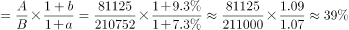

# 基期比重计算

考点：[[20-考点/资料分析/比重/基期比重计算|比重 / 基期比重计算]]
材料：[[15-材料/资料分析/215728 2018年1-7月全国社会消费品零售|215728 2018年1-7月全国社会消费品零售]]

**问法模型**：题干问'2017年1-7月……占……比重约为'（基期时间+部分占整体）→ 采用基期比重模型：A/B × (1+g整体)/(1+g部分)

## 推理链
1. 第1步：定位第1段，现期（2018年1-7月）部分量=限额以上单位消费品零售额81125亿元（其增速记为a），整体量=社会消费品零售总额210752亿元（其增速记为b），所给文本中a、b数值均空缺，须以完整材料增速为准
2. 第2步：题干时间是2017年1-7月（基期），判定为基期比重，公式：基期比重 = 81125/210752 × (1+b)/(1+a)，即现期比重再乘'整体与部分增速的1+g之比'修正
3. 第3步：先截位直除现期比重 81125/210752 ≈ 0.385（约38.5%），再按完整材料的a、b代入 (1+b)/(1+a) 做小幅修正（若a<b则基期比重略高于38.5%，反之略低）
4. 第4步：官方解析代入增速计算后，所得基期比重与D项最接近，故正确答案为D

**最快解法**：⚡ 公式法+截位直除：先算现期比重 81125/210752≈38.5% 锁定量级，再乘修正系数 (1+g总)/(1+g限上)；由g限上与g总的大小关系判断基期比重相对38.5%的升降方向，直接排除方向不符的选项，锁定D

## 易错点
- ⚠ 基期现期混淆：题干问2017年（基期）比重，若直接用现期比重81125/210752≈38.5%作答，极可能落入设置的干扰选项
- ⚠ 基期比重公式方向记反：修正系数应为(1+整体增速)/(1+部分增速)，分子是总额增速g总、分母是限额以上增速g限上，写反会得出反向升降
- ⚠ 时间口径陷阱：必须用'1-7月累计'的210752与81125两个数，切勿误读第2、3段'7月当月'数值或第4段网上零售数据；且所给文本增速空缺，严禁凭印象代数

## 母题抽象
> 🧩 当题干出现'基期年份+部分占整体比重'特征时，用基期比重公式 A/B×(1+g整体)/(1+g部分)：先截位直除现期比重锁定约数，再用部分/整体增速大小关系判断修正方向，验证选项升降方向即可秒杀

**同类特征**：2017年1-7月（基期时间前置）、限额以上单位消费品零售额（部分量81125）、社会消费品零售总额（整体量210752）、占……比重约为、基期比重模型、现期数据取自第1段总量段

## 相关题
- [[10-真题/资料分析/比重/2188466 基期比重计算|2188466]]（黑龙江 2018，相关度3）
- [[10-真题/资料分析/比重/2444066 基期比重计算|2444066]]（江西 2019，相关度3）
- [[10-真题/资料分析/比重/2616071 基期比重计算|2616071]]（云南 2020，相关度3）
- [[10-真题/资料分析/比重/2402471 基期比重计算|2402471]]（重庆 2018，相关度3）
- [[10-真题/资料分析/比重/3522676 基期比重计算|3522676]]（广西 2021，相关度3）

---

### 题干
2017年1-7月，限额以上单位消费品零售额占社会消费品零售总额比重约为：

### 选项
- A. 

- B. 

- C. 

- D. 

　✅

### 官方解析

由题干“2017年1-7月······占······比重约为”，结合材料已知时间为2018年1-7月，可判定本题为基期比重问题。定位文字材料第一段可得：“2018年1-7月份，社会消费品零售总额210752亿元，同比增长。其中，限额以上单位消费品零售额81125亿元，同比增长”，故2017年1-7月，限额以上单位消费品零售额占社会消费品零售总额比重。与D项最接近。

故正确答案为D。

### 给定材料

        2018年1-7月份，社会消费品零售总额210752亿元，同比增长。其中，限额以上单位消费品零售额81125亿元，同比增长。

        按经营单位所在地分，7月份，城镇消费品零售额26388亿元，同比增长；乡村消费品零售额4345亿元。1-7月份，城镇消费品零售额180480亿元，同比增长；乡村消费品零售额30272亿元，同比增长。

        按消费类型分，7月份，餐饮收入3343亿元，同比增长；商品零售27391亿元，同比增长。1-7月份，餐饮收入22800亿元，同比增长；商品零售187951亿元，同比增长。

        2018年1-7月份，全国网上零售额47863亿元，同比增长。其中，实物商品网上零售额36461亿元，同比增长，占社会消费品零售总额的比重为；在实物商品网上零售额中，吃、穿和用类商品分别同比增长、和。

