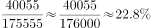
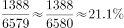

# 现期比重计算（双指标分别占比）

考点：[[20-考点/资料分析/比重/现期比重计算（双指标分别占比）|比重 / 现期比重计算（双指标分别占比）]]
材料：[[15-材料/资料分析/215727 国家统计局公布的2014—2018年|215727 国家统计局公布的2014—2018年]]

**问法模型**：题干出现'2018年夏粮的播种面积和总产量分别占全国…的比重约为'→ 直接用现期量相除，面积、产量两个口径各算一次：部分量÷整体量

## 推理链
1. 第1步：由题干'2018年…分别占…比重'定位2018年统计表'分季节'块，提取夏粮播种面积40055万亩、夏粮总产量1388亿公斤
2. 第2步：同一'全年粮食'行提取整体量：播种面积175555万亩、总产量6579亿公斤（与文字段、条形图2018年数据三处一致，可互验）
3. 第3步：播种面积比重=40055÷175555，总产量比重=1388÷6579，两问分子分母单位各自对应（万亩对万亩、亿公斤对亿公斤）
4. 第4步：截位直除：40055/175555≈0.228即22.8%；1388/6579≈0.211即21.1%；再用单产桥梁验证：夏粮单产346公斤/亩低于全国平均375公斤/亩，故产量占比(21.1%)应小于面积占比(22.8%)，方向吻合
5. 第5步：与选项对照，约22.8%和约21.1%与D项最接近，故选D

**最快解法**：⚡ 截位直除+首两位估算：面积比重40055/175555，首两位40/176→约22.8%；产量比重1388/6579，首两位14/66→约21.1%；辅以'夏粮单产346<全国375'判定产量占比必小于面积占比，直接锁定D

## 易错点
- ⚠ 口径混淆：'夏粮'是季节口径（40055万亩/1388亿公斤），勿误取品种口径的'稻谷'（45284/2121）或'谷物'数据
- ⚠ 分块错位：表中'分季节'与'分品种'是同一总量的两种互斥拆分，取数必须取'分季节'块的夏粮行，不能从'分品种'块或两块交叉取数
- ⚠ 对应关系错配：面积比重须面积除面积、产量比重须产量除产量，分子分母不可交叉搭配；且面积单位万亩、产量单位亿公斤，两问口径不同不可混算

## 母题抽象
> 🧩 当题干出现'现期A（两个指标）分别占B的比重约为'时，直接在同一张截面统计表中取部分量与整体量，同口径相除（部分÷整体）各算一问，可用'部分单产与整体单产的高低'快速校验两比重的相对大小

**同类特征**：现期年份+占…的比重约为、'播种面积和总产量分别占'双指标并列设问、部分量与整体量同在一张截面统计表、无需基期、无增长信息、选项为两个百分数成对出现

## 相关题
（暂无）

---

### 题干
2018年夏粮的播种面积和总产量分别占全国粮食播种面积和总产量的比重约为：

### 选项
- A. 
和

- B. 
和

- C. 
和

- D. 
和
　✅

### 官方解析

由题干“2018年······分别占······的比重约为”，可判定本题为现期比重计算问题。定位表格可得，2018年全国粮食总播种面积175555万亩，总产量6579亿公斤，夏粮播种面积40055万亩，总产量1388亿公斤，则2018年夏粮的播种面积占全国的比重为，总产量占全国比重为，与D项最接近。

故正确答案为D。

### 给定材料

        国家统计局公布的全国粮食生产数据显示，2018年全国粮食播种面积175555万亩，比2017年下降。全国粮食单位面积产量375公斤/亩，比2017年增长。谷物单位面积产量408公斤/亩，比2017年增长。粮食总产量6579亿公斤，比2017年下降；其中谷物（包括稻谷，小麦，玉米、大麦、高粱、荞麦、燕麦等）总产量6102亿公斤，比2017年下降。全年粮食产量虽有所下降，但减幅不大，仍处于高位水平，属于丰收年景。

