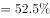
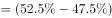
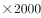
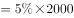
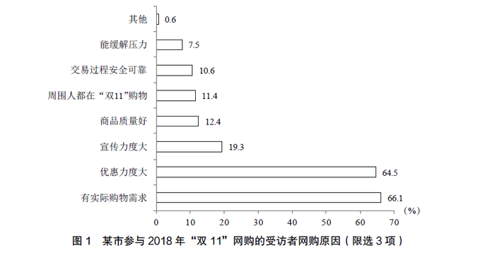
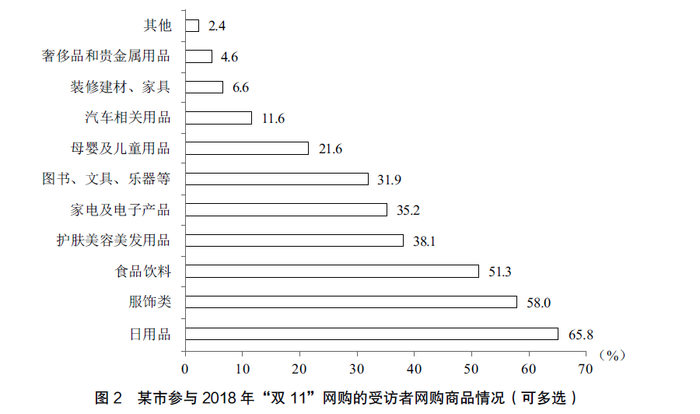

# 现期比重——部分量之差（参与与未参与人数差=总量×占比差）

考点：[[20-考点/资料分析/比重/现期比重——部分量之差（参与与未参与人数差=总量×占比差）|比重 / 现期比重——部分量之差（参与与未参与人数差=总量×占比差）]]
材料：[[15-材料/资料分析/238959 2018年11月中旬某市统计局对全市|238959 2018年11月中旬某市统计局对全市]]

**问法模型**：题干问'参与2018年双11网购的与未参与的相差多少人'→ 只依赖文字段参与率p，用 差=总量×|2p−1| 一式求解，无需动用表和图

## 推理链
1. 第1步：从文字材料提取：调查总样本为2000名18-65周岁常住居民，材料只给比重数据，题问两类人（参与/未参与）的人数之差，判断为现期部分量之差问题
2. 第2步：文字段给出参与2018年'双11'网购的受访者占47.5%（原卷数值，所给文本此处空缺需补齐），则未参与的占比=1−47.5%=52.5%
3. 第3步：所用公式：差=总量×占比差=2000×(52.5%−47.5%)=2000×|2×47.5%−1|=2000×5%
4. 第4步：代入计算：参与人数=2000×47.5%=950人，未参与人数=1050人，差=1050−950=100人
5. 第5步：与选项对照：100人对应A；交叉验证——同组兄弟题'恰有551名受访者网购某商品类别'，950×58.0%（图2服饰类）=551，证明参与率47.5%口径无误，若取52.5%则551对不上图2任何类别

**最快解法**：⚡ 百分点差法（一式直除）：不分别算950和1050，直接 差=2000×|2×参与率−1|=2000×5%=100人；核心口算只有一步——把参与率与50%的偏差（2.5个百分点）加倍后乘总量

## 易错点
- ⚠ 所给文本中参与率空缺，找不到47.5%易无从下手；切勿反设参与率为52.5%——那样参与人数1050人，兄弟题551/1050≈52.5%在图2中无对应类别（51.3%只对应539人），而950×58.0%恰为551，可锁定原卷参与率是47.5%
- ⚠ 基数口径：差值的基数是全体2000名受访者；表、图1、图2的基数是'参与者'子群体（950人），直接用图表占比×2000会严重出错
- ⚠ 差值方向：参与率47.5%<50%，2000×(2p−1)为负值，须取绝对值或先判断'未参与52.5%>参与47.5%'再作差；另注意选项百位陷阱，2000×5%=100不是114/120/131

## 母题抽象
> 🧩 当题干出现'参与X的与未参与X的相差（多少人）'、材料仅给总样本N与参与率p时，用 N×|2p−1| 一式直出；若p在文本中空缺，可用同组题数据（如人数×类别占比）或选项反代验证p的取值

**同类特征**：参与…与未参与…相差、相差…人、仅依赖文字段参与率、样本总量2000名受访者、单一现期时点调查占比、部分量之差=总量×占比差，图表数据为干扰项

## 相关题
（暂无）

---

### 题干
该市受访者中，参与2018年“双11”网购的与未参与的相差

### 选项
- A. 100人　✅
- B. 114人
- C. 120人
- D. 131人

### 官方解析

根据“该市受访者中，参与2018年‘双11’网购的与未参与的相差”，且材料中所给数据为比重数据，判断本题为现期比重问题。定位文字材料，对全市2000名常住居民调查，有的受访者参与了2018年“双11”的网购，则未参与的占比为。因此所求差值人。

故正确答案为A。

### 给定材料

        2018年11月中旬，某市统计局对全市2000名18-65周岁的常住居民进行了有关“双11”网购情况的电话调查。调查结果显示，的受访者参与了2018年“双11”的网购，其中的男性和的女性表示“有实际购物需求”是其参与“双11”网购的原因之一。

> [!warning] 疑点（官方解析可能有误，待人工复核）
> 官方答案A（100人）无争议；但所给材料原文三处百分比为空缺，本题及第1步所用的参与率47.5%系按原卷补齐，验证依据：差=2000×(52.5%−47.5%)=100人，且兄弟题551人=2000×47.5%×58.0%（服饰类）完全吻合，若按52.5%为参与率则无法解释551，故47.5%口径唯一确定，属材料文本缺数而非解析错误

<!-- CODEX-ANSWER-REVIEW:BEGIN -->
### 本次独立复核

**复核状态：** `resolved`（答案与解析已核定）

**计分答案：** A（可计分）

**复核解析：**

材料样本2000人，参与网购47.5%，即950人；未参与1050人。人数差=1050−950=100人，选A。原文字缺少47.5%，公式图可读并直接验证。

**相关信息：**

互补比例为52.5%；总人数×比例差5%=100。

**题源依据：** [固定版本原题](https://github.com/Mentat-Uran/kaogongzhentizhengliu/blob/84ab93d4b64b61d897bece8a1c0a5bab06b4feb2/10-%E7%9C%9F%E9%A2%98/%E8%B5%84%E6%96%99%E5%88%86%E6%9E%90/%E6%AF%94%E9%87%8D/2367971%20%E7%8E%B0%E6%9C%9F%E6%AF%94%E9%87%8D%E2%80%94%E2%80%94%E9%83%A8%E5%88%86%E9%87%8F%E4%B9%8B%E5%B7%AE%EF%BC%88%E5%8F%82%E4%B8%8E%E4%B8%8E%E6%9C%AA%E5%8F%82%E4%B8%8E%E4%BA%BA%E6%95%B0%E5%B7%AE%3D%E6%80%BB%E9%87%8F%C3%97%E5%8D%A0%E6%AF%94%E5%B7%AE%EF%BC%89.md)；固定内容 commit `84ab93d4b64b61d897bece8a1c0a5bab06b4feb2`，Markdown blob `a2b2998eda40ccfe4a2389a123035982851e4aa7`。
<!-- CODEX-ANSWER-REVIEW:END -->
