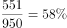

# 现期比重——由部分量反推类别（人数÷参与人数=占比，与图2条形精确匹配）

考点：[[20-考点/资料分析/比重/现期比重——由部分量反推类别（人数÷参与人数=占比，与图2条形精确匹配）|比重 / 现期比重——由部分量反推类别（人数÷参与人数=占比，与图2条形精确匹配）]]
材料：[[15-材料/资料分析/238959 2018年11月中旬某市统计局对全市|238959 2018年11月中旬某市统计局对全市]]

**问法模型**：题干给出'恰有551名受访者'购买某类别的人数 → 用 人数÷整体(参与人数)=比重 的现期比重模型，先确定图2基数（参与者950人），再算551÷950=58%与图2各条形精确对照

## 推理链
1. 第1步：从材料提取条件——全市调查2000名常住居民；图2《网购商品情况（可多选）》标题限定基数为'参与2018年双11网购的受访者'，而非全体2000人
2. 第2步：结合上一题结论（文字段参与率47.5%），参与网购人数 = 2000 × 47.5% = 950人，即图2的真实基数
3. 第3步：所用规则——图2为可多选占比，某类别人数 = 参与人数 × 该类别占比；反向则 551 ÷ 950 = 该类别占参与者的比重
4. 第4步：代入计算：551 ÷ 950 = 0.58，即58.0%
5. 第5步：对照图2——服饰类占比恰为58.0%，精确命中；同时验证其余选项：日用品950×65.8%≈625人、食品饮料950×51.3%≈487人、家电及电子产品950×35.2%≈334人、母婴及儿童用品950×21.6%≈205人，均不等于551
6. 第6步：结论——恰有551人购买的类别为服饰类，答案选A

**最快解法**：⚡ 乘法整除验证（逆向匹配）：先锁定参与人数950，直接心算 950×58.0%=551 精确命中服饰类；其余选项快速排除——950×65.8%≈625、950×51.3%≈487、950×35.2%≈334、950×21.6%≈205；或用截位直除 551÷950 看首两位得58，去图2找58.0%的条形

## 易错点
- ⚠ 基数错用：图2标题限定'参与网购的受访者'，基数为950人而非2000人；若用551÷2000=27.55%去图2匹配，找不到任何对应类别
- ⚠ 跳步依赖：本题必须先由文字段参与率算出参与人数950（与上一题连环复用基数），直接拿551与图2百分比硬凑会误配
- ⚠ 多选占比陷阱：图2'可多选'合计327.1%远超100%，一人可计入多类，占比不能相加当人数比例；另注意'恰有551'要求精确匹配，服饰类950×58.0%=551恰为整数无舍入误差，其余选项均有明显差距

## 母题抽象
> 🧩 当题干出现'恰有N人属于某子群体类别'且图表占比基数为子群体时，先用'总样本×子群体率'求出真实基数，再用 N÷基数 得比重，在图中找精确相等的条形即为答案（优先用基数×占比做乘法验证能否整除命中）

**同类特征**：恰有551名受访者、网购的商品类别是、可多选占比反推人数、现期比重、需先求参与人数（与上一题连环）、精确匹配条形占比

## 相关题
- [[10-真题/资料分析/比重/4792819 现期比重计算（多部分比重依次求解）|4792819]]（新疆 2014，相关度1）
- [[10-真题/资料分析/比重/827355 现期比重比较（部分占比过半速判）|827355]]（政法干警 2014，相关度1）
- [[10-真题/资料分析/比重/2272297 现期比重比较|2272297]]（选调 2015，相关度1）
- [[10-真题/资料分析/比重/2032972 现期比重计算（多地区占比求和）|2032972]]（吉林 2015，相关度1）
- [[10-真题/资料分析/比重/2187857 现期比重计算（部分量需先由'总量−其中量'减法间接求得）|2187857]]（山东 2018，相关度1）

---

### 题干
该市恰有551名受访者2018年“双11”网购的商品类别是

### 选项
- A. 服饰类　✅
- B. 家电及电子产品
- C. 食品饮料
- D. 母婴及儿童用品

### 官方解析

根据“该市恰有551名受访者2018年“双11”网购的商品类别是”，材料中为比重数据，判断本题为现期比重。定位文字材料和第二个图形，对全市2000名常住居民调查，结合上一题，有参与了网购。则受访者中参与网购的有人。551名受访者在其中所占的比重为，定位第二个图形，正好是服饰类（）。

故正确答案为A。

### 给定材料

        2018年11月中旬，某市统计局对全市2000名18-65周岁的常住居民进行了有关“双11”网购情况的电话调查。调查结果显示，的受访者参与了2018年“双11”的网购，其中的男性和的女性表示“有实际购物需求”是其参与“双11”网购的原因之一。

> [!warning] 疑点（官方解析可能有误，待人工复核）
> 所给材料原文与官方解析中参与率数值均空缺（'____的受访者参与了网购'），解析也未写出参与人数；按官方答案A反推唯一自洽口径为参与人数950人（参与率47.5%），且950×58.0%=551精确成立，与官方解析逻辑一致，不影响答案A
