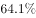
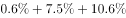
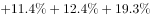
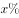
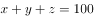
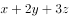
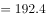

# 现期比重最值——多选'限选N项'占比合计模型（占比合计÷N）

考点：[[20-考点/资料分析/比重/现期比重最值——多选'限选N项'占比合计模型（占比合计÷N）|比重 / 现期比重最值——多选'限选N项'占比合计模型（占比合计÷N）]]
材料：[[15-材料/资料分析/238959 2018年11月中旬某市统计局对全市|238959 2018年11月中旬某市统计局对全市]]

**问法模型**：题干出现'选择3种网购原因的占比至多为'（限选3项的多选题+最值问法）→ 采用'占比合计÷限选次数'模型：图1八项占比之和192.4%全部堆给选满3项者，至多占比=192.4%÷3≈64.1%

## 推理链
1. 第1步：定位图1《某市参与2018年'双11'网购的受访者网购原因（限选3项）》，基数是'参与者'，8项原因占比依次为：其他0.6%、能缓解压力7.5%、交易过程安全可靠10.6%、周围人都在'双11'购物11.4%、商品质量好12.4%、宣传力度大19.3%、优惠力度大64.5%、有实际购物需求66.1%
2. 第2步：因'限选3项'可多选，八项占比之和=0.6+7.5+10.6+11.4+12.4+19.3+64.5+66.1=192.4%，即全体参与者'原因选择总次数'折合占比192.4%（人均约1.924次）
3. 第3步：设选1种、2种、3种原因的受访者占比分别为x、y、z，则选择总次数满足x+2y+3z=192.4%，且x+y+z≤100%（允许部分受访者不选原因）
4. 第4步：要使z（选满3种者占比）最大，应让其余人占用的选择次数最少，取x=0、y=0，则3z=192.4%
5. 第5步：解得z≤192.4%÷3≈64.1%，即选择3种网购原因的占比至多约64.1%
6. 第6步：对照选项，B（64.1%）与计算结果一致，故正确答案为B

**最快解法**：⚡ '占比合计÷限选次数'极限模型（极端放缩）：把192.4%全部压给选满3项的人，一步出答案192.4%÷3≈64.1%；口算验证64×3=192，故约64.1%，无需解方程组

## 易错点
- ⚠ 误加'每人至少选1项'的隐含约束：若错误地令x+y+z=100%，会解出z=(192.4%−100%)÷2=46.2%的偏小值；'至多'问法下应允许其余受访者选0项，正确结果为64.1%
- ⚠ 忽视多选口径：直接取图1最大单项66.1%（有实际购物需求）作答，或误把合计192.4%当作'选3种原因者占192.4%'
- ⚠ 图表定位与基数陷阱：图1基数是'参与者'而非2000名全体受访者，且易与图2（可多选商品、合计327.1%）或支出表混淆；此外8项求和时漏加小项（如0.6%、12.4%）会导致合计不等于192.4%

## 母题抽象
> 🧩 当题干出现'可多选/限选N项……的占比至多为'时，先把各分项占比求和得占比合计S，再用S÷N即得'选满N项'的至多占比（其余人选择次数趋零），最后验证该值×N=S且结果≤100%

**同类特征**：占比至多为、限选3项、网购原因（多选题）、占比合计192.4%、参与者基数、最值/极端假设问法

## 相关题
（暂无）

---

### 题干
该市参与2018年“双11”网购的受访者中，选择3种网购原因的占比至多为

### 选项
- A. 

- B. 

　✅
- C. 

- D. 

### 官方解析

根据“占比至多为······”，可判定本题为现期比重问题。定位统计图1，某市参与2018年“双11”网购的受访者中，各种原因的比例分别为：、、、、、、、，各占比总和为：。设选择一个选项的受访者占比，选择两个选项的受访者占比，选择三个选项的受访者占比（最多同时选择三项）。则······，······，可得：，若要最大，则，。因此选择三种网购原因的占比至多为。

故正确答案为B。

### 给定材料

        2018年11月中旬，某市统计局对全市2000名18-65周岁的常住居民进行了有关“双11”网购情况的电话调查。调查结果显示，的受访者参与了2018年“双11”的网购，其中的男性和的女性表示“有实际购物需求”是其参与“双11”网购的原因之一。

