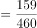
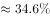

# 现期比重计算（部分=农村无酬劳动用时，整体=农村劳动总用时，需自构整体口径）

考点：[[20-考点/资料分析/比重/现期比重计算（部分=农村无酬劳动用时，整体=农村劳动总用时，需自构整体口径）|比重 / 现期比重计算（部分=农村无酬劳动用时，整体=农村劳动总用时，需自构整体口径）]]
材料：[[15-材料/资料分析/238952 2018年国家统计局第二次全国时间利|238952 2018年国家统计局第二次全国时间利]]

**问法模型**：题干出现'A占其B的比重'且A、B均为'小时+分钟'混写的日均用时 → 先统一换算为分钟，再确认整体口径（劳动=有酬+无酬），用 部分÷整体 求比重

## 推理链
1. 第1步：从材料提取农村居民两笔数据：有酬劳动平均用时5小时1分钟，无酬劳动平均用时2小时39分钟
2. 第2步：换算规则1小时=60分钟：5小时1分=5×60+1=301分钟，2小时39分=2×60+39=159分钟
3. 第3步：确认口径——'劳动平均用时'=有酬+无酬=301+159=460分钟（材料导读明确整体应取有酬+无酬合计）
4. 第4步：代入比重公式：无酬/劳动总用时=159/460
5. 第5步：直除计算159÷460≈0.3457，即约34.6%
6. 第6步：与选项对照，B项即159/460（约34.6%），故选B

**最快解法**：⚡ 截位直除+先换算：两组'小时+分钟'先口算成分钟（301、159），整体301+159=460，比重159/460，直除首位得3、次位4即34.6%，直接匹配B；亦可估算160/460≈34.8%就近锁定

## 易错点
- ⚠ 整体口径陷阱：'劳动平均用时'若误只取有酬（301）或只取无酬（159）作分母，比重即错，必须为有酬+无酬=460分钟
- ⚠ 小时-分钟换算陷阱：'5小时1分钟'易被当5.1小时或501分钟处理，'2小时39分钟'易被当2.39小时，必须先换算为301分钟、159分钟再运算
- ⚠ 时间口径陷阱：材料区分工作日/休息日，但本题农村数据为整体日均口径，不可误用工作日4小时50分或休息日数值；且不可把48580人样本量卷入计算

## 母题抽象
> 🧩 当题干出现'A占其B的比重'且A、B为'小时+分钟'混写的日均用时特征时，先统一换算为分钟，再确认整体口径（本题劳动=有酬+无酬之和），用部分÷整体直除即得答案

**同类特征**：农村居民、无酬劳动平均用时、占、劳动平均用时、比重、每日/一天的活动中

## 相关题
- [[10-真题/资料分析/比重/2060616 现期比重计算|2060616]]（深圳市考 2017，相关度2）
- [[10-真题/资料分析/比重/1752600 两期比重变化（比重差，百分点表述）|1752600]]（北京 2016，相关度1）
- [[10-真题/资料分析/比重/2367766 现期比重计算（部分=农村无酬用时，整体=农村有酬+无酬合计）|2367766]]（江苏 2019，相关度1）
- [[10-真题/资料分析/比重/2434312 基期比重计算|2434312]]（新疆 2019，相关度1）

---

### 题干
受访农村居民每日无酬劳动平均用时占其劳动平均用时的比重为

### 选项
- A. 

- B. 

　✅
- C. 

- D. 

### 官方解析

“居民在一天的活动中，有酬劳动······农村居民5小时1分钟；无酬劳动······农村居民2小时39分钟”，统一单位为分钟，则受访农村居民在一天的活动中，有酬劳动301分钟；无酬劳动159分钟，故受访农村居民每日无酬劳动平均用时占其劳动平均用时的比重。

故正确答案为B。

### 给定材料

        2018年国家统计局组织开展了第二次全国时间利用的随机抽样调查，共调查48580人。结果显示，受访居民在一天的活动中，有酬劳动平均用时4小时24分钟。其中，男性5小时15分钟，女性3小时35分钟；城镇居民3小时59分钟，农村居民5小时1分钟；工作日4小时50分钟，休息日3小时19分钟。受访居民有酬劳动的参与率为，其中城镇居民。受访居民无酬劳动平均用时2小时42分钟。其中，女性3小时48分钟；农村居民2小时39分钟；工作日2小时34分钟。受访居民无酬劳动的参与率为，其中男性。

        无酬劳动包括家务劳动、陪伴照料孩子生活、护送辅导孩子学习、陪伴照料成年家人、购买商品或服务、看病就医和公益活动。受访居民家务劳动平均用时1小时26分钟，参与率为。其中，女性2小时6分钟，参与率。受访居民陪伴照料孩子生活平均用时36分钟，参与率为；护送辅导孩子学习平均用时9分钟，参与率为；陪伴照料成年家人平均用时8分钟，参与率为；看病就医平均用时4分钟，参与率为；公益活动平均用时3分钟，参与率为。

