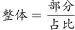
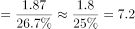

# 现期比重逆推整体（整体=部分÷比重）

考点：[[20-考点/资料分析/比重/现期比重逆推整体（整体=部分÷比重）|比重 / 现期比重逆推整体（整体=部分÷比重）]]
材料：[[15-材料/资料分析/239235 2018年我国全社会用电量（分三次产|239235 2018年我国全社会用电量（分三次产]]

**问法模型**：题干问2018年发电总量（整体未知），材料给出部分量（可再生能源发电量1.87万亿千瓦时）及其占全年发电总量的比重 → 用现期比重模型：整体=部分÷比重

## 推理链
1. 第1步：从文字第二段提取条件：2018年可再生能源发电量1.87万亿千瓦时（=18700亿千瓦时，与表格2018年18700亿千瓦时互相印证），占全年发电总量比重为X%（原卷补全数值，材料所给版本空缺，另知该比重同比上升0.2个百分点）
2. 第2步：题干求2018年发电总量即整体，已知部分量和其所占比重，套用公式：整体（发电总量）=部分（可再生能源发电量）÷比重
3. 第3步：代入计算：发电总量=1.87万亿千瓦时÷X%；按正确答案D反推X≈26.7%（1.87÷0.267≈7.00），实际代入须以原卷补全的比重数值为准
4. 第4步：与选项对照：计算结果约为7.00万亿千瓦时，与D项最接近；A项1.87恰为部分量本身，B、C量级不符，排除后锁定D

**最快解法**：⚡ 公式法+截位直除：发电总量=1.87÷26.7%≈1.87÷0.267≈7.00万亿千瓦时；考场亦可先排除A（1.87是部分不是整体），再用选项反代验证1.87÷7.00≈26.7%与材料比重吻合

## 易错点
- ⚠ 部分与整体混淆：A项1.87万亿千瓦时是可再生能源发电量（部分），不是发电总量（整体），直接照抄材料数字会误选A
- ⚠ 单位量级陷阱：文字'1.87万亿千瓦时'=表格'18700亿千瓦时'，若用18700÷26.7%≈70000亿千瓦时，须换算回7.00万亿千瓦时再对选项，否则量级对不上
- ⚠ 材料中'占全年发电总量比重'数值空缺，切勿把'同比上升0.2个百分点'当成比重本身使用，也不得凭空杜撰比重数值，须以原卷补全数据代入

## 母题抽象
> 🧩 当题干求某整体总量、材料只给'部分量+部分占整体的比重'时，直接用整体=部分÷比重（截位直除），并把结果与选项核对单位换算（万亿/亿）后择最接近项

**同类特征**：求整体：'发电总量约为'（整体未知）、已知部分量：可再生能源发电量1.87万亿千瓦时、已知'占全年发电总量比重为__'、现期（2018年）直接计算，无基期、选项含部分量1.87作干扰项、单位为万亿千瓦时，与表格亿千瓦时需换算

## 相关题
（暂无）

---

### 题干
2018年，我国发电总量约为（    ）万亿千瓦时。

### 选项
- A. 1.87
- B. 3.70
- C. 5.84
- D. 7.00　✅

### 官方解析

由题干“2018年我国发电总量约为多少万亿千瓦时”，结合材料给出2018年可再生能源发电量及其占全年发电总量比重，可判定本题为现期比重问题。定位文字材料第二段，“2018年我国可再生能源发电量达1.87万亿千瓦时，占全年发电总量比重为”，根据，2018年我国发电总量万亿千瓦时，与D项最接近。

故正确答案为D。

### 给定材料

        2018年，我国全社会用电量68449亿千瓦时，同比增长，增幅同比提高1.9个百分点。具体来看，第一产业用电量728亿千瓦时，同比增长；第二产业用电量47235亿千瓦时，同比增长；第三产业用电量10801亿千瓦时，同比增长；城乡居民生活用电量9685亿千瓦时，同比增长。

        2018年，我国可再生能源发电量达1.87万亿千瓦时，同比增长约1700亿千瓦时；可再生能源发电量占全年发电总量比重为，同比上升0.2个百分点。

> [!warning] 疑点（官方解析可能有误，待人工复核）
> 所给材料文字段中'占全年发电总量比重'数值空缺，官方解析中公式亦未显示具体比重值；按正确答案D反推比重≈1.87÷7.00≈26.7%（与'同比上升0.2个百分点'的表述口径相容），实际计算须以原卷补全的比重数值为准，不得视为官方解析给出26.7%这一明确数字。
