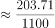
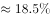

# 现期比重计算（流量占存量比重）

考点：[[20-考点/资料分析/比重/现期比重计算（流量占存量比重）|比重 / 现期比重计算（流量占存量比重）]]
材料：[[15-材料/资料分析/239248 B省2015-2018年市场主体发展|239248 B省2015-2018年市场主体发展]]

**问法模型**：题干'2018年A占B的（比重）'且选项为百分数 → 现期比重 = 现期分子÷现期分母，直接代入一步除法

## 推理链
1. 第1步：题干求'第三产业新登记市场主体'占'全省实有各类市场主体'的比重，时间同为2018年，属跨段落取数的现期比重问题
2. 第2步：取分子——文字第二段：2018年第三产业新登记市场主体203.71万户（当年流量）；取分母——统计表：2018年末实有各类市场主体1146.13万户（年末存量）
3. 第3步：代入现期比重公式：比重 = 203.71 ÷ 1146.13
4. 第4步：截位直除：203.71/1146.13 ≈ 204/1146 ≈ 17.77%，约17.8%
5. 第5步：与选项对照，计算结果与B项最接近，故正确答案为B

**最快解法**：⚡ 截位直除：将203.71/1146.13分子分母各截三位为204/1146，首位商1、次位商7，约为17.8%，对照选项直接锁定B，无需精算

## 易错点
- ⚠ 口径混淆：分子须用'新登记'（流量203.71万户），分母须用'实有'（存量1146.13万户）；若错把分子取成第三产业实有978.92万户或分母取成新登记229.74万户，结果完全错误
- ⚠ 数据源陷阱：文字中2018年新登记总数为229.74万户、表中为229.76万户，本题分子只取第三产业新登记数203.71万户（文字段数据），不涉及该差异，但取数时须按题目指定口径定位段落
- ⚠ 单位量级陷阱：'日均新登记6294户'单位是户，与万户相差1万倍，本题不用该数据，勿被干扰代入

## 母题抽象
> 🧩 当题干出现'现期某流量占某存量/总量的比重'且选项为百分数时，直接用现期分子÷现期分母做截位直除，取数前先辨清'新登记（流量）/实有（存量）'口径并跨'文字+表格'定位

**同类特征**：约占、第三产业新登记市场主体、全省实有各类市场主体、2018年（现期）、选项为百分数、需跨文字段与统计表拼接取数

## 相关题
- [[10-真题/资料分析/比重/2741671 增长量计算+增量比重（现期比重，分子分母均为同比增量）|2741671]]（山东 2021，相关度2）
- [[10-真题/资料分析/比重/2144616 现期比重计算（部分占各部分合计的比重）|2144616]]（选调 2018，相关度2）
- [[10-真题/资料分析/增长/2579797 一般增长率计算（两期定基比较：现期2018年对基期2011年）|2579797]]（浙江 2020，相关度2）
- [[10-真题/资料分析/比重/2606258 现期比重计算（两类别合并占比）|2606258]]（广东 2020，相关度2）
- [[10-真题/资料分析/增长/9629 一般增长率计算（现期需由增量倒推）|9629]]（安徽 2009，相关度1）

---

### 题干
2018年，B省第三产业新登记市场主体约占全省实有各类市场主体的（    ）。

### 选项
- A. 

- B. 

　✅
- C. 

- D. 

### 官方解析

根据题干“2018年······占······”，结合选项为百分数，可判定本题为现期比重问题。定位文字材料第二段可知，2018年第三产业新登记市场主体数为203.71万户，定位表格材料可知，2018年实有各类市场主体为1146.13万户，则比重，与B项最接近。

故正确答案为B。

### 给定材料

        近年来，B省营商环境不断优化，市场活力不断增强，新登记市场主体都保持较快增长势头。2018年，全省新登记市场主体229.74万户，日均新登记市场主体6294户，同比增长。

        全省产业结构也进一步调整优化，新登记市场主体主要集中在第三产业。2018年，全省三大产业新登记市场主体分别为第一产业2.02万户，第二产业24.01万户，第三产业203.71万户。截止2018年12月末，全省三大产业的实有各类市场主体户数分别为9.83万户，157.38万户，978.92万户。

        2018年，全省新登记企业最集中的三个行业分别是批发和零售业、租赁和商务服务业、制造业，新登记企业数分别为36.14万户、15.19万户、9.25万户，分别同比增长、增长、下降。

