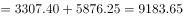
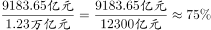

# 现期比重计算（部分-整体，构成分项加总求分子）

考点：[[20-考点/资料分析/比重/现期比重计算（部分-整体，构成分项加总求分子）|比重 / 现期比重计算（部分/整体，构成分项加总求分子）]]
材料：[[15-材料/资料分析/239311 2017年我国渔业经济情况：全社会渔|239311 2017年我国渔业经济情况：全社会渔]]

**问法模型**：'2017年渔业产值中，养殖产值占比约为'→现期比重模型：占比=养殖产值（海水养殖+淡水养殖之和）÷渔业产值整体，需同时锁定苗种口径与万亿元→亿元换算

## 推理链
1. 第1步：题干求2017年（现期）'渔业产值中养殖产值占比'，定位材料第二段取分子、第一段取分母，模型为比重=部分÷整体
2. 第2步：分子养殖产值=海水养殖3307.40亿元+淡水养殖5876.25亿元=9183.65亿元（水产苗种680.80亿元在段2单列，不属于养殖，不得计入分子）
3. 第3步：分母渔业产值=1.23万亿元=12300亿元，与第二段五个分项加总12313.85亿元（1987.65+3307.40+461.75+5876.25+680.80）基本一致，可互验
4. 第4步：代入计算：占比=9183.65÷12313.85≈74.6%（若用约数12300亿元作分母约74.7%，精度差异不影响选项判断）
5. 第5步：与选项对照，仅B项约74.6%与计算结果吻合，故正确答案为B

**最快解法**：⚡ 截位直除：分子=3307.40+5876.25≈9184亿元，分母取12313.85亿元，同截三位得918÷123≈7.46，即约74.6%，直接锁定B

## 易错点
- ⚠ 苗种口径坑：水产苗种680.80亿元单列，分子不能误加苗种，分母也不能误用'不含苗种'口径（11633.05亿元作分母会得约79%而出错），本题分母为渔业产值全口径12313.85亿元
- ⚠ 单位换算坑：分母'1.23万亿元'必须换成12300亿元再除，直接用1.23参与计算会差一万倍
- ⚠ 跨维度混淆坑：'养殖/捕捞'在产值段与产量段各有一套数值，若误用产量口径4905.99÷6445.33≈76.1%，会错选相邻干扰项

## 母题抽象
> 🧩 当题干出现'某年X中Y占比约为'且材料分层给出Y的构成项与X总值时，先按口径圈定分子（单列项是否计入）与分母（全口径或剔除口径），统一单位后用截位直除求Σ部分÷整体

**同类特征**：现期占比、部分占整体、养殖产值、渔业产值、分项加总、万亿元与亿元混用

## 相关题
- [[10-真题/资料分析/比重/2578475 现期比重比较（产值贡献率）|2578475]]（内蒙古 2020，相关度1）
- [[10-真题/资料分析/比重/2578488 现期比重计算|2578488]]（内蒙古 2020，相关度1）
- [[10-真题/资料分析/比重/17764864 现期比重计算（部分占整体，单位量级统一）|17764864]]（湖北 2024，相关度1）

---

### 题干
2017年渔业产值中，养殖产值占比约为

### 选项
- A. 

- B. 

　✅
- C. 

- D. 

### 官方解析

根据题干“2017年……中……占比约为”，可判定本题为现比重问题。定位文字材料第二段可得：“海水养殖产值3307.40亿元，……，淡水养殖产值5876.25亿元”，故养殖产值亿元。定位文字材料第一段可得：“渔业产值1.23万亿元”，故2017年渔业产值中，养殖产值的占比为：。

故正确答案为B。

### 给定材料

根据以下资料，回答下列问题。

        据统计，按当年价格计算，2017年我国全社会渔业经济总产值2.48万亿元，其中渔业产值1.23万亿元，渔业工业和建筑业产值0.57万亿元，渔业流通和服务业产值0.68万亿元。

        渔业产值中，海洋捕捞产值1987.65亿元，海水养殖产值3307.40亿元，淡水捕捞产值461.75亿元，淡水养殖产值5876.25亿元，水产苗种产值680.80亿元。

        渔业产值中（不含苗种），海水产品与淡水产品的产值比例为，养殖产品与捕捞产品的产值比例为。

        据对全国1万户渔民家庭收支情况调查，2017年全国渔民人均纯收入18452.78元，比上年增长。

        2017年，全国水产品总产量6445.33万吨，比上年增长。其中，养殖产量4905.99万吨，同比增长；捕捞产量1539.34万吨，同比降低；养殖产品与捕捞产品的产量比例为，海水产品产量3321.74万吨，同比增长；淡水产品产量3123.59万吨，同比增长；海水产品与淡水产品的产量比例为。

        2017年，全国水产品人均占有量46.37千克（总人口139008万人），比上年减少0.23千克，降低。

