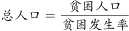
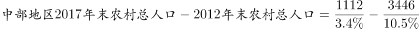
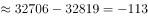

# 比重求整体（整体=部分÷比重）之两期整体量差值比较

考点：[[20-考点/资料分析/比重/比重求整体（整体=部分÷比重）之两期整体量差值比较|比重 / 比重求整体（整体=部分÷比重）之两期整体量差值比较]]
材料：[[15-材料/资料分析/239333 党的十八大以来（2012—2017年|239333 党的十八大以来（2012—2017年]]

**问法模型**：题干先给出'贫困发生率=贫困人口÷总人口'的定义，再比较两期农村总人口 → 两期整体量各自=部分量÷对应期比重，分别反推后作差（两期比重公式求整体）。

## 推理链
1. 第1步：由题干定义'贫困发生率=贫困人口/总人口'可得：某年末农村总人口=该年末农村贫困人口÷该年末贫困发生率；材料第二段给出中部贫困人口2012年末3446万人→2017年末1112万人，发生率下降7.1个百分点（原值10.5%→3.4%，与7.1个百分点自洽）。
2. 第2步：所用公式：整体量=部分量÷比重，即总人口=贫困人口÷贫困发生率，对2012、2017两期分别套用。
3. 第3步：2012年末总人口=3446÷10.5%≈32819万人（截位直除：3446÷10.5≈328.2）。
4. 第4步：2017年末总人口=1112÷3.4%≈32706万人（1112÷3.4≈327.1）。
5. 第5步：两期作差：32819−32706≈113万人，2017年末小于2012年末，即总人口减少约113万人。
6. 第6步：与选项对照：'减少了约113万人'对应A；B量级不符，C、D方向相反，均排除。

**最快解法**：⚡ 公式法（整体=部分÷比重）+截位直除：先定方向——3446/1112≈3.10＞10.5/3.4≈3.09，故2012年末总人口更大（为'减少'，排除C、D）；再定量级——1112÷3.4%≈32706万人为基准，差值约为总人口的0.3%（0.35%×32706≈113万），锁定A。

## 易错点
- ⚠ 部分量与整体量混淆：误把'贫困人口累计减少2334万人'或'下降幅度%'当成总人口变化；实际因发生率同步大幅下降（分母几乎未变），总人口仅减少约113万人，与2334万量级相差20余倍。
- ⚠ 个百分点与%混用：'下降7.1个百分点'是两期发生率之差，不是发生率相对降幅，更不是总人口降幅；须先用它还原两期发生率10.5%→3.4%再套公式。
- ⚠ 所给文本中发生率起止值空缺：若误补其他区域数值（如连片特困地区3.4%、西部12.0pp）或凭空编数即错；本题依赖与7.1个百分点自洽的原值10.5%/3.4%。

## 母题抽象
> 🧩 当题干先给出'某率=部分÷整体'的定义、并要求比较两期整体量（如总人口、总产量）变化时，用'整体=部分÷率'分别反推两期整体再作差；若两期率值未直接给出，先用'下降/上升N个百分点'还原起止率，再用截位直除判定方向与量级。

**同类特征**：题干先行给出指标定义（贫困发生率=低于贫困线人口/总人口）、与2012年末相比…2017年末…总人口（两期整体量对比）、材料只给部分量（贫困人口）两期数值与发生率变化（下降7.1个百分点）、整体量不能直接查到，必须由部分÷比重反推、选项形式为'增加了/减少了约××万人'的差值型选项

## 相关题
（暂无）

---

### 题干
贫困发生率指的是低于贫困线的人口占总人口的比例，由材料数据可知，与2012年末相比，我国中部地区2017年末农村总人口：

### 选项
- A. 减少了约113万人　✅
- B. 减少了约280万人
- C. 增加了约113万人
- D. 增加了约280万人

### 官方解析

根据题干“贫困发生率指的是低于贫困线的人口占总人口的比例”，结合材料给出贫困人口，求两年总人口的差，可判定本题为现期比重问题。定位文字材料第二段“中部地区农村贫困人口由2012年末的3446万人减少到2017年末的1112万人，······农村贫困发生率由下降到”，由可得，万人，即与2012年末相比，我国中部地区2017年末农村总人口减少了约113万人。

故正确答案为A。

### 给定材料

根据以下资料，回答下列问题。 

        党的十八大以来，党中央，国务院实施精准扶贫、精准脱贫基本方略，深入实施东西部扶贫协作，区域性整体贫困明显缓解，为实现到2020年现行标准下农村贫困人口脱贫，贫困县全部摘帽，解决区域性整体贫困打下了坚实基础。

        从地区看，东部地区已率先基本脱贫，中西部地区贫困人口数量全面下降，2017年末，东部地区农村贫困人口300万人，比2012年末减少1067万人，五年累计下降；农村贫困发生率由2012年末的下降到，下降3.1个百分点，已率先基本实现脱贫。中部地区农村贫困人口由2012年末的3446万人减少到2017年末的1112万人，累计减少2334万人，下降幅度为。农村贫困发生率由下降到，下降7.1个百分点。西部地区农村贫困人口由2012年末的5086万人减少到2017年末的1634万人，累计减少3452万人，下降幅度为；农村贫困发生率由2012年末的下降到2017年末的，下降12.0个百分点。

        从贫困区域看，贫困地区、集中连片特困地区，民族八省区减贫成效更加突出，区域性整体贫困明显缓解。贫困地区2017年末农村贫困人口1900万人，比2012年末减少4139万人，减贫规模占全国农村减贫总规模的六成；农村贫困发生率从2012年末的下降至2017年末的，五年累计下降16.0个百分点，年均下降3.2个百分点。集中连片特困地区2017年末农村贫困人口1540万人，比2012年末减少3527万人，下降幅度为；农村贫困发生率从2012年末的下降至2017年末的，累计下降17.0个百分点，年均下降3.4个百分点。内蒙古、广西、贵州、云南、西藏、青海、宁夏、新疆等民族八省区2017年末农村贫困人口1032万人，比2012年末减少2089万人，下降幅度为，减贫规模占全国农村减贫规模的三成；农村贫困发生率从2012年末的下降至2017年末的，累计下降14.2个百分点，年均下降2.8个百分点。

> [!warning] 疑点（官方解析可能有误，待人工复核）
> 所给材料文本中中部贫困发生率起止%数值为空缺（导读亦要求'不得凭常识补数'），官方解析实际使用原题数值10.5%→3.4%：其与材料明确给出的'下降7.1个百分点'自洽，且3446÷10.5%−1112÷3.4%≈113万恰与答案A吻合，官方答案本身无矛盾，予以保留；仅提示：若严格限定只用空缺文本，本题无法独立复算。
