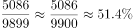
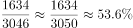
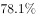
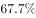
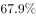
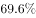
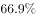

# 两期比重计算与比较（西部占全国比重，需跨段拼合全国总量）

考点：[[20-考点/资料分析/比重/两期比重计算与比较（西部占全国比重，需跨段拼合全国总量）|比重 / 两期比重计算与比较（西部占全国比重，需跨段拼合全国总量）]]
材料：[[15-材料/资料分析/239333 党的十八大以来（2012—2017年|239333 党的十八大以来（2012—2017年]]

**问法模型**：题干给出'2012年末和2017年末西部地区农村贫困人口占全国农村贫困人口比重'并要求判断两期大小关系及与阈值的关系 → 分别用'西部人口÷全国人口'计算两期比重，再比大小、对阈值

## 推理链
1. 第1步：从材料第二段提取西部数据：2012年末农村贫困人口5086万人，2017年末1634万人（累计减少3452万人）
2. 第2步：全国总量不能直接取数，须东+中+西拼合：2012年末=1367+3446+5086=9899万人，2017年末=300+1112+1634=3046万人（即本篇第101题/小题1的锚定量）
3. 第3步：比重公式：某期比重=该期西部农村贫困人口÷该期全国农村贫困人口
4. 第4步：代入计算——2012年末比重=5086÷9899≈51.4%，2017年末比重=1634÷3046≈53.6%
5. 第5步：比较两期：53.6%＞51.4%，故2017年末比重高于2012年末（方向亦可由降幅判断：西部降幅3452÷5086≈68%＜全国降幅6853÷9899≈69.2%，部分降得慢则占比升）；且51.4%、53.6%均高于50%
6. 第6步：对照选项——'2017年末高于2012年末，且均高于50%'仅B项符合，故选B

**最快解法**：⚡ 截位直除+过半验证：5086÷9899，看半数4949.5，5086明显过半→约51.4%；1634÷3046，看半数1523，1634明显过半→约53.6%；两期均＞50%且现期更大，直接锁定B，无需精算到小数

## 易错点
- ⚠ 分母陷阱：全国农村贫困人口必须由东+中+西拼合（9899、3046），若误把贫困地区6039、连片特困5067、民族八省3121等交叉重叠口径加总，或直接用西部分段外的其他数据做分母，比重全错
- ⚠ 方向直觉错误：西部贫困人口从5086降到1634，易凭'人口大幅减少'误判占比下降；实际西部降幅约68%略小于全国降幅约69.2%，占比不降反升
- ⚠ 选项中四个'低于/高于50%'的搭配需两期同时验证，只算一期（如只算2017年）会误选A或C

## 母题抽象
> 🧩 当题干要求判断'某部分占总体比重'在两期的高低及是否超过某阈值时，先拼出两期总体量，用'部分÷总体'分别算两期比重（或用部分降幅与总体降幅比大小定方向），再与阈值（如50%）对照排除选项

**同类特征**：两期比重比较、占全国……比重、西部地区农村贫困人口、2012年末和2017年末、高于/低于某一百分比、需跨段拼合全国总量

## 相关题
- [[10-真题/资料分析/综合/10204448 综合分析-逐项判断（历史极值确认、两期比重比较、多期累计求和、基期比重）|10204448]]（广东 2024，相关度1）
- [[10-真题/资料分析/比重/17097813 两期比重比较（比重差计算）|17097813]]（山西 2024，相关度1）
- [[10-真题/资料分析/比重/1746802 两期比重变化比较（增速比较法，连续两年判断）|1746802]]（国考 2016，相关度1）
- [[10-真题/资料分析/比重/2136660 两期比重变化比较（比重上升判断）|2136660]]（河南 2017，相关度1）
- [[10-真题/资料分析/比重/2281002 两期比重比较（比重升降-高于上年判断）|2281002]]（四川 2018，相关度1）

---

### 题干
下列关于2012年末和2017年末我国西部地区农村贫困人口占全国农村贫困人口比重的说法，描述正确的是：

### 选项
- A. 
2017年末高于2012年末，且2012年低于

- B. 
2017年末高于2012年末，且均高于
　✅
- C. 
2017年末低于2012年末，且2017年低于

- D. 
2017年末低于2012年末，但均高于

### 官方解析

根据题干“2012年末和2017年末我国西部地区农村贫困人口占全国农村贫困人口比重”，可判定本题为两期比重的计算问题。定位文字材料第二段“西部地区农村贫困人口由2012年末的5086万人减少到2017年末的1634万人”，结合本篇第101题，2012年末和2017年末我国农村贫困人口总数分别为9899万人、3046万人，则2012年末我国西部地区农村贫困人口占全国农村贫困人口比重为，2017年末为，故2017年末比重高于2012年末，且均高于。

故正确答案为B。

### 给定材料

根据以下资料，回答下列问题。 

        党的十八大以来，党中央，国务院实施精准扶贫、精准脱贫基本方略，深入实施东西部扶贫协作，区域性整体贫困明显缓解，为实现到2020年现行标准下农村贫困人口脱贫，贫困县全部摘帽，解决区域性整体贫困打下了坚实基础。

        从地区看，东部地区已率先基本脱贫，中西部地区贫困人口数量全面下降，2017年末，东部地区农村贫困人口300万人，比2012年末减少1067万人，五年累计下降；农村贫困发生率由2012年末的下降到，下降3.1个百分点，已率先基本实现脱贫。中部地区农村贫困人口由2012年末的3446万人减少到2017年末的1112万人，累计减少2334万人，下降幅度为。农村贫困发生率由下降到，下降7.1个百分点。西部地区农村贫困人口由2012年末的5086万人减少到2017年末的1634万人，累计减少3452万人，下降幅度为；农村贫困发生率由2012年末的下降到2017年末的，下降12.0个百分点。

        从贫困区域看，贫困地区、集中连片特困地区，民族八省区减贫成效更加突出，区域性整体贫困明显缓解。贫困地区2017年末农村贫困人口1900万人，比2012年末减少4139万人，减贫规模占全国农村减贫总规模的六成；农村贫困发生率从2012年末的下降至2017年末的，五年累计下降16.0个百分点，年均下降3.2个百分点。集中连片特困地区2017年末农村贫困人口1540万人，比2012年末减少3527万人，下降幅度为；农村贫困发生率从2012年末的下降至2017年末的，累计下降17.0个百分点，年均下降3.4个百分点。内蒙古、广西、贵州、云南、西藏、青海、宁夏、新疆等民族八省区2017年末农村贫困人口1032万人，比2012年末减少2089万人，下降幅度为，减贫规模占全国农村减贫规模的三成；农村贫困发生率从2012年末的下降至2017年末的，累计下降14.2个百分点，年均下降2.8个百分点。

