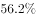
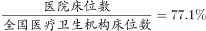
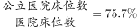
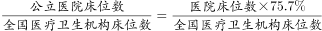
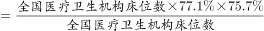
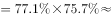
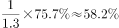

# 现期比重两步折算（比重乘比重：公立占医院×医院占全国）

考点：[[20-考点/资料分析/比重/现期比重两步折算（比重乘比重：公立占医院×医院占全国）|比重 / 现期比重两步折算（比重乘比重：公立占医院×医院占全国）]]
材料：[[15-材料/资料分析/239338 全国医疗卫生机构床位：2017年末总|239338 全国医疗卫生机构床位：2017年末总]]

**问法模型**：题干'2017年末公立医院床位占全国医疗卫生机构床位的比重'→现期比重两步折算：公立占全国=公立占医院比重×(医院612.0/全国794.0)

## 推理链
1. 第1步：定位文字第一段：2017年末全国医疗卫生机构床位794.0万张，其中医院612.0万张；'医院中，公立医院床位占（所给文本该百分比空缺未显示）'
2. 第2步：先算可自行求出的中间比重：医院占全国=612.0/794.0，截位直除612/794≈77.1%（794×0.77≈611.4，验证成立）
3. 第3步：套两步折算公式：公立占全国=公立占医院比重×77.1%；因两乘数均<100%，乘积必小于'公立占医院比重'本身
4. 第4步：依官方解析，代入文字中'公立医院床位占'的比重（空缺值）与77.1%相乘，所得比重与C项最接近，故选C

**最快解法**：⚡ 两步折算+截位直除：先算612/794≈77.1%（首两位直除得77），再以'公立占医院比重×77.1%'对照选项——乘积应略小于公立占医院比重且低于77.1%，据此结构特征排除干扰项锁定C

## 易错点
- ⚠ 把612.0/794.0≈77.1%直接当答案——这是'医院占全国'比重，不是'公立医院占全国'比重，还差一层'公立占医院'的折算
- ⚠ 文字中'公立医院床位占（ ）'数值在所给文本中空缺，切勿凭感觉编数代入，须按两步折算结构与选项关系验证
- ⚠ 口径层级混淆：公立床位⊂医院612.0万张⊂全国794.0万张，两层比重是相乘关系，不是相加或再用794做分母重算

## 母题抽象
> 🧩 当题干出现'A占B的比重'而材料只给'A占C的比重'+C与B的总量时，用两步折算：比重(A/B)=比重(A/C)×(C/B)，先算C/B再乘已知比重，结果应小于任一乘数

**同类特征**：现期比重、公立医院床位数、占全国医疗卫生机构床位、两层结构比重相乘、医院612.0万张/全国794.0万张、文字占比空缺需结构验证

## 相关题
- [[10-真题/资料分析/比重/4792819 现期比重计算（多部分比重依次求解）|4792819]]（新疆 2014，相关度1）
- [[10-真题/资料分析/比重/827355 现期比重比较（部分占比过半速判）|827355]]（政法干警 2014，相关度1）
- [[10-真题/资料分析/比重/2272297 现期比重比较|2272297]]（选调 2015，相关度1）
- [[10-真题/资料分析/比重/2032972 现期比重计算（多地区占比求和）|2032972]]（吉林 2015，相关度1）
- [[10-真题/资料分析/比重/2187857 现期比重计算（部分量需先由'总量−其中量'减法间接求得）|2187857]]（山东 2018，相关度1）

---

### 题干
2017年末公立医院床位数占全国医疗卫生机构床位数的比重为：

### 选项
- A. 

- B. 

- C. 

　✅
- D. 

### 官方解析

根据题干“2017年末······占······的比重为”，可判定本题为现期比重问题。定位文字材料第一段：“全国医疗卫生机构床位794.0万张，其中：医院612.0万张（占）”以及下文“医院中，公立医院床位占”，可得，，因此，2017年末公立医院床位数占全国医疗卫生机构床位数的比重为：，与C项最接近。

故正确答案为C。

### 给定材料

根据以下资料，回答下列问题。

        2017年末，全国医疗卫生机构床位794.0万张，其中：医院612.0万张（占），基层医疗卫生机构152.9万张（占）。医院中，公立医院床位占，民营医院床位占。与上年比较，床位增加53.0万张，其中：医院床位增加43.1万张，基层医疗卫生机构床位增加8.7万张。每千人口医疗卫生机构床位数由2016年5.37张增加到2017年5.72张。

> [!warning] 疑点（官方解析可能有误，待人工复核）
> 所给文字中'公立医院床位占（ ）''民营医院床位占（ ）'及'医院（占 ）'的百分比数值均空缺未显示，官方解析对应处亦留空、未给出代入的具体占比，两步折算的乘数无法从给定文本直接取得；仅能确认计算结构为'公立占医院比重×(612.0/794.0≈77.1%)'，C为官方给定正确答案，本笔记不改判
