# 复合增长推算（(1+r)²）+比值（社会总抚养比）计算

考点：[[20-考点/资料分析/比重/复合增长推算（(1+r)²）+比值（社会总抚养比）计算|比重 / 复合增长推算（(1+r)²）+比值（社会总抚养比）计算]]
材料：[[15-材料/资料分析/239354 2011-2015年我国人口统计数据|239354 2011-2015年我国人口统计数据]]

**问法模型**：按2015年各年龄段绝对量和增长率推算2017年（间隔2年）人口 → 每段乘(1+r)²后代入题干给定的抚养比公式求比值

## 推理链
1. 第1步：从表格2015年列提取：0-14岁22715万人（增长率0.65%）、15-64岁100361万人（增长率-0.04%）、65岁及以上14386万人（增长率4.13%）
2. 第2步：2017年底距2015年末间隔2年，各段人口=2015年绝对量×(1+r)²，是复合增长而非只乘一次增长率
3. 第3步：算各段(1+r)²：0-14岁(1.0065)²≈1.0130，15-64岁(0.9996)²≈0.9992，65岁及以上(1.0413)²≈1.0843
4. 第4步：代入得2017年：0-14岁≈22715×1.0130≈23011万人，15-64岁≈100361×0.9992≈100281万人，65岁及以上≈14386×1.0843≈15599万人
5. 第5步：代入抚养比公式=(23011+15599)/100281≈38610/100281
6. 第6步：截位直除386/1003≈0.385即约38.5%，与选项对照仅D项符合，故选D

**最快解法**：⚡ 公式法+截位直除：r较小时(1+r)²≈1+2r，得0-14岁≈22715×1.013≈23011、65+岁≈14386×1.0843≈15599、15-64岁≈100361×0.9992≈100281；分子23011+15599=38610，分母约10.03万万人，386/1003≈38.5%，锁定D

## 易错点
- ⚠ 把复合增长错算成单期增长：65+岁若只乘一次4.13%得约14980万人，比值约37.7%，落入错误选项
- ⚠ 忽略15-64岁增长率为负（-0.04%），分母应略减；且年龄段增长率单位是%（相对自身上年量），不能误用出生率/死亡率（‰，相对总人口）来推算
- ⚠ 间隔年数判断：2015年末→2017年末n=2须平方，基期取2015年，勿错取其他年份

## 母题抽象
> 🧩 当题干出现'按某年绝对量和增长率计算N年后某指标'且给出比值公式时，用现期×(1+r)^(间隔年数)逐段推算（注意r正负与平方），再代入公式截位直除验证选项

**同类特征**：按2015年各年龄段人口绝对量和增长率计算、推算2017年年底（隔2年）、题干直接给出社会总抚养比公式、分三个年龄段分段推算、增长率有正有负且为当年同比口径、结果为百分数比值

## 相关题
（暂无）

---

### 题干
社会总抚养比可以衡量社会人均劳动年龄人口的抚养负担情况，是测度一个国家人口红利的重要指标之一。若社会总抚养比=（0-14岁人口数+65岁及以上人口数）/15-64岁劳动年龄人口数，那么按照2015年各年龄段人口绝对量和增长率计算，2017年年底我国社会总抚养比是多少？

### 选项
- A. 
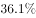

- B. 

- C. 
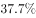

- D. 

　✅

### 官方解析

由题干“2017年年底我国社会总抚养比······”，可判定本题为比值计算问题。定位表格最后一列可得，2015年0-14岁人口数为22715万人，增长率为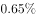，2015年15-64岁人口数为100361万人，增长率为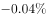，2015年65岁及以上人口数为14386万人，增长率为。则2017年0-14岁人口数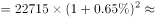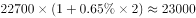万人，2017年15-64岁人口数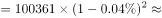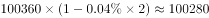万人，2017年65岁及以上人口数约为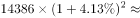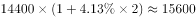万人。根据社会总抚养比=（0-14岁人口数+65岁及以上人口数）/15-64岁劳动年龄人口数，则2017年年底我国社会总抚养比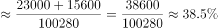。

故正确答案为D。

### 给定材料

根据以下资料，回答下列问题 

 

