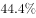
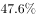

# 基期比重计算

考点：[[20-考点/资料分析/比重/基期比重计算|比重 / 基期比重计算]]
材料：[[15-材料/资料分析/239356 2018年中国社会消费品零售总额的总|239356 2018年中国社会消费品零售总额的总]]

**问法模型**：题干问'2017年12月……所占比重约是'（基期时间+占比）→ 用基期比重公式：基期比重=(A/B)×(1+总体增速)/(1+部分增速)，或分别倒推基期值再相除

## 推理链
1. 第1步：题干时间'2017年12月'早于材料现期，判定为基期比重；锁定表格12月当月列：商品零售31472亿元、同比8.0%，其中限额以上单位商品零售14175亿元、同比2.2%
2. 第2步：套用基期比重公式：基期比重=(14175/31472)×(1+8.0%)/(1+2.2%)
3. 第3步：现期比重14175/31472≈45.0%，修正系数1.08/1.022≈1.057，45.0%×1.057≈47.6%（交叉验证：14175÷1.022≈13870亿元，31472÷1.08≈29141亿元，13870/29141≈47.6%）
4. 第4步：与选项对照，约47.6%与B项最接近，故选B

**最快解法**：⚡ 基期比重公式法＋截位直除：先截位直除现期比重14175/31472≈45%，因部分增速2.2%＜总体增速8.0%，基期比重应略大于现期比重，乘修正系数1.08/1.022≈1.057得≈47.6%；选项差距大时可直接锁定'比45%略大'的B项，无需精算

## 易错点
- ⚠ 用错列：表中12月与1-12月两套口径混排，本题必须用12月当月列（31472/8.0%、14175/2.2%），误用全年列（338271/8.9%、136075/5.7%）即错
- ⚠ 分子分母口径错：分母必须是'商品零售'31472亿元（不能是总额35893或含餐饮的'限额以上单位消费品零售额'15084），分子必须是'限额以上单位商品零售'14175亿元
- ⚠ 忘做基期修正：直接算现期比重14175/31472≈45.0%会误选；因部分增速2.2%低于总体增速8.0%，基期占比应高于现期占比，需乘(1+8.0%)/(1+2.2%)≈1.057

## 母题抽象
> 🧩 当题干出现'基期时间＋部分占总体比重约是'特征时，用基期比重公式A/B×(1+b)/(1+a)（a为部分增速、b为总体增速），先截位直除估现期比重，再按a与b的大小判断修正方向，结合选项差距决定估算或精算

**同类特征**：2017年12月（基期时间点）、所占比重约是、商品零售额中、限额以上单位商品零售、需锁定表格12月当月列、约是（选项差距大可估算）

## 相关题
- [[10-真题/资料分析/比重/2377004 基期比重计算|2377004]]（选调 2019，相关度3）
- [[10-真题/资料分析/比重/2049856 基期比重计算|2049856]]（湖南 2017，相关度2）
- [[10-真题/资料分析/比重/2050986 基期比重计算|2050986]]（江西 2017，相关度2）
- [[10-真题/资料分析/比重/2172071 基期比重计算|2172071]]（广州市考 2018，相关度2）
- [[10-真题/资料分析/比重/2188466 基期比重计算|2188466]]（黑龙江 2018，相关度2）

---

### 题干
2017年12月，商品零售额中限额以上单位商品零售所占比重约是：

### 选项
- A. 

- B. 

　✅
- C. 

- D. 

### 官方解析
根据题干“2017年······所占比重约是”，结合材料数据为2018年，可判定本题为基期比重问题。定位表格材料可得：“2018年12月，商品零售额为31472亿元，同比增长；限额以上单位商品零售额为14175，同比增长”，代入基期比重公式：，与B项最接近。
故正确答案为B。

### 给定材料

根据以下资料，回答下列问题 

        2018年1-12月，社会消费品零售总额380987亿元，比上年增长（扣除价格因素实际增长，以下除特殊说明外均为名义增长）。

        2018年，限额以上零售业单位中的超市、百货店、专业店和专卖店零售额比上年分别增长、、和。

