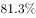
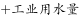
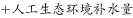

# 现期比重比较（同分母比分子）

考点：[[20-考点/资料分析/比重/现期比重比较（同分母比分子）|比重 / 现期比重比较（同分母比分子）]]
材料：[[15-材料/资料分析/239371 2016年全国水资源供水量与用水量状|239371 2016年全国水资源供水量与用水量状]]

**问法模型**：'占2016年全国用水总量最大比重的是'→四大分项分母同为用水总量6040.2亿立方米，比重比较退化为分子（分项用水量）大小比较，无需算出比重值

## 推理链
1. 第1步：定位材料第2段，提取2016年用水四分项：生活821.6、工业1308.0、农业3768.0、人工生态环境补水142.6亿立方米，分母为用水总量（即供用水总量）6040.2亿立方米
2. 第2步：比重=分量÷总量，四个选项对应的分母是同一个数6040.2亿立方米，故比重排序由分子排序决定
3. 第3步：直接比分子：3768.0＞1308.0＞821.6＞142.6，农业用水最大，且3768.0超过总量一半（6040.2÷2≈3020.1），占比超六成（约62.4%）
4. 第4步：对照选项，农业用水比重最大，对应C项

**最快解法**：⚡ 同分母比分子法（口算级）：四项分母均为6040.2亿立方米，不必计算任何比重，直接比821.6/1308.0/3768.0/142.6四个数，一眼锁定3768.0最大→农业用水→C；辅助验证：3768.0＞3020.1（总量一半），占比必超50%，其余三项均远小于一半

## 易错点
- ⚠ 原文各'占用水总量的比重'处百分数空缺，若试图回原文找现成比重会落空，须用'分量÷总量'自算或直接比分子
- ⚠ 误把第2段的同比增减量（农业-84.2、生活+28.1、生态+19.9）当成比较对象，去比'变化幅度'而非'现期比重'，方向完全跑偏
- ⚠ 材料第一段与第二段共用'供用水总量6040.2'一个数，分母唯一；另勿被干扰指标'农田灌溉水有效利用系数0.542'带偏，它与用水结构比重无关

## 母题抽象
> 🧩 当题干出现'占某年某总量最大比重的是'且材料给出同一年各分项数值与统一总量时，用'同分母比分子'法直接比较分量大小即可，若某分量明显超过总量一半可一步锁定，无需计算任何比重百分数

**同类特征**：占2016年全国用水总量最大比重、四大用水领域并列比较、同一分母（供用水总量6040.2亿立方米）、现期比重比较、纯文字材料第2段取数、比重百分数原文空缺须自算

## 相关题
- [[10-真题/资料分析/比重/10204607 现期比重比较（与1-3判定，分母需由累计值差分）|10204607]]（辽宁 2024，相关度1）
- [[10-真题/资料分析/比重/18643847 现期比值计算与百分点差值比较（资产负债率=总负债÷总资产）|18643847]]（四川 2026，相关度1）
- [[10-真题/资料分析/比重/19283749 现期比重比较（逐组求比重比大小）|19283749]]（国考 2025，相关度1）
- [[10-真题/资料分析/比重/2042810 现期比重比较（子口径占全口径比重，逐部计数判断）|2042810]]（江苏 2017，相关度1）
- [[10-真题/资料分析/比重/2052082 现期比重比较|2052082]]（吉林 2017，相关度1）

---

### 题干
下列选项中，占2016年全国用水总量最大比重的是：

### 选项
- A. 生活用水
- B. 工业用水
- C. 农业用水　✅
- D. 人工生态环境补水

### 官方解析
定位第二段文字材料可得，生活用水占2016年全国用水总量比重为；工业用水占2016年全国用水总量比重为；农业用水占2016年全国用水总量比重为；人工生态环境补水占2016年全国用水总量比重为。则最大比重为农业用水。
故正确答案为C。

### 给定材料

根据所给资料，回答下列问题。

        2016年全国供用水总量为6040.2亿立方米，较上年减少63.0亿立方米。其中，地表水源供水量4912.4亿立方米，占供水总量的；地下水源供水量1057.0亿立方米，占供水总量的；其他水源供水量70.8亿立方米，占供水总量的。与2015年相比，地表水源供水量减少57.1亿立方米，地下水源供水量减少12.2亿立方米，其他水源供水量增加6.3亿立方米。

        2016年，全国生活用水821.6亿立方米，占用水总量的；工业用水1308.0亿立方米，占用水总量的；农业用水3768.0亿立方米，占用水总量的；人工生态环境补水142.6亿立方米，占用水总量的。与2015年相比，农业用水量减少84.2亿立方米，生活用水量及人工生态环境补水量分别增加28.1亿立方米和19.9亿立方米。

        2016年全国万元国内生产总值（当年份）用水量81立方米，万元工业增加值（当年份）用水量52.8立方米，农田灌溉水有效利用系数0.542。按可比价计算，万元国内生产总值用水量和万元工业增加值用水量分别比2015年下降和。

        注：

