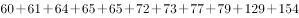
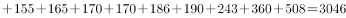
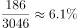

# 现期比重计算（部分-整体，整体需自行加总）

考点：[[20-考点/资料分析/比重/现期比重计算（部分-整体，整体需自行加总）|比重 / 现期比重计算（部分/整体，整体需自行加总）]]
材料：[[15-材料/资料分析/239374 2000—2017年中国人工智能专利|239374 2000—2017年中国人工智能专利]]

**问法模型**：题干'在位列前20位的国内专利权人中，浙江大学专利授权量占比约为' → 现期比重模型：比重=浙江大学授权量÷前20名授权量合计（分母是前20合计，不是全国总量）

## 推理链
1. 第1步：题干限定范围'位列前20位的国内专利权人'，锁定图2；浙江大学2017年授权量为186件（部分值）
2. 第2步：整体值需自行加总，从图2逐条读取前20名授权量：60、61、64、65、65、72、73、77、79、129、154、155、165、170、170、186、190、243、360、508
3. 第3步：加总得前20合计=3046件（可用分组核对：9家高校/科研院校约1585件+11家企业约1461件=3046件）
4. 第4步：代入现期比重公式：比重=部分/整体=186/3046
5. 第5步：截位直除：186/3046≈186/3050≈0.061，即约6%
6. 第6步：与选项对照，B项（约6%）最接近，故选B

**最快解法**：⚡ 先加总后直除：前20数值按百位/十位截位累加得约3046（可用'院校1585+企业1461'分组核验），分子186；截位直除186/3046≈6.1%，直接选约6%的选项（B）；全程无需精算，加总保留到个位、除法商一位即可

## 易错点
- ⚠ 分母口径陷阱：不能用图1中2017年全国授权量17477件作分母（186/17477≈1%会误选），题干限定'前20位专利权人中'，分母只能是前20合计3046件
- ⚠ 加总漏项/错项：前20共20条数据须逐一相加，漏一条即出错；'电子科技大学72件'与'广东小天才科技65件'名称相近勿混淆，院校名单须与注释9家逐一对应
- ⚠ 视觉顺序陷阱：图2按授权量升序自上而下排列，最大值中国科学院508件在最底部，读取数据时勿因条形顺序漏读或错位

## 母题抽象
> 🧩 当题干出现'在某榜单/前N名主体中，某主体占比约为'特征时，用 现期比重=该主体数值÷前N名合计，切记分母是榜单内加总而非材料中的全行业总量，先加总一次再截位直除对照选项

**同类特征**：位列前20位的国内专利权人中、浙江大学、占比约为、图2横截面数据、分母需自行加总

## 相关题
- [[10-真题/资料分析/比重/2187857 现期比重计算（部分量需先由'总量−其中量'减法间接求得）|2187857]]（山东 2018，相关度1）

---

### 题干
在位列中国人工智能专利授权量前20位的国内专利权人中，浙江大学专利授权量占比约为：

### 选项
- A. 

- B. 

　✅
- C. 

- D. 

### 官方解析

根据题干“······占比约为”，可判断本题为现期比重问题。定位图2，可得2017年浙江大学中国人工智能专利授权量为186件，位列中国人工智能专利授权量前20位的国内总量为。故位列中国人工智能专利授权量前20位的国内专利权人中，浙江大学专利授权量占比为，与B项最接近。

故正确答案为B。

### 给定材料

根据以下资料，回答下列问题。

图1 2000-2017年中国人工智能专利授权情况（单位：件）

图2 2017年中国人工智能专利授权量排名前20国内专利权人（单位：件）

注：排名前20名的高校、科研院校有：北京工业大学、电子科技大学、哈尔滨工业大学、清华大学、北京航空航天大学、华南理工大学、浙江大学、西安电子科技大学及中国科学院，其余均为企业。

