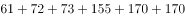
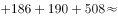
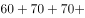
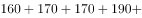
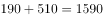
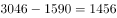
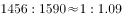
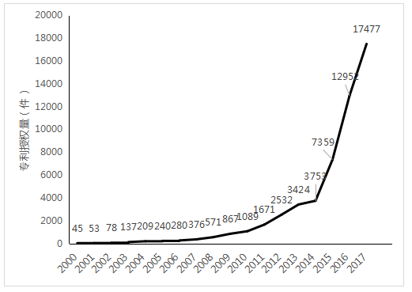

# 分类分组求和后作比值（企业-院校授权量之比）

考点：[[20-考点/资料分析/比重/分类分组求和后作比值（企业-院校授权量之比）|比重 / 分类分组求和后作比值（企业:院校授权量之比）]]
材料：[[15-材料/资料分析/239374 2000—2017年中国人工智能专利|239374 2000—2017年中国人工智能专利]]

**问法模型**：题干问'企业和高校、科研院校的授权量之比约为'→ 按注释名单把前20专利权人分成两组分别加总（或用前20合计3046减去院校组1585），再作比并与选项分数对照

## 推理链
1. 第1步：题干限定主体为'位列前20位的国内专利权人'，数据源为图2；注释给出9家高校/科研院校名单：北京工业大学、电子科技大学、哈尔滨工业大学、清华大学、北京航空航天大学、华南理工大学、浙江大学、西安电子科技大学、中国科学院，其余11家为企业
2. 第2步：从图2逐一读取9家院校授权量：北京工业大学61、电子科技大学72、哈尔滨工业大学73、清华大学155、北京航空航天大学170、华南理工大学170、浙江大学186、西安电子科技大学190、中国科学院508
3. 第3步：院校组合计=61+72+73+155+170+170+186+190+508=1585件
4. 第4步：借用第3题口径，前20合计为3046件，则企业组=3046−1585=1461件
5. 第5步：比值=1461:1585≈0.92:1，与1:1最接近（若误判为2:3≈0.67、1:2=0.5、1:3≈0.33均明显偏离）
6. 第6步：对照选项，A项1:1与0.92:1最接近，故选A

**最快解法**：⚡ 半数估判法：前20合计3046的一半约1523件，企业1461与院校1585均紧贴1523且二者只差约8%，直接锁定1:1；无须精算每组加总也可先用'3046−中国科学院508−其余院校'快速验证两组量级相当

## 易错点
- ⚠ 分组遗漏：图2第2条（61件）名称显示不清，须依注释反推为北京工业大学并计入院校组；9家院校须逐一与图2标签核对，漏一家（尤其漏掉最大的中国科学院508件）则院校合计骤降、比值全错
- ⚠ 名称混淆：'电子科技大学'属院校组，'广东小天才科技'属企业组，名称相近勿混；中国科学院须按注释归入'科研院校'而非企业
- ⚠ 口径陷阱：本题为两组之间的比值（1461:1585），分母不是前20合计3046，更不能用图1中2017年全国授权量17477件；同时勿与题3的'占比'问法混淆
- ⚠ 图2条形自上而下按升序排列，最大值508在最底部，逐条抄数时勿漏读或错位

## 母题抽象
> 🧩 当题干出现'两类主体（按注释/图例分组）的量之比约为'时，先按名单分组加总或用合计减去一组，再作比并与选项分数（1:1、2:3、1:2、1:3）对照——两组数值均贴近总数一半即选1:1

**同类特征**：前20位的国内专利权人、企业和高校、科研院校、授权量之比约为、分组名单（注释给定9家院校）、需先求和再作比、与题3共用前20合计3046件

## 相关题
（暂无）

---

### 题干
在位列中国人工智能专利授权量前20位的国内专利权人中，企业和高校、科研院校的授权量之比约为：

### 选项
- A. 1:1　✅
- B. 2:3
- C. 1:2
- D. 1:3

### 官方解析

由题干“企业和高校、科研院校的授权量之比约为”，可判定本题为比值计算问题。定位图2可得人工智能专利授权量排名前20国内专利权人及其专利授权量，定位文字材料可知，排名前20名的高校、科研院校有：北京工业大学、电子科技大学、哈尔滨工业大学、清华大学、北京航天航空大学、华南理工大学、浙江大学、西安电子科技大学及中国科学院，其余均为企业。则高校、科研院校的授权量为，结合本篇第3题，位列中国人工智能专利授权量前20位的国内总量为3046，可计算出企业的授权量约为。则企业和高校、科研院校的授权量之比约为，与A项最接近。

故正确答案为A。

### 给定材料

根据以下资料，回答下列问题。

图1 2000-2017年中国人工智能专利授权情况（单位：件）

图2 2017年中国人工智能专利授权量排名前20国内专利权人（单位：件）

注：排名前20名的高校、科研院校有：北京工业大学、电子科技大学、哈尔滨工业大学、清华大学、北京航空航天大学、华南理工大学、浙江大学、西安电子科技大学及中国科学院，其余均为企业。

