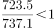
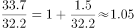
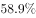
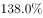
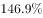

# 现期产销率（销量-产量）比较

考点：[[20-考点/资料分析/比重/现期产销率（销量-产量）比较|比重 / 现期产销率（销量/产量）比较]]
材料：[[15-材料/资料分析/239834 2018年1-9月中国汽车行业产销统|239834 2018年1-9月中国汽车行业产销统]]

**问法模型**：题干问'产销率最高的乘用车车型是'→产销率=销量÷产量，用四类车型现期销量、产量逐项构造分数比较大小（现期比值比较模型）

## 推理链
1. 第1步：题干时间2018年1-9月即材料现期，产销率=销量/产量，四个选项的销量、产量均为现期累计值，本题不涉及材料中缺失的同比增速
2. 第2步：从材料第一段提取数据：轿车产841.3/销842.6万辆，SUV产737.1/销723.5万辆，MPV产124.4/销126.2万辆，交叉型乘用车产32.2/销33.7万辆
3. 第3步：代入产销率=销量/产量：轿车842.6/841.3≈100.2%，SUV 723.5/737.1≈98.2%，MPV 126.2/124.4≈101.4%，交叉型33.7/32.2≈104.7%
4. 第4步：比较四个百分数：交叉型104.7%＞MPV 101.4%＞轿车100.2%＞SUV 98.2%
5. 第5步：对照选项，产销率最高的为交叉型乘用车，对应D项

**最快解法**：⚡ 差比排除法：产销率>100%⟺销量>产量，SUV销量723.5<产量737.1必<100%先排除；其余三项均销量>产量，转为比较(销量−产量)÷产量：交叉型1.5/32.2≈4.7%＞MPV 1.8/124.4≈1.4%＞轿车1.3/841.3≈0.15%，故交叉型最高选D（亦可截位直除直接算四个分数）

## 易错点
- ⚠ 分子分母方向搞反：产销率=销量/产量，若误用产量/销量则SUV(737.1/723.5)最高，会错选B
- ⚠ 只比差值不比基数：销量−产量差值MPV(+1.8)＞交叉型(+1.5)＞轿车(+1.3)，凭差值大小会误选C，必须除以各自产量基数后再比较
- ⚠ 量级直觉与增速缺失双重干扰：轿车体量841.3万远大于交叉型32.2万，易凭量级误判大车型占优；本题纯现期比值不需增速，勿因材料增速空缺而补造数据或误认无法求解

## 母题抽象
> 🧩 当题干出现'产销率（销量/产量）最高/最低的是哪类'特征时，用现期销量÷产量逐项代入，先按'销量是否大于产量'排除一类，再对小基数项做(销量−产量)÷产量的差比验证大小

**同类特征**：产销率最高、乘用车四类车型（轿车/SUV/MPV/交叉型）、现期比值比较不依赖增速、销量÷产量口径、1-9月累计数据、四选一比较

## 相关题
- [[10-真题/资料分析/增长/2195847 增长率比较（增长倍数与绝对增量的口径统一）|2195847]]（黑龙江 2018，相关度1）

---

### 题干
2018年1-9月，产销率最高的乘用车车型是（    ）。

### 选项
- A. 轿车
- B. SUV
- C. MPV
- D. 交叉型乘用车　✅

### 官方解析

根据题干“2018年1-9月，产销率最高的乘用车车型是（）”，结合材料时间为2018年1-9月，可判断本题为现期比重问题。，主体是乘用车车型，定位材料第二段，A项轿车：；B项SUV：；C项MPV：；D项交叉型乘用车：。产销率最高的乘用车车型是交叉型乘用车。

故正确答案为D。

### 给定材料

        2018年1-9月汽车行业统计数据如下：

        乘用车累计产销分别完成1735.1万辆和1726.0万辆，同比分别增长和。其中，轿车产销分别完成841.3万辆和842.6万辆，同比分别增长和；SUV产销分别完成737.1万辆和723.5万辆，同比分别增长和；MPV产销分别完成124.4万辆和126.2万辆，同比分别下降和；交叉型乘用车产销分别完成32.2万辆和33.7万辆，同比分别下降和。中国品牌乘用车累计销售724.2万辆，同比下降。

        商用车累计产销分别完成314.1万辆和323.1万辆，同比分别增长和。分车型情况看，客车产销分别完成33.9万辆和33.3万辆，同比分别下降和；货车产销分别完成280.1万辆和289.8万辆，同比分别增长和。

        新能源汽车中，纯电动汽车产销分别完成55.5万辆和54.1万辆，同比分别增长和；插电式混合动力汽车产销分别完成18.0万辆和18.1万辆，同比分别增长和。

        汽车整车出口81.4万辆，同比增长。分车型情况看，乘用车出口60.1万辆，同比增长；商用车出口21.3万辆，同比增长。

> [!warning] 疑点（官方解析可能有误，待人工复核）
> 官方解析称'定位材料第二段'有误：乘用车四类车型数据在材料第一段（第二段为商用车），属定位笔误；且解析中A-D各项具体算式缺失，经核算交叉型33.7/32.2≈104.7%确为最高，答案D无误
