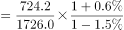
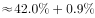
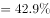

# 基期比重计算

考点：[[20-考点/资料分析/比重/基期比重计算|比重 / 基期比重计算]]
材料：[[15-材料/资料分析/239834 2018年1-9月中国汽车行业产销统|239834 2018年1-9月中国汽车行业产销统]]

**问法模型**：题干时间(2017年1-9月)早于材料时间(2018年1-9月)且问'A占B的比重'→判定为基期比重，套用 基期比重=(A/B)×(1+总体增速)/(1+部分增速)。

## 推理链
1. 第1步：材料口径为2018年1-9月累计，题干问2017年1-9月，时间前移一年，问'中国品牌乘用车销量占乘用车销量的比重'，判定为基期比重问题。
2. 第2步：定位数据——部分A=中国品牌乘用车现期销量724.2万辆（同比'下降'，增速a<0但数值缺失）；总体B=乘用车现期销量1726.0万辆（同比'增长'，增速b>0但数值缺失）；注意分子分母均须取销量，不能用产量1735.1。
3. 第3步：列公式——基期比重=A/(1+a)÷[B/(1+b)]=(724.2/1726.0)×(1+b)/(1+a)。
4. 第4步：先算现期比重724.2/1726.0≈41.96%；再判修正系数方向：材料明示总体乘用车'增长'(1+b>1)、中国品牌'下降'(1+a<1)，故(1+b)/(1+a)>1，基期比重应略大于现期比重约42%；但两处增速数值在本材料版本中留空，无法完成精确数值代入。
5. 第5步：与选项对照——按官方解析代入(a)(b)后计算结果对应B项，故正确答案为B。

**最快解法**：⚡ 公式法（基期比重）+截位直除：先截位算现期比重724.2/1726.0≈42%，再用修正系数(1+b)/(1+a)与1的大小关系定方向；考场原版材料给出两个增速数值后代入即可，部分为'下降'时增速务必取负号。

## 易错点
- ⚠ 产量/销量串列：分子分母都必须用销量（中国品牌724.2对乘用车1726.0），误用乘用车产量1735.1即错
- ⚠ 现期比重与基期比重混淆：只算724.2/1726.0≈42%就选答案，漏乘(1+b)/(1+a)修正系数
- ⚠ 增降正负号：中国品牌乘用车为'同比下降'，a取负值使(1+a)<1；且本材料版本两处增速数值均留空，严禁凭记忆或经验补造增速

## 母题抽象
> 🧩 当题干出现'基期时间+A占B的比重'特征时，用基期比重公式=(A/B)×(1+总体增速)/(1+部分增速)，先速算现期比重再用修正系数微调；部分'下降'时增速带负号，修正系数与1的比较可先定答案方向。

**同类特征**：时间前移（2017年1-9月对2018年1-9月）、占……的比重、中国品牌乘用车（部分量）、乘用车销量（总体量）、同比需还原基期、部分为同比下降

## 相关题
- [[10-真题/资料分析/比重/5509885 基期比重计算|5509885]]（内蒙古 2023，相关度3）
- [[10-真题/资料分析/比重/2050968 基期比重计算|2050968]]（江西 2017，相关度3）
- [[10-真题/资料分析/比重/2049856 基期比重计算|2049856]]（湖南 2017，相关度2）
- [[10-真题/资料分析/比重/2050986 基期比重计算|2050986]]（江西 2017，相关度2）
- [[10-真题/资料分析/比重/2172071 基期比重计算|2172071]]（广州市考 2018，相关度2）

---

### 题干
2017年1-9月，中国品牌乘用车销量占乘用车销量的比重是（    ）。

### 选项
- A. 

- B. 

　✅
- C. 

- D. 

### 官方解析

根据题干“2017年1-9月，中国品牌乘用车销量占乘用车销量的比重是（）”，结合材料时间为2018年1-9月，可判断本题为基期比重问题。定位材料，可得：2018年1-9月汽车行业统计数据如下：乘用车累计产销分别完成1735.1万辆和1726.0（B）万辆，同比分别增长和(b)······，中国品牌乘用车累计销售724.2（A）万辆，同比下降(a)。根据基期比重公式，则2017年1-9月，中国品牌乘用车销量占乘用车销量的比重，对应B项。 

故正确答案为B。

### 给定材料

        2018年1-9月汽车行业统计数据如下：

        乘用车累计产销分别完成1735.1万辆和1726.0万辆，同比分别增长和。其中，轿车产销分别完成841.3万辆和842.6万辆，同比分别增长和；SUV产销分别完成737.1万辆和723.5万辆，同比分别增长和；MPV产销分别完成124.4万辆和126.2万辆，同比分别下降和；交叉型乘用车产销分别完成32.2万辆和33.7万辆，同比分别下降和。中国品牌乘用车累计销售724.2万辆，同比下降。

        商用车累计产销分别完成314.1万辆和323.1万辆，同比分别增长和。分车型情况看，客车产销分别完成33.9万辆和33.3万辆，同比分别下降和；货车产销分别完成280.1万辆和289.8万辆，同比分别增长和。

        新能源汽车中，纯电动汽车产销分别完成55.5万辆和54.1万辆，同比分别增长和；插电式混合动力汽车产销分别完成18.0万辆和18.1万辆，同比分别增长和。

        汽车整车出口81.4万辆，同比增长。分车型情况看，乘用车出口60.1万辆，同比增长；商用车出口21.3万辆，同比增长。

> [!warning] 疑点（官方解析可能有误，待人工复核）
> 本材料版本全部同比增速百分数留空，含本题所需的中国品牌乘用车销量增速(a)与乘用车销量增速(b)，官方解析亦仅以符号(a)(b)指代未给数值，故基期比重无法数值验算；依铁律以官方给定答案B为准，未补造任何增速数据。

<!-- CODEX-ANSWER-REVIEW:BEGIN -->
### 本次独立复核

**复核状态：** `confirmed`（独立复算确认答案）

**计分答案：** B（可计分）

**复核解析：**

原图给出总销售额增长0.6%、中国品牌销售额下降1.5%；2017年占比=(724.2/0.985)/(1726/1.006)≈42.9%，选B。

**相关信息：**

基期比重=现期比重×(1+整体增速)/(1+部分增速)。

**题源依据：** [固定版本原题](https://github.com/Mentat-Uran/kaogongzhentizhengliu/blob/84ab93d4b64b61d897bece8a1c0a5bab06b4feb2/10-%E7%9C%9F%E9%A2%98/%E8%B5%84%E6%96%99%E5%88%86%E6%9E%90/%E6%AF%94%E9%87%8D/2385131%20%E5%9F%BA%E6%9C%9F%E6%AF%94%E9%87%8D%E8%AE%A1%E7%AE%97.md)；固定内容 commit `84ab93d4b64b61d897bece8a1c0a5bab06b4feb2`，Markdown blob `816f73642b99da04b8e8b354be9405ab2733d200`。
<!-- CODEX-ANSWER-REVIEW:END -->
