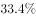

# 现期比重计算

考点：[[20-考点/资料分析/比重/现期比重计算|比重 / 现期比重计算]]
材料：[[15-材料/资料分析/240010 2019年1-2月与1-3月全国固定|240010 2019年1-2月与1-3月全国固定]]

**问法模型**：题干问'某期整体中某部分所占比重约为多少'且题干时间与材料现期一致 → 直接用'部分量÷整体量'求现期比重，无需基期换算

## 推理链
1. 第1步：题干时间'2019年1-2月'与材料第一段现期口径完全一致，判定为现期比重问题，增速缺失不影响本题
2. 第2步：定位材料第一段：整体量=全国固定资产投资（不含农户）44849亿元，部分量=第三产业投资30035亿元（可用950+13864+30035=44849核对读数无误）
3. 第3步：代入现期比重公式：比重=部分量/整体量=30035/44849
4. 第4步：速算：30035/44849，分子分母各截三位≈300/448≈0.67，精确值约66.97%≈67%
5. 第5步：与选项对照，A项约为67%，故正确答案为A

**最快解法**：⚡ 截位直除：30035/44849→截三位300/448≈0.67（约67%），一步出答案，无需精算

## 易错点
- ⚠ 时间口径混淆：第三产业1-2月为30035亿元、1-3月为66240亿元，误用第二段1-3月数据则分母分母全错（且101872/66240会得出错误比重）
- ⚠ 分母误用：整体量必须用全国固定资产投资44849亿元，不能误用民间投资26963亿元作分母（民间投资是交叉子口径，不能与三次产业混同）
- ⚠ 量级/形式陷阱：材料单位为亿元，选项以百分数呈现，注意66.97%≈67%的百分数转换与小数点量级，勿错选量级不符的干扰项

## 母题抽象
> 🧩 当题干出现'某期A中B所占比重约为多少'且时间与材料现期一致时，直接定位B（部分量）与A（整体量），用B÷A截位直除得比重，再对照选项量级与百分数形式；若时间问过去期间才需基期修正

**同类特征**：'所占比重约为'、题干时间=材料现期时间、部分量÷整体量、文字型材料定位第一段、无需增速数据参与、三次产业与全国总量的包含关系

## 相关题
- [[10-真题/资料分析/比重/2604234 现期比重计算|2604234]]（广东 2020，相关度2）
- [[10-真题/资料分析/比重/1751688 现期比重计算|1751688]]（江苏 2015，相关度2）
- [[10-真题/资料分析/比重/2456370 现期比重计算|2456370]]（浙江 2020，相关度2）
- [[10-真题/资料分析/比重/2050970 现期比重计算|2050970]]（江西 2017，相关度2）
- [[10-真题/资料分析/比重/2188157 现期比重计算|2188157]]（陕西 2018，相关度2）

---

### 题干
2019年1-2月，全国固定资产投资（不含农户）中第三产业投资所占比重约为多少？

### 选项
- A. 

　✅
- B. 

- C. 

- D. 

### 官方解析

根据题干“2019年1-2月···第三产业投资所占比重约为···”，结合材料时间为2019年，可判定本题为现期比重问题。定位文字材料第一段可得：“2019年1-2月份，全国固定资产投资（不含农户）44849亿元···第三产业投资30035亿元···”故。

故正确答案为A。

### 给定材料

        2019年1-2月份，全国固定资产投资（不含农户）44849亿元，同比增长，增速比2018年全年提高0.2个百分点。其中，民间固定资产投资26963亿元，同比增长。分产业看，第一产业投资950亿元，同比增长，增速比2018年全年回落9.2个百分点；第二产业投资13864亿元，增长，增速回落0.7个百分点；第三产业投资30035亿元，增长，增速提高1个百分点。

        2019年1-3月份，全国固定资产投资（不含农户）101872亿元，同比增长，增速比去年同期回落1.2个百分点。其中，民间固定资产投资61492亿元，同比增长。

        分产业看，第一产业投资2408亿元，同比增长，增速比1-2月份回落0.7个百分点；第二产业投资33224亿元，增长，增速回落1.3个百分点；第三产业投资66240亿元，增长，增速提高1个百分点。

        第二产业中，工业投资同比增长，增速比1-2月份回落1.4个百分点；其中，采矿业投资增长，增速回落26.6个百分点；制造业投资增长，增速回落1.3个百分点；电力、热力、燃气及水生产和供应业投资增长，1-2月份为下降。

        第三产业中，基础设施投资（不含电力、热力、燃气及水生产和供应业）同比增长，增速比1-2月份提高0.1个百分点。其中，水利管理业投资下降，降幅扩大3.7个百分点；公共设施管理业投资下降，降幅收窄2.3个百分点；道路运输业投资增长，增速回落2.5个百分点；铁路运输业投资增长，增速回落11.5个百分点。

        分地区看，东部地区投资同比增长，增速比1-2月份提高1个百分点；中部地区投资增长，增速提高0.2个百分点；西部地区投资增长，增速提高0.2个百分点；东北地区投资增长，增速回落2.8个百分点。

        分登记注册类型看，内资企业投资同比增长，增速与1-2月份持平；港澳台商投资增长，增速提高2.8个百分点；外商投资增长，增速提高5.3个百分点。

