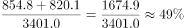

# 现期比重计算（区间范围判断）

考点：[[20-考点/资料分析/比重/现期比重计算（区间范围判断）|比重 / 现期比重计算（区间范围判断）]]
材料：[[15-材料/资料分析/240202 2014年全国及11个省（自治区）的|240202 2014年全国及11个省（自治区）的]]

**问法模型**：题干以'播种面积排名前两位的省（自治区）……产量之和占全国总产量的比重在以下哪个范围'设问 → 先按播种面积列排序锁定主体，再用现期比重模型：比重＝两省产量之和÷全国总产量，将结果与选项区间对照

## 推理链
1. 第1步：题干限定'播种面积排名前两位'，扫描表格播种面积列（千公顷）：湖南1453.3最大、江西1394.6次之（广东893.2、广西917.6均更小），锁定湖南、江西两省
2. 第2步：读取对应总产量列与总计行：湖南854.8万吨、江西820.1万吨，全国总产量3401.0万吨；材料为单一现期2014年，直接用现期值
3. 第3步：套用现期比重公式：比重＝部分之和÷总体＝(854.8+820.1)÷3401.0＝1674.9÷3401.0
4. 第4步：估算：3401.0×50%＝1700.5＞1674.9，比重略低于50%；3401.0×40%＝1360.4＜1674.9，比重高于40%，故比重约49.2%
5. 第5步：对照选项，49.2%落在40%~50%区间（B项），排除A（低于40%）、C（50%~60%）、D（高于60%）

**最快解法**：⚡ 选项区间锚定法（免精确除法）：分子先加总1674.9，再算总体锚点——3401.0×50%＝1700.5＞1674.9排除C、D，3401.0×40%＝1360.4＜1674.9排除A，直接锁定B；如需精确值，截位直除1674.9÷3401.0≈49.2%

## 易错点
- ⚠ 看错排序列：须按'播种面积'列排前二（湖南1453.3、江西1394.6），若误按单产列排会错选浙江6143.7、福建6020.4，导致分子全错
- ⚠ 分子分母口径错位：必须用总产量（万吨）÷总产量（万吨）；若误用播种面积之和2847.9千公顷去除，或拿单产列与全国单产5868.9比大小，模型全错
- ⚠ 分母误取：分母必须是总计行的3401.0万吨，不能自行加总11省产量（四川'?'未给出易加错），更不能用单产5868.9做分母

## 母题抽象
> 🧩 当题干出现'按某列指标排名前N的个体，其另一列指标之和占总体的比重在以下哪个范围'时，先在指定列排序锁定主体，再取目标列求和除以总计行，并用选项区间端点×总体与部分和比大小，即可免除法秒定区间

**同类特征**：播种面积排名前两位的省（自治区）、产量之和、占全国总产量的比重、在以下哪个范围、现期（2014年）比重区间判断、跨列取数（面积列排序＋产量列计算）

## 相关题
- [[10-真题/资料分析/其他/2028340 多年份数据加总与区间判断（'十二五'期间界定）|2028340]]（国考 2017，相关度1）
- [[10-真题/资料分析/增长/13504450 现期量外推（按同比增速复合增长预测未来年份）|13504450]]（河北 2025，相关度1）

---

### 题干
2014年早稻播种面积排名前两位的省（自治区），当年早稻产量之和占全国总产量的比重在以下哪个范围？

### 选项
- A. 
低于

- B. 

　✅
- C. 

- D. 
高于

### 官方解析

根据问题“2014年······的比重在以下哪个范围”，结合材料时间为2014年，可判定本题为现期比重问题。定位表格，2014年早稻播种面积排名前两位的省（自治区）为湖南、江西，对应两个省份当年的早稻产量分别为854.8万吨、820.1万吨，2014年全国早稻产量总计为3401.0万吨，那么其当年早稻产量之和占全国总产量的比重为。

故正确答案为B。

### 给定材料

