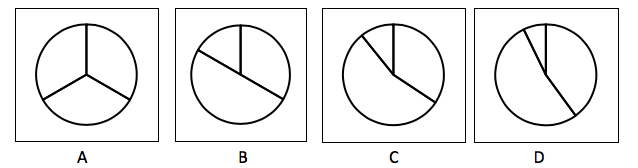
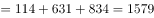
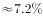
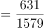
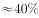
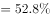

# 现期比重计算（三年数据占合计比重＋饼图匹配）

考点：[[20-考点/资料分析/比重/现期比重计算（三年数据占合计比重＋饼图匹配）|比重 / 现期比重计算（三年数据占合计比重＋饼图匹配）]]
材料：[[15-材料/资料分析/240292 全国普通高校毕业生人数的历年变化（散|240292 全国普通高校毕业生人数的历年变化（散]]

**问法模型**：“最能准确反映2001年、2010年和2019年…人数比重的统计图”→ 先求三个年份数值之和作总体，再用 比重=部分/总体 逐一求占比，与选项饼图扇形比例对照

## 推理链
1. 第1步：从文字材料提取2001年毕业生114万人，从柱状图提取2010年631万人、2019年（预计）834万人
2. 第2步：三者为并列部分，先求合计总体：114+631+834=1579万人
3. 第3步：用现期比重公式 比重=部分量/总体量，2001年占114/1579≈7.2%
4. 第4步：2010年占631/1579≈40.0%（1579×2/5≈631.6，恰约四成）；2019年占834/1579≈52.8%（834＞1579/2≈790，超过一半）
5. 第5步：三者比重结构为约7.2% : 40.0% : 52.8%，对应扇形圆心角约26°、144°、190°，即一个略过半圆的扇形＋一个约四成扇形＋一个极小扇形
6. 第6步：与选项饼图逐一对照，仅D选项扇形比例符合“约一半多、约四成、约7%”的结构，故选D

**最快解法**：⚡ 半圆判断法＋截位直除：先算合计1579，判断834＞1579÷2≈790（2019年扇形超半圆、约53%），631/1579≈40%（1579×2/5≈632），114/1579≈7%（小窄条），锁定“过半＋四成＋小条”结构的饼图即D，无需精确计算三个百分比

## 易错点
- ⚠ 分母误用单一数据：直接以2019年834万（或某一年总毕业生数）作分母算比重，正确分母应为三年合计1579万
- ⚠ 年份与数值对应错位：最小份额7.2%对应2001年的114万，勿与2010年631万对调，否则饼图结构完全错误
- ⚠ 扇形与百分比换算失误：52.8%对应圆心角约190°（超过半圆），若选项中有“恰好一半”或“约45%＋45%”的干扰图，需用半圆判断法甄别；另注意2019年为'预计'值，但本题口径直接采用834万，不需另行调整

## 母题抽象
> 🧩 当题干出现“最能准确反映某几个年份/部分…比重的统计图”时，用“各部分÷三部分合计”求占比，再用半圆判断法（最大占比是否＞50%）和整十比例估算（约几成）快速匹配饼图选项

**同类特征**：最能准确反映、比重的统计图、三个年份数据占比、饼形图/结构图匹配、现期比重、部分占合计比重

## 相关题
- [[10-真题/资料分析/比重/5408652 现期比重比较·饼图占比判断|5408652]]（四川 2022，相关度2）
- [[10-真题/资料分析/比重/4792819 现期比重计算（多部分比重依次求解）|4792819]]（新疆 2014，相关度1）
- [[10-真题/资料分析/比重/827355 现期比重比较（部分占比过半速判）|827355]]（政法干警 2014，相关度1）
- [[10-真题/资料分析/比重/2272297 现期比重比较|2272297]]（选调 2015，相关度1）
- [[10-真题/资料分析/比重/2032972 现期比重计算（多地区占比求和）|2032972]]（吉林 2015，相关度1）

---

### 题干

最能准确反映2001年，2010年和2019年全国普通高校毕业生人数比重的统计图是（    ）。

### 选项
- A. A
- B. B
- C. C
- D. D　✅

### 官方解析

根据“······比重的统计图是”，结合材料已给2001年、2010年、2019年数据，可判定本题为现期比重问题。定位文字材料和图形材料，可知2001年全国普通高校毕业生人数为114万人，2010年为631万人，2019年为834万人，则这三年总毕业人数万人。根据，则2001年毕业人数所占比重；2010年毕业人数所占比重；2019年毕业人数所占比重，结合选项饼形图的比重关系，D选项最符合。

故正确答案为D。

### 给定材料

        1979年全国普通高校毕业生人数为8.5万人，1980年为14.7万人，2001年为114万人，2002年为145万人，2010年较上一年同比增长，2018年首次突破了800万人，2019年预计达到834万人，毕业生就业创业面临严峻形势。

