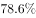
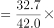
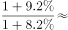
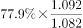
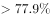

# 基期比重计算

考点：[[20-考点/资料分析/比重/基期比重计算|比重 / 基期比重计算]]
材料：[[15-材料/资料分析/241019 2017年我国专利事业发展概况：发明|241019 2017年我国专利事业发展概况：发明]]

**问法模型**：题干问2016年（早于材料年份2017年）国内发明专利授权占授权发明专利的比例→基期比重模型：A/(1+a) ÷ B/(1+b) = A/B × (1+b)/(1+a)。

## 推理链
1. 第1步：从材料第一段提取条件：2017年我国共授权发明专利42.0万件（总体B，同比增速b），其中国内发明专利授权32.7万件（部分A，同比增速a），题干求2016年国内授权占授权总量的比例。
2. 第2步：材料时间为2017年而题干问2016年，判定为基期比重问题，套用公式 基期比重 = [A/(1+a)] ÷ [B/(1+b)]。
3. 第3步：化简为 32.7/42.0 × (1+b)/(1+a)，先截位直除得现期比重 32.7/42.0 ≈ 77.9%。
4. 第4步：从固定原题公式图读取总体增速b=9.2%、国内部分增速a=8.2%，修正因子为1.092/1.082≈1.00924。
5. 第5步：基期比重=(32.7/42.0)×1.092/1.082≈78.58%。
6. 第6步：选项图显示A=23.7%、B=25%、C=77.9%、D=78.6%；78.58%按选项精度对应D，正确答案为D。

**最快解法**：⚡ 基期比重公式法+截位直除：现期比重32.7/42.0≈77.86%，部分增速8.2%低于总体增速9.2%，故基期比重略高于现期值；再乘1.092/1.082≈1.00924，得约78.58%，选78.6%的D。

## 易错点
- ⚠ 现期/基期混淆：直接用 32.7/42.0≈77.9% 作答而不乘 (1+b)/(1+a) 修正因子，易误选与现期比重相同的干扰项。
- ⚠ 增速对位错误：分子部分32.7万件应配部分自身增速a、分母总体42.0万件应配总体增速b，若把 (1+b)/(1+a) 写反，结果向相反方向偏差。
- ⚠ 口径陷阱：42.0万件为当年授权量（流量），勿误用135.6万件拥有量（截至年底的存量）、职务发明30.4万件或单位为'件'的'一带一路'数据；增速应从公式图读取，分别是总体9.2%和国内部分8.2%。

## 母题抽象
> 🧩 当题干出现'上一年（基期）某部分占某总体的比例'，且材料给出现期部分A、总体B及各自同比增速a、b时，用 A/B × (1+b)/(1+a)：先算现期比重，再按部分与总体增速的相对大小乘增速修正因子，对照选项。

**同类特征**：题干年份（2016年）早于材料年份（2017年）、'……占……的比例'问法、部分与整体均带同比增速、部分-整体嵌套关系（国内授权⊂授权发明专利）、选项为比例/百分数、基期比重模型

## 相关题
- [[10-真题/资料分析/比重/2188466 基期比重计算|2188466]]（黑龙江 2018，相关度3）
- [[10-真题/资料分析/比重/2444066 基期比重计算|2444066]]（江西 2019，相关度3）
- [[10-真题/资料分析/比重/2616071 基期比重计算|2616071]]（云南 2020，相关度3）
- [[10-真题/资料分析/比重/2307731 基期比重计算|2307731]]（辽宁 2018，相关度3）
- [[10-真题/资料分析/比重/3522676 基期比重计算|3522676]]（广西 2021，相关度3）

---

### 题干
2016年，国内发明专利授权占我国授权发明专利的比例为：

### 选项
- A. 

- B. 

- C. 

- D. 

　✅

### 官方解析

根据“2016年，······占······的比例”，结合材料时间为2017年，可判定本题为基期比重问题。定位材料第一段可知， 2017年，我国共授权发明专利42.0万件，同比增长。其中，国内发明专利授权32.7万件，同比增长。代入公式，，只有D项符合。

故正确答案为D。

### 给定材料

        2017年，我国发明专利申请量为138.2万件，同比增长。共授权发明专利42.0万件，同比增长。其中，国内发明专利授权32.7万件，同比增长。在国内发明专利授权中，职务发明为30.4万件，占；非职务发明为2.3万件，占。

        截至2017年底，我国国内（不含港澳台）发明专利拥有量共计135.6万件，每万人口发明专利拥有量达到9.8件。我国每万人口发明专利拥有量排名前十位的省（区、市）依次为：北京（94.5件）、上海（41.5件）、江苏（22.5件）、浙江（19.7件）、广东（19.0件）、天津（18.3件）、陕西（8.9件）、福建（8.0件）、安徽（7.7件）和辽宁（7.6件）。

        2017年，我国在“一带一路”沿线国家（不含中国）专利申请公开量为5608件，同比增长。其中，在印度专利申请公开量为2724件，在俄罗斯专利申请公开量为1354件，专利申请初具规模。2017年，“一带一路”沿线国家在华申请专利4319件，同比增长；在华申请专利的“一带一路”沿线国家数达到41个，较2016年增加4个。

        2017年，全国专利行政执法办案总量6.7万件，同比增长。其中，专利纠纷办案2.8万件（包括专利侵权纠纷办案2.7万件），同比增长；查处假冒专利案件3.9万件，同比增长。

[!note] 题图数据已复原并独立复算
固定版本题图给出全国授权增速9.2%、国内发明授权增速8.2%，选项图给出D=78.6%。按基期比重公式计算为78.58%，与D项吻合；文本抽取时遗漏公式图内容不构成题面缺数。

<!-- CODEX-ANSWER-REVIEW:BEGIN -->
### 本次独立复核

**复核状态：** `resolved`（答案与解析已核定）

**计分答案：** D（可计分）

**复核解析：**

固定版本公式图显示总体授权增速9.2%、国内发明授权增速8.2%；32.7/42.0×1.092/1.082≈78.58%。选项图D为78.6%，因此选D。公式图和选项图足以独立复算。

**相关信息：**

基期比重=现期比重×(1+总体增长率)/(1+部分增长率)；若题目直接给占比百分点变化，则按百分点加减回推。人口分项占比应与分项人数/总人数核对。

**题源依据：** [固定版本原题](https://github.com/Mentat-Uran/kaogongzhentizhengliu/blob/84ab93d4b64b61d897bece8a1c0a5bab06b4feb2/10-%E7%9C%9F%E9%A2%98/%E8%B5%84%E6%96%99%E5%88%86%E6%9E%90/%E6%AF%94%E9%87%8D/2402471%20%E5%9F%BA%E6%9C%9F%E6%AF%94%E9%87%8D%E8%AE%A1%E7%AE%97.md)；固定内容 commit `84ab93d4b64b61d897bece8a1c0a5bab06b4feb2`，Markdown blob `95af2155eb2573fa58160801f9d1fcc78704df6f`。
<!-- CODEX-ANSWER-REVIEW:END -->
