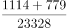
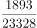
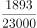

# 现期比重计算（区间型选项）

考点：[[20-考点/资料分析/比重/现期比重计算（区间型选项）|比重 / 现期比重计算（区间型选项）]]
材料：[[15-材料/资料分析/241028 2018年1-5月我国软件和信息技术|241028 2018年1-5月我国软件和信息技术]]

**问法模型**：题干出现'……总量占全国……的比重范围为'且时间（2018年1-5月）与材料一致 → 现期比重模型：比重=部分合计÷总体，算出百分数后对照选项区间

## 推理链
1. 第1步：题干时间为2018年1-5月，与材料时间完全一致，判定为现期比重，无需基期换算
2. 第2步：从表2提取部分数据：四川软件业务收入1114亿元、陕西779亿元，合计1114+779=1893亿元
3. 第3步：从文字材料第一段提取总体数据：2018年1-5月全国软件业务收入23328亿元
4. 第4步：套用现期比重公式：比重=部分/总体=1893/23328
5. 第5步：截位直除估算：1893/23328≈19/233≈8.1%（精确约8.11%）
6. 第6步：与选项区间对照，8.1%落在选项B的区间（8%—9%）内，故选B

**最快解法**：⚡ 截位直除+区间排除法：部分合计1893≈1900，总体23328≈23000，1900/23000≈8.3%；再用端点验证：23328×8%=1866.2、23328×9%=2099.5，1893介于两者之间且更靠近8%，即比重略高于8%而低于9%，直接锁定对应8%—9%的选项B，无需精算到小数

## 易错点
- ⚠ 误把表2中四川、陕西的同比增速（10.5%、15.0%）当成收入或参与计算，本题只取收入两列数据
- ⚠ 表2标题写'前十位城市'实为省（直辖市），易对四川/陕西的取数资格产生怀疑而犹豫；直接按表取收入即可，且四川、陕西同属西部地区，切勿误用西部总量2645亿元÷23328≈11.3%作答
- ⚠ 选项为区间而非精确值，无需计算到底；若误做基期（2017年）比重或用错总体（如用四地区之和之外的其他口径），会落入相邻错误区间

## 母题抽象
> 🧩 当题干出现'某几项合计占总体比重（范围/约为）'且时间与材料一致时，先加总部分值、再除以总体值，用截位直除或'总体×区间端点'验证数值落在哪个区间，不必精算

**同类特征**：比重范围为、总量占全国、四川和陕西、现期比重、跨图表取数、区间型选项

## 相关题
- [[10-真题/资料分析/比重/10297462 现期比重计算（部分占整体比重+区间型选项）|10297462]]（四川 2025，相关度2）
- [[10-真题/资料分析/比重/4792819 现期比重计算（多部分比重依次求解）|4792819]]（新疆 2014，相关度1）
- [[10-真题/资料分析/比重/827355 现期比重比较（部分占比过半速判）|827355]]（政法干警 2014，相关度1）
- [[10-真题/资料分析/比重/2272297 现期比重比较|2272297]]（选调 2015，相关度1）
- [[10-真题/资料分析/比重/2032972 现期比重计算（多地区占比求和）|2032972]]（吉林 2015，相关度1）

---

### 题干
2018年1-5月，四川和陕西的软件业务收入总量占全国软件业务收入的比重范围为：

### 选项
- A. 
-

- B. 
-
　✅
- C. 
-

- D. 
-

### 官方解析

根据题干“2018年1-5月，······占······的比重范围为”，结合材料时间也为2018年1-5月，可判定本题为现期比重问题。定位文字材料第一段可知，2018年1-5月，我国软件和信息技术服务业完成软件业务收入23328亿元；定位表格材料可知，2018年1-5月，四川和陕西的软件业务收入总量分别为1114亿元和779亿元。根据公式，比重，因此所求比重，在-之间。

故正确答案为B。

### 给定材料

        2018年1-5月，我国软件和信息技术服务业完成软件业务收入23328亿元。1-5月，全行业实现利润总额2822亿元，同比增长，增速同比回落0.9个百分点。

        从分地区运行情况来看，2018年1-5月，中部地区完成软件业务收入976亿元，增长，增速同比提高3.3个百分点；其中河南、安徽、湖北软件业务收入增速持续高于全国平均水平。西部地区完成软件业务收入2645亿元，增长，增速同比回落4个百分点，近年来西部地区首次出现增速低于全国平均水平的情况。东部地区完成软件业务收入18747亿元，同比增长，增速同比提高1.2个百分点；总量居前5名的广东、江苏、北京、浙江、山东完成软件业务收入累计占全国比重为，其中北京和浙江增速分别高出全国平均增速5.3、6.1个百分点。东北地区完成软件业务收入960亿元，同比增长，增速同比提高2.8个百分点，高于1-4月1.7个百分点。

