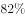
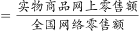
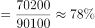

# 现期比重计算

考点：[[20-考点/资料分析/比重/现期比重计算|比重 / 现期比重计算]]
材料：[[15-材料/资料分析/242945 2018年全国网络零售规模与结构：全|242945 2018年全国网络零售规模与结构：全]]

**问法模型**：题干为'现期年份+整体中某部分的比重约为'→直接套现期比重=部分÷整体，无需基期调整或增速参与

## 推理链
1. 第1步：题干求2018年全国网络零售额中实物商品网上零售额的比重，题干时间与材料时间均为2018年，判定为现期比重
2. 第2步：定位材料第1段：2018年全国网络零售额90100亿元（整体），其中实物商品网上零售额70200亿元（部分）
3. 第3步：现期比重=部分÷整体=70200÷90100
4. 第4步：截位计算702/901≈0.779，即约78%
5. 第5步：与选项对照，约78%对应C选项

**最快解法**：⚡ 截位直除：70200/90100→702/901，分母901≈900，702/900=0.78，商首两位约77~78%，直选C；亦可用构成关系验证：70200+19900=90100，故比重=1-19900/90100≈1-22%≈78%

## 易错点
- ⚠ 口径混淆：全国口径'实物商品网上零售额70200亿元'与农村口径'农村实物商品网络零售额10900亿元'名称高度相近，本题必须取全国口径70200
- ⚠ 分母选择错误：整体是全国网络零售额90100亿元，勿误用农村网络零售额13700亿元或农产品网络零售额2305亿元
- ⚠ 现期/基期混淆：材料中各增速数值虽留空，但本题只需两个现期金额相除，切勿画蛇添足除以(1+增速)转基期

## 母题抽象
> 🧩 当题干出现'现期年份+A中B的比重约为'且与材料时间一致时，用现期比重=部分÷整体，截位直除后对照选项验证

**同类特征**：2018年（与材料同期）、全国网络零售额中、实物商品网上零售额、比重约为、选项为百分比形式

## 相关题
- [[10-真题/资料分析/比重/2662198 现期比重计算|2662198]]（新疆 2020，相关度3）
- [[10-真题/资料分析/比重/2604234 现期比重计算|2604234]]（广东 2020，相关度2）
- [[10-真题/资料分析/比重/1751688 现期比重计算|1751688]]（江苏 2015，相关度2）
- [[10-真题/资料分析/比重/2456370 现期比重计算|2456370]]（浙江 2020，相关度2）
- [[10-真题/资料分析/比重/2050970 现期比重计算|2050970]]（江西 2017，相关度2）

---

### 题干
2018年全国网络零售额中，实物商品网上零售额的比重约为：

### 选项
- A. 

- B. 

- C. 

　✅
- D. 

### 官方解析

根据问题“2018年······比重约为”，结合材料时间为2018年，判定本题为现期比重问题。定位材料第一段“2018年全国网络零售额90100亿元，······，其中，实物商品网上零售额为70200亿元”。故所求占比，对应C选项。

故正确答案为C。

### 给定材料

        2018年全国网络零售额90100亿元，同比增长。其中，实物商品网上零售额为70200亿元，同比增长；非实物商品网上零售额19900亿元，同比增长。

        2018年全国农村网络零售额为13700亿元。其中，农村实物商品网络零售额为10900亿元，同比增长；农村非实物商品网络零售额2800亿元，同比增长。分品类看，农村实物商品零售额前三位的品类分别为服装鞋帽针织品、日用品、粮油食品及饮料烟酒，分别占农村实物商品零售额的、和，同比增速分别为、和。

        2018年全国农产品网络零售额达2305亿元，比全国网络零售额同比增速高9.9个百分点。其中，休闲食品、茶叶、滋补食品零售额排名前三，占比分别为、和，同比增速分别为、和。

