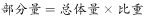
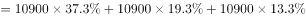
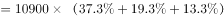

# 现期比重求部分量（多品类占比求和）

考点：[[20-考点/资料分析/比重/现期比重求部分量（多品类占比求和）|比重 / 现期比重求部分量（多品类占比求和）]]
材料：[[15-材料/资料分析/242945 2018年全国网络零售规模与结构：全|242945 2018年全国网络零售规模与结构：全]]

**问法模型**：题干问'前三位品类的总零售额约为多少亿元'→采用现期比重求和模型：部分=整体×各占比之和，整体取同口径的农村实物商品网络零售额10900亿元

## 推理链
1. 第1步：定位材料第二段，整体口径为'农村实物商品网络零售额=10900亿元'（注意不是农村网络零售额13700亿元）；第三段给出服装鞋帽针织品、日用品、粮油食品及饮料烟酒分别占农村实物商品零售额的比重（文本留空，依官方解析结果反推三项合计≈7600÷10900≈69.7%，约七成）
2. 第2步：规则：现期比重求部分量，部分=整体×比重；前三品类求总量则将三个占比相加：总零售额=10900×（三占比之和）
3. 第3步：代入速算：10900×70%≈7630亿元（精确约10900×69.7%≈7600），与C项7600最接近
4. 第4步：选项对照排陷阱：D项9600≈13700×70%，即误用'农村网络零售额13700'为整体的基数陷阱；A项1960约为10900×18%，仅相当于单一品类量级；B项7400对应占比和约68%亦偏差更大，故选C

**最快解法**：⚡ 公式法+特殊分数估算：把三品类占比之和近似为70%，10900×70%=7630，最接近7600选C；同时心算13700×70%≈9590，锁定D为'基数换成13700'的陷阱项，双重验证

## 易错点
- ⚠ 基数口径误用：占比的分母是'农村实物商品零售额10900亿元'，若误用农村网络零售额13700亿元作整体，得约9600误选D
- ⚠ 近义指标混淆：全国口径'实物商品网上零售额70200亿元'与农村口径'农村实物商品网络零售额10900亿元'名称相近，勿跨口径取数
- ⚠ 占比求和遗漏：须将三个品类占比相加后再乘整体，若只乘一个占比会得到约1000~2000量级（对应A项量级）

## 母题抽象
> 🧩 当题干出现'某整体中前N个子类的合计量为多少'特征时，用'部分=整体×占比之和'，先核对整体与占比分母是否同口径（同一指标、同一基数），再以70%等特殊分数截位估算并排除基数陷阱项

**同类特征**：2018年（现期）、前三位品类、总零售额、约为多少亿元、农村实物商品、占比之和求部分量

## 相关题
- [[10-真题/资料分析/比重/2374810 现期比重计算（流量占存量比重）|2374810]]（广东 2019，相关度1）
- [[10-真题/资料分析/增长/2456363 基期量计算|2456363]]（浙江 2020，相关度1）
- [[10-真题/资料分析/平均数/2579778 现期平均数计算（累计值−单月值做差求子时段总量后求月均）|2579778]]（浙江 2020，相关度1）
- [[10-真题/资料分析/平均数/4652180 现期平均数之两步拼接（单位企业利润=利润总额÷企业数，企业数由营业收入÷单位企业营业收入间接求出）|4652180]]（北京 2022，相关度1）
- [[10-真题/资料分析/增长/2388066 按上年价格计算的现期值折算（名义增速→实际增速）|2388066]]（河北 2019，相关度1）

---

### 题干
2018年全国农村实物商品零售额前三位品类的总零售额约为多少亿元？

### 选项
- A. 1960
- B. 7400
- C. 7600　✅
- D. 9600

### 官方解析

由题干“2018年全国农村······总零售额为多少亿元”，结合材料已知2018年农村实物商品网络零售额及零售额前三位品类所占的比重，判定本题为现期比重问题。定位文字材料第二段可得“农村实物商品网络零售额为10900亿元”，“农村实物商品零售额前三位······分别占农村实物商品零售额的、和”，根据公式：，可得全国农村实物商品零售额前三位品类的总零售额亿元，与C项最为接近。

故正确答案为C。

### 给定材料

        2018年全国网络零售额90100亿元，同比增长。其中，实物商品网上零售额为70200亿元，同比增长；非实物商品网上零售额19900亿元，同比增长。

        2018年全国农村网络零售额为13700亿元。其中，农村实物商品网络零售额为10900亿元，同比增长；农村非实物商品网络零售额2800亿元，同比增长。分品类看，农村实物商品零售额前三位的品类分别为服装鞋帽针织品、日用品、粮油食品及饮料烟酒，分别占农村实物商品零售额的、和，同比增速分别为、和。

        2018年全国农产品网络零售额达2305亿元，比全国网络零售额同比增速高9.9个百分点。其中，休闲食品、茶叶、滋补食品零售额排名前三，占比分别为、和，同比增速分别为、和。

