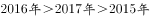
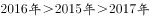
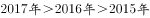
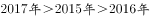

# 部分量=整体量×比重（跨图拼接）+ 多年份排序比较

考点：[[20-考点/资料分析/比重/部分量=整体量×比重（跨图拼接）+ 多年份排序比较|比重 / 部分量=整体量×比重（跨图拼接）+ 多年份排序比较]]
材料：[[15-材料/资料分析/242946 2013～2018年中国数字音乐的用|242946 2013～2018年中国数字音乐的用]]

**问法模型**：'2015-2017年三年广告收入由高到低排序' → 各年广告收入=图2收入规模×图3广告占比，先分别求三个部分量再比大小

## 推理链
1. 第1步：定位图2，2015、2016、2017年中国数字音乐市场收入规模分别为18.8、36.4、47.7亿元
2. 第2步：定位图3，三年广告收入占比分别为51.1%、38.7%、27.9%
3. 第3步：按'部分量=整体量×比重'跨图相乘：2015年=18.8×51.1%≈9.6亿元，2016年=36.4×38.7%≈14.1亿元，2017年=47.7×27.9%≈13.3亿元
4. 第4步：14.1＞13.3＞9.6，由高到低排序为2016年＞2017年＞2015年，对照选项得A

**最快解法**：⚡ 速算拆分+量级排除：2016年36.4×38.7%≈36.4×0.4−36.4×0.013≈14.6−0.5≈14.1；2017年47.7×27.9%≈47.7×0.28≈13.4；2015年18.8×51.1%≈18.8×0.5≈9.4；2015年明显最小先排除含'2015最高'的选项，再精算2016与2017（14.1 vs 13.3）定序

## 易错点
- ⚠ 只看占比大小排序：广告占比逐年下降（51.1%→38.7%→27.9%），易误判为2015＞2016＞2017，实际因收入规模翻倍式增长（18.8→36.4→47.7），部分量排序与占比排序相反
- ⚠ 跨图拼接遗漏：单一图内无法得出广告收入绝对额，必须用图2收入规模×图3广告占比，漏掉任一图即无从下手
- ⚠ 2016与2017差距小（14.1 vs 13.3），若粗略估算（如把27.9%当30%、38.7%当40%仍可分但取整过粗）可能误判二者先后，需保证估算精度在1以内

## 母题抽象
> 🧩 当题干要求'某部分量（收入/支出）多年份排序'且材料分为'总量图+结构占比图'时，用部分量=总量×占比做跨图乘法逐项计算再比较，切忌只按占比或只按总量单因素排序

**同类特征**：由高到低排序、广告收入（部分量）、收入规模×占比 跨图拼接、占比逐年下降而总量逐年上升、2015-2017连续三年

## 相关题
- [[10-真题/资料分析/平均数/13504650 现期平均数计算与多期排序比较|13504650]]（辽宁 2025，相关度1）
- [[10-真题/资料分析/比重/15833690 现期比重比较（累计值相减求当期值后再作商排序）|15833690]]（黑龙江 2026，相关度1）
- [[10-真题/资料分析/比重/2377386 现期比重比较（同分母大小比较）|2377386]]（陕西 2019，相关度1）

---

### 题干
2015-2017年三年中国数字音乐市场的广告收入由高到低排序正确的是：

### 选项
- A. 

　✅
- B. 

- C. 

- D. 

### 官方解析
定位图2可得，2015-2017年中国数字音乐市场收入分别为18.8、36.4、47.7亿元，定位图3可得，其中广告收入占比分别为、、。则2015年中国数字音乐市场的广告收入为亿元，2016年为亿元，2017年为亿元，由高到低排序为。
故正确答案为A。

### 给定材料

