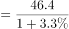
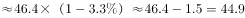
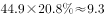
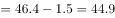

# 基期比重乘法（基期总量还原×基期占比）

考点：[[20-考点/资料分析/比重/基期比重乘法（基期总量还原×基期占比）|比重 / 基期比重乘法（基期总量还原×基期占比）]]
材料：[[15-材料/资料分析/242954 2018年全国能源消费总量（46.4|242954 2018年全国能源消费总量（46.4]]

**问法模型**：题干问'基期年份（2017年）某部分（清洁能源）的消费总量'→ 采用两步模型：现期总量÷(1+总量增速)还原基期总量，再乘图中基期占比

## 推理链
1. 第1步：题干求2017年清洁能源消费总量；文字给2018年能源消费总量46.4亿吨标准煤及同比增速（给定文本该增速数值缺省，须以卷面实际给数代入，按官方答案反推应约为3.3%），图给2017年清洁能源占比20.8%
2. 第2步：规则为跨文字+图拼接两步公式：2017年能源消费总量=46.4÷(1+总量增速)；2017年清洁能源消费量=2017年总量×20.8%
3. 第3步：代入还原基期：46.4÷1.033≈44.9亿吨标准煤（与兄弟题1的基期量结果连环复用）
4. 第4步：再乘占比：44.9×20.8%≈9.34亿吨标准煤，亦可一步式46.4×20.8%÷1.033≈9.65÷1.033≈9.34
5. 第5步：与选项对照：9.34≈9.3，最接近B（9.3），其余选项8.7、10.8、12.3均明显偏离，故选B

**最快解法**：⚡ 截位直除+特殊分数：1.033≈31/30，则基期总量≈46.4×30/31≈44.9；再44.9×20.8%≈45×0.21≈9.4，四舍五入取9.3选B；或先算46.4×20.8%≈9.65，再÷1.033≈9.34，一步到位

## 易错点
- ⚠ 现期基期混淆：直接用46.4×20.8%≈9.65，未还原2017年基期总量，会偏向更大数值而误判
- ⚠ 图读错年份：误用2018年占比22.1%（44.9×22.1%≈9.9或46.4×22.1%≈10.25），题干是2017年须对应20.8%
- ⚠ 口径与单位陷阱：'上升1.3个百分点'不能当占比数值用，'%'与'个百分点'不可混同；占比是2017年图中读数而非22.1%−1.3计算；结果单位为亿吨标准煤，勿错置小数位

## 母题抽象
> 🧩 当题干出现'基期年份+某部分总量'且文字给现期总量与增速、统计图给各年占比时，用'现期÷(1+r)还原基期总量→乘基期年份占比'两步模型，若无吻合选项优先检查是否误用现期占比或跳过基期还原

**同类特征**：基期年份（2017年）+部分量（清洁能源消费总量）、文字给总量与增速、图给占比的跨材料拼接、需先按现期÷(1+r)还原基期、占比须按题干年份从图中选对（20.8%而非22.1%）、结果单位为亿吨标准煤、'约为'估算型设问

## 相关题
（暂无）

---

### 题干
2017年，全国清洁能源消费总量约为多少亿吨标准煤？

### 选项
- A. 8.7
- B. 9.3　✅
- C. 10.8
- D. 12.3

### 官方解析

由题干“2017年，全国清洁能源消费总量约为多少亿吨标准煤”，结合文字材料给出2018年全年能源消费总量及增长率，图表材料给出2017年清洁能源消费量占比，可判定本题为基期比重计算问题。定位文字材料可得，2018年全年能源消费总量46.4亿吨标准煤，比上年增长；定位图表可得，2017年清洁能源消费量占比为。则2017年全年能源消费总量亿吨标准煤，2017年全国清洁能源消费总量约为亿吨标准煤。

故正确答案为B。

注：也可根据111题计算结果，计算出2017年全年能源消费总量亿吨标准煤。

### 给定材料

        2018年全年能源消费总量46.4亿吨标准煤，比上年增长。其中，煤炭消费量增长，原油消费量增长，天然气消费量增长，电力消费量增长。煤炭消费量占能源消费总量的，比上年下降1.4个百分点；天然气、水电、核电、风电等清洁能源消费量占能源消费总量的，上升1.3个百分点。

> [!warning] 疑点（官方解析可能有误，待人工复核）
> 给定文字材料中2018年能源消费总量同比增速及各项占比的具体百分数值均缺省（官方解析公式中同样留白），题设数据不完整；按官方答案B=9.3与图中2017年占比20.8%反推，增速应代入约3.3%（46.4÷1.033≈44.9，×20.8%≈9.3），考场解题须以卷面实际印刷数值为准

<!-- CODEX-ANSWER-REVIEW:BEGIN -->
### 本次独立复核

**复核状态：** `resolved`（答案与解析已核定）

**计分答案：** B（可计分）

**复核解析：**

2018年能源消费总量46.4亿吨标准煤、增长3.3%，故2017年总量约46.4/1.033=44.9；图中2017年清洁能源占比约20.8%，乘积约9.3亿吨标准煤，选B。

**相关信息：**

比重变化：分项增速高于整体增速时占比上升；基期比重需分别还原分子、分母后求比。

**题源依据：** [固定版本原题](https://github.com/Mentat-Uran/kaogongzhentizhengliu/blob/84ab93d4b64b61d897bece8a1c0a5bab06b4feb2/10-%E7%9C%9F%E9%A2%98/%E8%B5%84%E6%96%99%E5%88%86%E6%9E%90/%E6%AF%94%E9%87%8D/2423364%20%E5%9F%BA%E6%9C%9F%E6%AF%94%E9%87%8D%E4%B9%98%E6%B3%95%EF%BC%88%E5%9F%BA%E6%9C%9F%E6%80%BB%E9%87%8F%E8%BF%98%E5%8E%9F%C3%97%E5%9F%BA%E6%9C%9F%E5%8D%A0%E6%AF%94%EF%BC%89.md)；固定内容 commit `84ab93d4b64b61d897bece8a1c0a5bab06b4feb2`，Markdown blob `93eb38369a7cacff6f5cd12c9f3d45734b659ed4`。
<!-- CODEX-ANSWER-REVIEW:END -->
