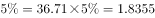

# 现期比重比较（部分值阈值计数）

考点：[[20-考点/资料分析/比重/现期比重比较（部分值阈值计数）|比重 / 现期比重比较（部分值阈值计数）]]
材料：[[15-材料/资料分析/242955 2018年第一季度我国水产品进出口情|242955 2018年第一季度我国水产品进出口情]]

**问法模型**：现期比重计数型问法'各品种出口额占一般贸易出口额的比重超过（5%＝1/20）的有几个'→ 转化为部分值判别式：品种出口额 > 整体36.71×5%≈1.84亿美元，直接在表格出口额列划线计数，无需逐项求比重

## 推理链
1. 第1步：题干限定现期为2018年第一季度，分母取文字段'一般贸易出口额36.71亿美元'（注意不是水产品整体出口额48.41亿美元）
2. 第2步：按官方解析口径，'比重超过5%（即1/20）'等价于品种出口额超过阈值36.71÷20＝1.8355亿美元
3. 第3步：遍历表格出口额列与1.8355比较：头足类8.79、对虾3.81、贝类2.77、罗非鱼2.47、鳗鱼2.46、蟹类2.02，均大于1.8355，计入
4. 第4步：鲭鱼1.70、大黄鱼0.75、藻类0.98、淡水小龙虾0.03均小于1.8355，不计入（鲭鱼1.70最接近但未超过阈值）
5. 第5步：计数共6个品种，对照选项A5/B6/C7/D8，故选B

**最快解法**：⚡ 阈值划线法（基准分数1/20）：36.71÷20≈1.84亿美元为界，表格出口额列中大于1.84的仅有头足类、对虾、贝类、罗非鱼、鳗鱼、蟹类6行，直接计数选B，全程只需一次除法加逐行比大小

## 易错点
- ⚠ 分母口径错位：同名指标三层递缩（整体出口48.41亿美元→一般贸易出口36.71亿美元→表中十品种合计约25.78亿美元），若误用48.41作分母则阈值变4.84亿美元、计数出错，分母必须取一般贸易出口额36.71
- ⚠ 临界值误判：鲭鱼1.70亿美元最接近阈值1.8355但未超过，若估算粗糙（如把阈值估成1.7以下）会误计成7个而错选C
- ⚠ 表格干扰信息：增速列正负混杂（如鲭鱼-30.71%/-25.02%与头足类21.99%/24.24%相邻），本题只看出口额列，逐行比较时勿串行、勿被增速列牵扯去算无用数据

## 母题抽象
> 🧩 当题干出现'各部分量占整体的比重超过X%（或1/n）的有几个'的计数特征时，将基准转化为'整体×X%'的金额阈值，在部分量列中与阈值划线比大小直接计数，避免逐项计算比重

**同类特征**：一般贸易主要出口品种、出口额占一般贸易出口额的比重、超过的有几个（计数型）、现期2018年第一季度、表格出口额列逐项比较、分母取文字段36.71亿美元

## 相关题
（暂无）

---

### 题干

2018年第一季度，我国水产品一般贸易主要出口品种中，出口额占我国水产品一般贸易出口额的比重，超过的有几个？

### 选项
- A. 5
- B. 6　✅
- C. 7
- D. 8

### 官方解析

根据题干“2018年第一季度······出口额占我国水产品一般贸易出口额的比重”，结合材料时间为2018年第一季度，可判定本题为现期比重问题。定位材料第二段：“出口方面，2018年第一季度······一般贸易······出口额36.71亿美元”，则一般贸易出口额的亿美元。定位表格材料第三列“出口额”数据，超过1.8355亿美元的有：头足类、对虾、贝类、罗非鱼、鳗鱼、蟹类，共6个。

故正确答案为B。

### 给定材料

        2018年第一季度我国水产品进出口192.67万吨，同比减少，增速较上年同期减少21.97个百分点；进出口总额77.15亿美元，同比增加。贸易顺差19.66亿美元，同比减少2.15亿美元。

        出口方面，2018年第一季度我国水产品出口量98.04万吨，同比减少，出口额48.41亿美元，增加。一般贸易出口量71.18万吨，同比减少；出口额36.71亿美元，同比增加。

> [!warning] 疑点（官方解析可能有误，待人工复核）
> 题干文字省略了比较基准（完整问法应为'比重超过5%'），阈值1.8355亿美元＝36.71×5%系由官方解析给出；本题须按官方解析的5%口径判定，否则无法对应任何选项，答案B不受影响

<!-- CODEX-ANSWER-REVIEW:BEGIN -->
### 本次独立复核

**复核状态：** `resolved`（答案与解析已核定）

**计分答案：** B（可计分）

**复核解析：**

阈值为一般贸易出口总额36.71亿美元的5%=1.8355亿美元。逐项比较八类主要品种，超过阈值的有6类，选B。公式图补明被题干转录漏掉的5%基准。

**相关信息：**

同一总额分母下，判断比重超过5%可转为分子是否>1.8355亿美元。

**题源依据：** [固定版本原题](https://github.com/Mentat-Uran/kaogongzhentizhengliu/blob/84ab93d4b64b61d897bece8a1c0a5bab06b4feb2/10-%E7%9C%9F%E9%A2%98/%E8%B5%84%E6%96%99%E5%88%86%E6%9E%90/%E6%AF%94%E9%87%8D/2423370%20%E7%8E%B0%E6%9C%9F%E6%AF%94%E9%87%8D%E6%AF%94%E8%BE%83%EF%BC%88%E9%83%A8%E5%88%86%E5%80%BC%E9%98%88%E5%80%BC%E8%AE%A1%E6%95%B0%EF%BC%89.md)；固定内容 commit `84ab93d4b64b61d897bece8a1c0a5bab06b4feb2`，Markdown blob `5e81a45b2835485909910ab7ccc3a7d17ed6aac7`。
<!-- CODEX-ANSWER-REVIEW:END -->
