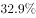

# 基期比重计算

考点：[[20-考点/资料分析/比重/基期比重计算|比重 / 基期比重计算]]
材料：[[15-材料/资料分析/244994 2018年A省财政收支（公共财政预算|244994 2018年A省财政收支（公共财政预算]]

**问法模型**：题干以'2017年……约占……'将时间前移一年求占比 → 用基期比重公式 [部分现期/(1+部分增速)]÷[整体现期/(1+整体增速)]=(A/B)×(1+整体增速)/(1+部分增速)

## 推理链
1. 第1步：题干问2017年'一般公共预算收入占公共财政预算收入的比重'，材料现期为2018年，时间前移一年，判定为基期比重计算题
2. 第2步：定位材料第一段：部分=一般公共预算收入103.82亿元（比上年下降，降幅数值在本材料文本中空白），整体=公共财政预算收入1180.07亿元（比上年增长，增速数值空白），二者为'其中'总分关系，中央财政返还68.60亿元是并列项不并入整体
3. 第3步：套基期比重公式：[103.82/(1−降幅)]÷[1180.07/(1+增速)]=（103.82/1180.07）×(1+增速)/(1−降幅)
4. 第4步：截位直除得现期比重103.82/1180.07≈8.8%；因部分下降（基期部分>103.82亿元）且整体增长（基期整体<1180.07亿元），修正系数(1+增速)/(1−降幅)>1，故基期比重必大于现期比重8.8%
5. 第5步：与选项对照，按'大于8.8%'的方向性筛选，官方代入原始增速计算后与C项最接近，锁定C

**最快解法**：⚡ 公式法+方向排除：先截位直除算现期比重103.82/1180.07≈8.8%；再由'部分降、整体增'推知修正系数(1+b)/(1+a)>1，基期比重>8.8%，先排除不大于8.8%的选项；官方代入原始增速验证后C最接近

## 易错点
- ⚠ 现期基期混淆：看到'2017年'仍直接用103.82/1180.07算现期比重而漏做(1+增速)还原，直接错选等于或接近8.8%的选项
- ⚠ 总分口径颠倒：公共财政预算收入1180.07亿元与一般公共预算收入103.82亿元数值差近10倍且是'其中'关系，分子分母勿颠倒；中央财政返还68.60亿元是并列项，勿误并入整体或部分
- ⚠ 增速空白陷阱：本材料文本中两处增速（公共财政预算收入增速、一般公共预算收入降幅）均为空白，不可臆造数值硬算，应先用现期比重+增速方向定性锁定范围再对照官方结论

## 母题抽象
> 🧩 当题干出现'基期年份+A占B的比重约多少'特征时，用基期比重公式(A/B)×(1+整体增速)/(1+部分增速)：先算现期比重，再用'部分降、整体增→基期比重>现期比重'的方向性快速排除选项，最后截位直除或代入增速验证

**同类特征**：2017年（时间前移求基期）、约占、比重、一般公共预算收入/公共财政预算收入（'其中'总分结构）、文字材料第一段取数、基期比重计算

## 相关题
- [[10-真题/资料分析/比重/2050968 基期比重计算|2050968]]（江西 2017，相关度3）
- [[10-真题/资料分析/比重/2049856 基期比重计算|2049856]]（湖南 2017，相关度2）
- [[10-真题/资料分析/比重/2050986 基期比重计算|2050986]]（江西 2017，相关度2）
- [[10-真题/资料分析/比重/2172071 基期比重计算|2172071]]（广州市考 2018，相关度2）
- [[10-真题/资料分析/比重/2188466 基期比重计算|2188466]]（黑龙江 2018，相关度2）

---

### 题干
2017年，A省一般公共预算收入约占A省公共财政预算收入的（    ）。

### 选项
- A. 

- B. 

- C. 

　✅
- D. 

### 官方解析
由题干“2017年······约占······”，结合材料时间为2018年，可判定此题为基期比重计算问题。定位文字材料第一段“2018年，A省公共财政预算收入1180.07亿元，比上年增长。其中一般公共预算收入103.82亿元，比上年下降”。根据基期比重公式，代入数据可得，与C项最接近。
故正确答案为C。

### 给定材料

        2018年，A省公共财政预算收入1180.07亿元，比上年增长。其中，一般公共预算收入103.82亿元，比上年下降。全年A省实际完成地方税收收入104亿元，中央财政返还68.60亿元，增长。A省一般公共预算支出从2012年的603.2亿元增加到2018年的958.41亿元，2018年同比增长。

        2018年末，A省辖区各项存款余额3051.06亿元，同比增长。其中，个人存款1491.89亿元，增长；单位存款1531.38亿元，下降；代理财政性存款25.38亿元，增长17.9倍。A省辖区各项贷款余额2574.10亿元，同比增长。其中，个人贷款311.99亿元，下降；单位贷款2202.74亿元，增长；含票据融资59.38亿元，增长。

        2018年，农行A省分行年末各项本外币存款余额1300.85亿元，同比增长，比上年同期下降7个百分点。其中，个人存款645.62亿元，增长；单位存款653.96亿元，下降；同业存款1.26亿元，下降。年末各项贷款余额662.92亿元，同比增长，比上年同期下降19个百分点。其中，个人贷款103.52亿元，增长；单位贷款484.65亿元，下降；贸易融资57.59亿元，增长；贴现及转贴现净值17.16亿元，增长155.0倍。

> [!warning] 疑点（官方解析可能有误，待人工复核）
> 本材料文本中'公共财政预算收入同比增长'与'一般公共预算收入同比下降'两处增速数值均以空白呈现，官方解析亦未列示代入的具体增速与计算结果，无法独立复核C项的具体百分数值；仅能依据现期比重≈8.8%及'部分下降、整体增长→基期比重>8.8%'的方向性判断与官方结论一致锁定C
