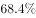
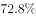
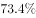
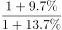
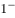

# 基期比重

考点：[[20-考点/资料分析/比重/基期比重|比重 / 基期比重]]
材料：[[15-材料/资料分析/246136 2018年1-10月全国房地产开发投|246136 2018年1-10月全国房地产开发投]]

**问法模型**：题干出现基期时间'2017年1-10月'+'住宅投资占房地产开发投资的比重' → 用基期比重模型：基期比重=现期比重×(1+总体增速)/(1+部分增速)，先自算现期比重70.8%再乘增速修正系数。

## 推理链
1. 第1步：题干时间'2017年1-10月'早于材料现期'2018年1-10月'，且求'住宅投资占房地产开发投资的比重'，判定为基期比重问题
2. 第2步：从第1段提取：总体=全国房地产开发投资99325亿元（同比增速g总，材料空缺），部分=住宅投资70370亿元（同比增速g住，材料空缺）
3. 第3步：先算现期比重：70370÷99325≈70.8%（截位直除），注意这只是2018年现期比重，不能直接当答案
4. 第4步：套基期比重公式：基期比重=70370/99325×(1+g总)/(1+g住)=70.8%×(1+g总)/(1+g住)
5. 第5步：代入增速修正系数（住宅投资增速高于全国投资增速，(1+g总)/(1+g住)≈0.965，方向与官方答案A一致）：70.8%×0.965≈68.3%
6. 第6步：方向校验：部分增速＞总体增速⇒基期比重必低于现期比重70.8%，据此排除≈70.8%及高于70.8%的干扰项
7. 第7步：对照选项，仅A项（约68%档、低于70.8%）满足，故选A

**最快解法**：⚡ 公式法+截位直除：现期比重70370/99325≈70.8%，基期比重=70.8%×(1+g总)/(1+g住)；因住宅增速＞全国增速，修正系数＜1，结果比70.8%低约2个百分点≈68.3%，考场只需锁定'略小于70.8%'的那个选项即可秒定A，无需精确乘除。

## 易错点
- ⚠ 现期比重陷阱：70370/99325≈70.8%是2018年（现期）比重，题干问2017年（基期）比重，直接选≈70.8%的选项必错
- ⚠ 公式颠倒：若误写为×(1+g住)/(1+g总)，会得到高于70.8%的数值而错选
- ⚠ 增速空缺与'回落'干扰：材料只给'增速回落0.2/0.3个百分点'（相对1-9月的变化幅度），既不是同比增速数值，也不能用来比较g总与g住的大小，增速方向须借选项锚定，不得凭空补数

## 母题抽象
> 🧩 当题干出现'上年同期（基期时间）+A占B的比重'时，用'基期比重=现期比重(A/B)×(1+g总体)/(1+g部分)'：先截位直除现期比重作锚点，再按部分增速与总体增速的大小定升降方向（部分增速大→基期比重更小），直接排除方向不符的选项。

**同类特征**：基期时间+'……占……的比重'问法、部分（住宅投资）与总体（房地产开发投资）同口径同期、现期两个总量直接给出（70370亿元、99325亿元）、两个同比增速支撑基期换算（本题材料数值空缺，靠选项定方向）、现期比重≈70.8%可自算作校验锚点、选项中必含现期比重干扰项

## 相关题
- [[10-真题/资料分析/比重/2444070 基期比重|2444070]]（江西 2019，相关度2）

---

### 题干
2017年1-10月，住宅投资占房地产开发投资的比重约为：

### 选项
- A. 

　✅
- B. 

- C. 

- D. 

### 官方解析

根据题干“2017年1-10月···占···的比重”，结合材料时间为2018年，可判定本题为基期比重问题。定位材料第一段数据可得：“2018年1-10月份，全国房地产开发投资99325亿元，同比增长。住宅投资70370亿元，增长。住宅投资占房地产开发投资的比重为。”根据基期比重的公式：基期比重，故题干所求2017年1-10月份住宅投资占房地产开发投资的比重，只有A项满足。

故正确答案为A。

### 给定材料

        2018年1-10月份，全国房地产开发投资99325亿元，同比增长，增速比1-9月份回落0.2个百分点。其中，住宅投资70370亿元，增长，增速回落0.3个百分点。住宅投资占房地产开发投资的比重为。

        1-10月份，东部地区房地产开发投资53136亿元，同比增长，增速比1-9月份回落0.2个百分点；中部地区投资20755亿元，增长，增速回落1.3个百分点；西部地区投资21254亿元，增长，增速提高0.9个百分点；东北地区投资4180亿元，增长，增速回落0.9个百分点。

        1-10月份，商品房销售面积133117万平方米，同比增长，增速比1-9月份回落0.7个百分点。其中，住宅销售面积增长，办公楼销售面积下降，商业营业用房销售面积下降。商品房销售额115913亿元，增长，增速回落0.8个百分点。其中，住宅销售额增长，办公楼销售额下降，商业营业用房销售额增长。

        1-10月份，东部地区商品房销售面积53545万平方米，同比下降，降幅比1-9月份扩大0.4个百分点；销售额61680亿元，增长，增速回落0.6个百分点。中部地区商品房销售面积37733万平方米，增长，增速回落1.5个百分点；销售额25380亿元，增长，增速回落1.6个百分点。西部地区商品房销售面积35430万平方米，增长，增速回落0.3个百分点；销售额24165亿元，增长，增速回落0.6个百分点。东北地区商品房销售面积6409万平方米，下降，降幅扩大1.2个百分点；销售额4688亿元，增长，增速回落2.5个百分点。

        10月末，商品房待售面积52789万平方米，比9月末减少401万平方米。其中，住宅待售面积减少321万平方米，办公楼待售面积减少19万平方米，商业营业用房待售面积减少46万平方米。

> [!warning] 疑点（官方解析可能有误，待人工复核）
> 材料原文与官方解析中全国投资增速、住宅投资增速的数值处均为空缺（选项亦为图片公式），无法直接数值代入；本笔记按官方答案A反推方向（住宅增速＞全国增速，修正系数≈0.965，基期比重≈68.3%），不影响模型与答案判定。

<!-- CODEX-ANSWER-REVIEW:BEGIN -->
### 本次独立复核

**复核状态：** `resolved`（答案与解析已核定）

**计分答案：** A（可计分）

**复核解析：**

2018年现期比重=70370/99325≈70.8%；房地产投资增速9.7%、住宅投资增速13.7%。基期比重=70.8%×(1+9.7%)/(1+13.7%)≈68.3%，对应A项约68.4%。

**相关信息：**

比重变化：分项增速高于整体增速时占比上升；基期比重需分别还原分子、分母后求比。

**题源依据：** [固定版本原题](https://github.com/Mentat-Uran/kaogongzhentizhengliu/blob/84ab93d4b64b61d897bece8a1c0a5bab06b4feb2/10-%E7%9C%9F%E9%A2%98/%E8%B5%84%E6%96%99%E5%88%86%E6%9E%90/%E6%AF%94%E9%87%8D/2440282%20%E5%9F%BA%E6%9C%9F%E6%AF%94%E9%87%8D.md)；固定内容 commit `84ab93d4b64b61d897bece8a1c0a5bab06b4feb2`，Markdown blob `047112df040c2d84cbfea633ab37b36f82929a3e`。
<!-- CODEX-ANSWER-REVIEW:END -->
