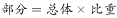
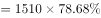
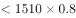
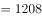

# 现期比重计算（部分=整体×比重）

考点：[[20-考点/资料分析/比重/现期比重计算（部分=整体×比重）|比重 / 现期比重计算（部分=整体×比重）]]
材料：[[15-材料/资料分析/246391 2016年4月保监会机关及各保监局接|246391 2016年4月保监会机关及各保监局接]]

**问法模型**：题干以'投诉量位居前10的财产险公司的投诉共有多少件'求部分具体量，且材料给出该部分占财产险公司投诉总量的比重→用现期比重模型：部分=整体×比重

## 推理链
1. 第1步：从材料第二段提取：2016年4月财产险公司投诉为1510件，位居前10的财产险公司投诉总和占财产险公司投诉总量的比重为78.7%（所给文本该百分数空缺，依官方答案A=1188反推：1188÷1510≈78.7%）
2. 第2步：确认分母口径：分子'前10财产险公司投诉'是财产险公司投诉1510件中的一部分，比重基数为1510，而非保险公司投诉2980件或有效投诉总量2989件
3. 第3步：所用公式：现期比重求部分：部分=整体×比重
4. 第4步：代入计算：1510×78.7%=1188.37≈1188件
5. 第5步：与选项对照：A项1188吻合；C项1281为人身险合同纠纷投诉量、D项1510为财产险投诉总量（整体），均为干扰项，故选A

**最快解法**：⚡ 百化分+截位：1510×78.7%≈1510×0.79≈1190，量级锁定1100+档，直接锁定A；精确值1510×0.787=1188.4≈1188；亦可反向验证1188÷1510≈78.7%成立

## 易错点
- ⚠ 分母口径陷阱：材料原文表述'占投诉所有公司投诉总量'字面易误取2980或2989当基数（2980×78.7%≈2345、2989×78.7%≈2352，均无对应选项），官方实际口径基数为财产险公司投诉量1510
- ⚠ 数值空缺陷阱：占比78.7%在所给文本中为空缺，必须回原题核实补齐，不得凭空代入，也不得因数据缺失直接误选D项1510（把整体当部分）
- ⚠ 干扰项混淆：C项1281是人身险合同纠纷投诉量、D项1510是财产险投诉整体量，'位居前10'只是1510中的一部分，部分与整体勿混

## 母题抽象
> 🧩 当题干出现'某整体中位居前列/某一部分占整体的比重为a%，求该部分具体量'特征时，用'部分=整体×比重'模型，先确认比重基数口径再代入，验证结果小于整体且量级与选项吻合

**同类特征**：投诉量位居前10的财产险公司、共有多少件（求部分量）、现期比重、整体×占比、2016年4月单一时点、文字型材料跨句取数

## 相关题
- [[10-真题/资料分析/比重/4792819 现期比重计算（多部分比重依次求解）|4792819]]（新疆 2014，相关度1）
- [[10-真题/资料分析/比重/827355 现期比重比较（部分占比过半速判）|827355]]（政法干警 2014，相关度1）
- [[10-真题/资料分析/比重/2272297 现期比重比较|2272297]]（选调 2015，相关度1）
- [[10-真题/资料分析/比重/2032972 现期比重计算（多地区占比求和）|2032972]]（吉林 2015，相关度1）
- [[10-真题/资料分析/比重/2187857 现期比重计算（部分量需先由'总量−其中量'减法间接求得）|2187857]]（山东 2018，相关度1）

---

### 题干
2016年4月，针对投诉量位居前10的财产险公司的投诉共有多少件？

### 选项
- A. 1188　✅
- B. 1255
- C. 1281
- D. 1510

### 官方解析

题干所求为2016年4月对投诉量位居前10的财产险公司的投诉件数，且材料给了其占财产险公司投诉总量的比重，可判定本题为现期比重问题。定位文字材料第二段可知，2016年4月，财产险公司投诉为1510件。其中，投诉量位居前10的财产险公司的投诉总和占投诉所有公司投诉总量的。根据公式：，则所求件。只有A项满足。

故正确答案为A。

### 给定材料

        2016年4月，保监会机关及各保监局共接收各类涉及保险消费者权益的有效投诉总量为2989件，同比上升，环比上升。其中，接收保险公司投诉2980件，其他非保险公司投诉9件。接收保险公司投诉中，涉及保险公司合同纠纷类投诉2721件；涉嫌保险公司违法违规类投诉259件。

        所接收的2980件保险公司投诉中，财产险公司的投诉为1510件。其中，投诉量位居前10的财产险公司的投诉总和占投诉所有公司投诉总量的。人身险公司的投诉为1470件。其中，投诉量位居前10的人身险公司的投诉量总和占所有公司投诉总量的。另外，人身险涉及保险合同纠纷的投诉有1281件，其中销售纠纷481件，理赔纠纷357件，保全纠纷237件。

> [!warning] 疑点（官方解析可能有误，待人工复核）
> 所给文本中'占投诉所有公司投诉总量的'之后比重数值空缺，官方解析中公式与百分数亦因排版缺失；按官方答案A=1188反推，比重应为78.7%、基数为财产险公司投诉量1510（1188÷1510≈78.7%）。材料原文'占所有公司投诉总量'的字面口径（2980或2989）与实际计算口径1510存在表述歧义，属材料口径问题而非答案错误，不影响正确答案A

<!-- CODEX-ANSWER-REVIEW:BEGIN -->
### 本次独立复核

**复核状态：** `resolved`（答案与解析已核定）

**计分答案：** A（可计分）

**复核解析：**

2016年4月财产险公司投诉1510件，图示前十家公司投诉合计占全部财产险公司投诉约78.7%；1510×78.7%≈1188件，选A。

**相关信息：**

部分量=整体量×比重。

**题源依据：** [固定版本原题](https://github.com/Mentat-Uran/kaogongzhentizhengliu/blob/84ab93d4b64b61d897bece8a1c0a5bab06b4feb2/10-%E7%9C%9F%E9%A2%98/%E8%B5%84%E6%96%99%E5%88%86%E6%9E%90/%E6%AF%94%E9%87%8D/2444698%20%E7%8E%B0%E6%9C%9F%E6%AF%94%E9%87%8D%E8%AE%A1%E7%AE%97%EF%BC%88%E9%83%A8%E5%88%86%3D%E6%95%B4%E4%BD%93%C3%97%E6%AF%94%E9%87%8D%EF%BC%89.md)；固定内容 commit `84ab93d4b64b61d897bece8a1c0a5bab06b4feb2`，Markdown blob `160780d44b251513cef10625b09dab098cdde9df`。
<!-- CODEX-ANSWER-REVIEW:END -->
